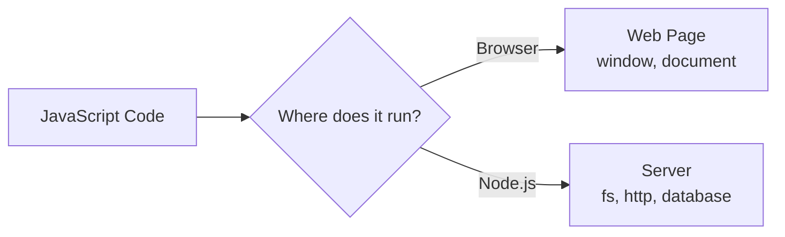

# 01 — Introduction to Node.js — Notes

> **Lesson:** 01 — Introduction to Node.js
> **Module:** 01 — Node.js Fundamentals
> **Priority:** ⭐ Start here — this is the first topic of Phase 01.
>
> **One-line summary:** Node.js lets you run JavaScript outside the browser, on the server — so the same language you use for a website can now build the backend behind it.
>
> **Prerequisite:** Core JavaScript fundamentals have already been completed. This lesson does not repeat the JavaScript course; it teaches a new *environment* for the language you already know.

## Table of Contents

- [1. Introduction](#1-introduction)
- [2. Definition of Important Concepts](#2-definition-of-important-concepts)
- [3. Detailed Explanations](#3-detailed-explanations)
- [4. How the Technology Works Internally](#4-how-the-technology-works-internally)
- [5. Architecture or Workflow](#5-architecture-or-workflow)
- [6. Real-World Examples](#6-real-world-examples)
- [7. Code Examples Where Applicable](#7-code-examples-where-applicable)
- [8. Step-by-Step Code Explanations](#8-step-by-step-code-explanations)
- [9. Common Misconceptions](#9-common-misconceptions)
- [10. Important Technical Terminology](#10-important-technical-terminology)
- [11. Summary](#11-summary)
- [12. Interview Questions and Answers](#12-interview-questions-and-answers)
- [13. References](#13-references)

---

## 1. Introduction

Before Node.js, JavaScript could only run inside a browser. A web page could use JavaScript to change its content, handle button clicks, and call an API — but JavaScript could not read a file from the hard disk, talk directly to a database, or listen for requests on a port.

Node.js takes JavaScript **out of the browser** and lets it run on a computer or server, where it can read files, talk to databases, and answer requests from users. The language is the same; what changes is the *environment* — and the environment decides what the code is allowed to do.

This lesson answers four questions, in order:

1. **What is Node.js?** — a JavaScript runtime, not a language and not a framework.
2. **Why was it created?** — because traditional servers wasted time waiting, one thread per user.
3. **What can you build with it — and what should you not?** — APIs and real-time apps, yes; heavy calculations, no.
4. **How do you start?** — install the LTS version, run your first program with `node`, and try code instantly in the REPL.

By the end of this lesson you will be able to explain Node.js in one sentence, run JavaScript outside the browser, tell browser JavaScript apart from Node.js, and write a small working server. The deep detail — how V8 runs the code, how the Event Loop handles waiting, and how the Thread Pool works — comes in the next lessons: 02 Node.js Architecture, 03 V8 Engine, and 04 Event Loop.

---

## 2. Definition of Important Concepts

### 2.1 Node.js

**Node.js is a JavaScript runtime environment.**

| Word | Meaning |
|------|---------|
| **JavaScript** | The programming language you already know from Core JavaScript. |
| **Runtime** | The environment that *runs* the code. A browser is a runtime for JavaScript. Node.js is another runtime — but for the server. |
| **Environment** | Everything around the code: the engine that executes it, the built-in tools (file system, network, timers), and the operating system underneath. |

**In simple words:**

> Before Node.js, JavaScript could only run inside a browser.
> Node.js takes JavaScript **out of the browser** and lets it run on a computer / server, where it can read files, talk to databases, and answer requests from users.

**The one-line test:**

> If someone asks "What is Node.js?", answer: *"A runtime that runs JavaScript outside the browser, on the server."*
> Then add one example: *"So I can build an API with the same language I use on the frontend."*

### 2.2 What Node.js is NOT

- ❌ **Not a programming language** — JavaScript is the language. Node.js runs it.
- ❌ **Not a framework** — Express.js is a framework *built on* Node.js. Node.js itself is the platform underneath.
- ❌ **Not a library** — it is a complete runtime, with its own engine, modules, and tools.

### 2.3 V8

**V8 is Google Chrome's JavaScript engine.** Node.js uses the same engine, outside the browser. V8 parses your JavaScript, compiles it to machine code, executes it, and frees memory you no longer use (garbage collection). V8 is covered in full detail in Lesson 03 — V8 Engine.

### 2.4 libuv

**libuv is a C library that gives Node.js the Event Loop, async I/O, and the Thread Pool.** It is the part that handles waiting, so your JavaScript code does not have to. libuv is covered in full detail in Lesson 02 — Node.js Architecture and Lesson 04 — Event Loop.

### 2.5 Non-blocking I/O

**Non-blocking I/O means slow work (a file, a database, a network request) runs in the background, while the main thread moves on to other work instead of waiting.** When the slow work finishes, a callback runs. This is the core idea behind Node.js, and it is explained with examples in Section 4 and Section 7 below.

### 2.6 npm

**npm (Node Package Manager) is the package manager that comes bundled with Node.js.** It is the largest package registry in the world: you install reusable code written by other developers with one command, instead of writing everything yourself. npm is covered in its own later lesson (Topic 08 — NPM).

### 2.7 REPL

**REPL stands for Read, Eval, Print, Loop.** It is Node.js's interactive mode: you type JavaScript, Node.js reads it, evaluates it, prints the answer, and waits for the next line. You start it by typing `node` with no file name. See Section 7.3.

### 2.8 Module

**A module is a reusable piece of code in its own file, loaded with `require()` (CommonJS) or `import` (ES Modules).** Node.js ships with built-in modules such as `fs` (file system), `http` (web server), `path`, and `os`. You never talk to V8 or libuv directly; you talk to these modules, and they talk to the rest for you.

---

## 3. Detailed Explanations

### 3.1 Why was Node.js created?

Before Node.js, servers worked like this:

```text
One user arrives  →  server gives them one thread  →  thread waits
                                                      for the database
                                                      / file / network
100 users arrive →  100 threads, most of them just WAITING
```

That waiting wastes memory and limits how many users one server can handle. This was called the **C10k problem** — handling 10,000 connections at the same time was very hard.

In **2009, Ryan Dahl** had a different idea:

> **What if one thread never waits?**
> Start the slow work, move on to the next user, and come back when the slow work is finished.

To build that, he needed two things:

1. A **very fast JavaScript engine** — he took **V8**, the engine from Google Chrome.
2. A way to do **non-blocking I/O** — he used **libuv**, a C library that handles async work in the background.

He joined them together, and **Node.js** was born.

**Why this mattered for JavaScript developers:**

- Frontend developers already knew JavaScript — now they could write the backend in the *same language*.
- One language for the whole application: frontend + backend.
- APIs, real-time apps, and servers became much simpler to build and scale.

### 3.2 A short history

You do not need to memorize dates for an exam — but the timeline helps you understand *why* Node.js looks the way it does.

| Year | What happened |
|------|---------------|
| **2009** | Ryan Dahl creates Node.js. First version runs on Linux, built on V8 + libuv. |
| **2010** | **npm** (Node Package Manager) is created — now the largest package registry in the world. |
| **2011** | Node.js runs on Windows. Companies start using it in production. |
| **2015** | Node.js and io.js (a fork) merge back together. The **Node.js Foundation** is formed. Long-Term Support (LTS) versions begin. |
| **2017–2020** | `async/await` becomes standard, ES Modules support improves, performance keeps growing. |
| **Today** | Node.js powers APIs at Netflix, PayPal, LinkedIn, Uber, Walmart, and thousands of startups. New versions release every 6 months; LTS versions are supported for years. |

**Two ideas to remember from the history:**

1. Node.js is **not new or experimental** — it has been in production since 2009.
2. npm is part of the story from the very start — sharing code is built into the Node.js way of working.

### 3.3 Key features

These are the features you will hear in every Node.js introduction. Learn them as *one line each* first — the deep detail comes in the next lessons.

| Feature | One line | Where it is explained |
|---------|----------|----------------------|
| **Built on V8** | Google's fast JavaScript engine compiles JS to machine code. | Lesson 03 — V8 Engine |
| **Single-threaded** | Your JavaScript runs on one main thread, one thing at a time. | Lesson 02 — Architecture |
| **Non-blocking I/O** | Slow work (file, database, network) runs in the background; the main thread never waits. | Lesson 02 — Architecture, Lesson 04 — Event Loop |
| **Event-driven** | Code runs in response to events: a request arrives, a file finishes, a timer fires. | Topic 12 — Events |
| **Asynchronous** | Use callbacks, Promises, and `async/await` instead of waiting line by line. | Topic 16 — Async Programming |
| **npm ecosystem** | Millions of reusable packages — install with one command. | Topic 08 — NPM |
| **Cross-platform** | Same code runs on Windows, macOS, and Linux. | — |
| **Large community** | Huge community, documentation, and packages for almost everything. | — |

**If you remember only two features, remember these:**

1. **Non-blocking I/O** — Node.js does not wait.
2. **Single-threaded + Event Loop** — one thread, many users.

### 3.4 Node.js vs JavaScript in the browser

Same language, different world. This table causes a lot of beginner confusion — learn it now.

|  | Browser JavaScript | Node.js |
|---|---|---|
| **Runs on** | The user's browser | A server / your computer |
| **Global object** | `window` | `global` |
| **Can access** | `document`, `window`, `alert()` | `fs`, `http`, `path`, `process`, `os` |
| **Cannot access** | The file system, the database directly | `window`, `document`, `alert()` |
| **Main job** | Make a web page interactive | Build servers, APIs, tools, scripts |
| **Modules** | ES Modules (`import`) | CommonJS (`require`) *and* ES Modules |
| **Example code** | `document.getElementById('btn')` | `fs.readFile('data.txt', ...)` |

**Try it yourself — this is the fastest way to feel the difference:**

```js
// In the browser console, this works:
console.log(window);    // ✅ Window object

// In Node.js, this fails:
console.log(window);    // ❌ ReferenceError: window is not defined
```

And the opposite:

```js
// In Node.js, this works:
const fs = require('fs');   // ✅ File System module

// In the browser, this fails:
// ❌ require is not defined (in plain browser JS)
```

### 3.5 What Node.js is NOT good for

Honesty matters — Node.js is not the best tool for everything.

| Weak area | Why | What to use instead |
|-----------|-----|---------------------|
| **CPU-heavy work** | Big calculations, video encoding, image processing block the single main thread | Worker Threads, a separate service, Python / Go / Rust for that part |
| **Heavy number crunching** | Machine learning training, complex math | Python, or a dedicated service |
| **Simple static websites** | Overkill — a static host is simpler | Static hosting (Vercel, Netlify) |

**The one-line test (same as in Lesson 02):**

> If the work is mostly *waiting*, use Node.js.
> If the work is mostly *calculating*, Node.js alone is the wrong tool.

This is not a weakness to hide — it is the trade-off that makes Node.js so good at what it *is* built for.

### 3.6 Install and check Node.js

#### Install

Download the **LTS version** (Long-Term Support — stable, recommended for learning and production) from:

**https://nodejs.org/**

- **LTS** = stable, use this.
- **Current** = newest features, changes faster — not needed for this journey.

#### Check it worked

Open a terminal and run:

```bash
node --version
npm --version
```

Expected output (your version numbers may be newer — that is fine):

```text
v24.22.1
10.9.4
```

- `node --version` — the Node.js runtime version.
- `npm --version` — npm comes bundled with Node.js, no separate install.

**If `node` is not found:** close and reopen the terminal after installing, then try again. On Windows, restart the terminal so the new PATH is loaded.

---

## 4. How the Technology Works Internally

You do not need the full detail yet — that is Lesson 02. But here is the 30-second version, so the next lesson does not feel new:

```text
1. You write JavaScript.
2. V8 compiles and runs it on the Call Stack (main thread).
3. When you start slow work (read a file, call a database),
   libuv takes it to the background (Thread Pool / OS).
4. Your code moves on — it does not wait.
5. When the slow work finishes, the Event Loop runs your callback.
```

```text
  Your code          V8            libuv           OS
     │                │               │              │
     │── read file ──▶│               │              │
     │                │── hand off ──▶│── read ─────▶│
     │── next user ──▶│  (free!)      │   ...        │
     │                │               │◀── done ─────│
     │◀─ callback ────│◀── run it ────│              │
```

**If any word here is unclear, that is normal.** Each part gets its own lesson:

- **Lesson 02 — Architecture:** all the parts and how they connect.
- **Lesson 03 — V8 Engine:** how JavaScript becomes machine code.
- **Lesson 04 — Event Loop:** how the waiting and callbacks actually work.

The key insight, in one sentence: **the main thread never waits for slow work — it starts the work, moves on to the next request, and comes back only when the work is ready.** That is non-blocking I/O, and that is the whole secret of Node.js.

---

## 5. Architecture or Workflow

### 5.1 JavaScript before Node.js: it lived only in the browser

```text
┌─────────────────────────────────────────┐
│  BROWSER (Chrome, Firefox...)           │
│                                         │
│  ┌──────────┐    ┌───────────────────┐  │
│  │   V8     │    │  window, document │  │
│  │  Engine  │    │  alert, fetch...  │  │
│  └──────────┘    └───────────────────┘  │
│                                         │
│  JavaScript CAN:                        │
│  • Change a web page                    │
│  • Handle button clicks                 │
│  • Call an API with fetch()             │
│                                         │
│  JavaScript CANNOT:                     │
│  • Read a file from the hard disk       │
│  • Talk directly to a database          │
│  • Listen for requests on a port        │
└─────────────────────────────────────────┘
```

### 5.2 JavaScript after Node.js: the same JavaScript runs on the server

```text
┌─────────────────────────────────────────┐
│  NODE.JS (on your computer / server)    │
│                                         │
│  ┌──────────┐    ┌───────────────────┐  │
│  │   V8     │    │  fs, http, path,  │  │
│  │  Engine  │    │  os, crypto...    │  │
│  └──────────┘    └───────────────────┘  │
│         +                               │
│  ┌───────────────────────────────────┐  │
│  │  libuv — Event Loop + Thread Pool │  │
│  └───────────────────────────────────┘  │
│                                         │
│  JavaScript CAN now:                    │
│  • Read and write files (fs)            │
│  • Create a web server (http)           │
│  • Talk to a database (PostgreSQL)      │
│  • Answer thousands of requests         │
│                                         │
│  JavaScript CANNOT here:                │
│  • Use window or document —             │
│    there is no web page on a server     │
└─────────────────────────────────────────┘
```

### 5.3 The same idea as a flowchart (Mermaid — renders on GitHub)



**Read it like this:** the language is the same. What changes is the *environment* — and the environment decides what the code is allowed to do.

### 5.4 Workflow: from writing code to a running program

```text
Write code (hello.js)
      │
      ▼
Run it:  node hello.js
      │
      ▼
Node.js starts → V8 parses and compiles the JavaScript
      │
      ▼
Your code runs on the main thread (Call Stack)
      │
      ▼
Slow work (file, network, database) is handed to libuv
      │
      ▼
When the work finishes, the Event Loop runs your callback
      │
      ▼
Program prints its output and exits (or keeps serving requests)
```

For a server, the last step is different: instead of exiting, the program keeps listening on a port (for example `3000`) and answers each request that arrives. Press `Ctrl + C` in the terminal to stop it.

---

## 6. Real-World Examples

### 6.1 What you can build with Node.js

| What | Example | Why Node.js fits |
|------|---------|-----------------|
| **REST APIs** | A food-delivery API, a student-management API | Many small requests, mostly waiting for the database |
| **Real-time apps** | Chat app, live notifications, multiplayer game | Events + WebSockets, many connections at once |
| **Web servers** | Any website backend (before Express, with the `http` module) | Fast request handling |
| **Streaming apps** | Video/audio streaming, file uploads | Streams — data flows in pieces, never all at once |
| **Microservices** | Small services that talk to each other | Lightweight, fast to start |
| **CLI tools / scripts** | Build tools, automation scripts, data processing | JavaScript + file system access |
| **Dashboards & admin panels** | CRUD apps, internal tools | Same as REST APIs |

### 6.2 Who uses it in production

**Companies using Node.js in production:** Netflix, PayPal, LinkedIn, Uber, Walmart, eBay, NASA, Trello.

They did not choose it because it is trendy. They chose it because **most backend work is waiting** — waiting for the database, waiting for the network, waiting for a file — and Node.js wastes almost no time waiting.

### 6.3 A concrete example: a student-management API

A university app asks for a list of students. The Node.js server receives the request, starts a database query, and — instead of waiting — takes the next student's request straight away. When the database answers, the Event Loop runs the callback and sends the list back. One small server handles many students at once, because the real work (the database) happens outside the main thread. The same pattern works for a food-delivery API: many orders arrive at once, each one waits on the database, and none of them blocks the others.

---

## 7. Code Examples Where Applicable

### 7.1 Your first Node.js program

Create a file called `hello.js`:

```js
console.log('Hello, Node.js!');
```

Run it:

```bash
node hello.js
```

Output:

```text
Hello, Node.js!
```

That is it — you just ran JavaScript **outside the browser**.

### 7.2 A slightly bigger first program — a real server in 6 lines

```js
const http = require('http');

http.createServer((req, res) => {
  res.end('Hello from my first Node.js server!');
}).listen(3000);

console.log('Server running at http://localhost:3000');
```

Run it, then open **http://localhost:3000** in your browser. You will see your message.

Press `Ctrl + C` in the terminal to stop the server.

> Do not worry about understanding every line yet — the `http` module gets its own lesson (Topic 11). For now, notice the pattern: `require()` a module, use it, run it with `node`.

### 7.3 The REPL — try JavaScript instantly

Start the REPL by typing `node` with no file name:

```bash
node
```

```text
Welcome to Node.js v24.22.1.
Type ".help" for more information.
> 2 + 3
5
> const name = 'Talha';
undefined
> `Hello, ${name}!`
'Hello, Talha!'
> .exit
```

Useful REPL commands:

| Command | What it does |
|---------|-------------|
| `.help` | Show all commands |
| `.exit` | Leave the REPL (or press `Ctrl + C` twice) |
| `.clear` | Clear the current input |
| `.load hello.js` | Load and run a file inside the REPL |

**When to use the REPL:** quick tests, checking a function, trying a module — faster than creating a file every time.

### 7.4 The runnable example for this lesson

The file [`examples/introduction.js`](./examples/introduction.js) is the runnable demo for this lesson. Run it:

```bash
node examples/introduction.js
```

Expected output is saved in [`examples/example.txt`](./examples/example.txt). It is real output, captured by running the file on Node v24.22.1 — CPU and memory numbers will differ on your machine, because they describe your own computer.

---

## 8. Step-by-Step Code Explanations

### 8.1 What `examples/introduction.js` shows, in order

**Part 1 — Hello, Node.js:**

```js
console.log('Hello, Node.js!');
// Your first program — JavaScript running outside the browser.
```

**Part 2 — Which Node.js am I running?**

```js
console.log('Node version:', process.version);
console.log('V8 version:  ', process.versions.v8);
console.log('Platform:    ', process.platform);
// process is a global object — available everywhere, no require() needed.
// (Global Objects get their own lesson: Lesson 05.)
```

**Part 3 — Browser vs Node.js, in code:**

```js
console.log('typeof window:', typeof window);
// 'undefined' in Node.js — there is no window on a server.
// In a browser this would be 'object'.
```

**Part 4 — Your first module:**

```js
const os = require('os');
console.log('CPU cores:', os.cpus().length);
console.log('Free memory:', Math.round(os.freemem() / 1024 / 1024), 'MB');
// require() loads a built-in module. os tells you about the computer.
```

### 8.2 Important lines explained

| Line / idea | Why it matters |
|-------------|---------------|
| `console.log(...)` | Works in both browser and Node.js — same function, different runtime. |
| `process.version` | `process` is a global — no `require()` needed. It describes the running Node.js process. |
| `typeof window` | Proves there is no browser here. `'undefined'` is the expected, correct answer. |
| `require('os')` | Loads a built-in module. This is how you get new abilities in Node.js. |
| `os.cpus().length` | Real data from your own computer — Node.js can talk to the OS. |

### 8.3 How to run the example, step by step

1. Open a terminal in this lesson folder.
2. Run `node examples/introduction.js`.
3. Compare your output with [`examples/example.txt`](./examples/example.txt).
4. The lines must match, except for machine-specific numbers: the Node/V8 versions (if you installed a newer Node.js), the CPU core count, and the free/total memory.
5. If the output is different in any other way, read the code again before moving on — do not copy-paste blindly.

---

## 9. Common Misconceptions

- ❌ **"Node.js is a programming language."**
  ✅ JavaScript is the language. Node.js is the **runtime** that runs it.

- ❌ **"Node.js is a framework like Express."**
  ✅ Express is a framework **built on** Node.js. Node.js is the platform underneath.

- ❌ **"I need to learn a new language to learn Node.js."**
  ✅ If you know Core JavaScript, you already know the language. You are learning a new *environment*.

- ❌ **"`window` and `document` work in Node.js."**
  ✅ They do not exist on a server. Use `global`, `process`, `fs`, `http` instead.

- ❌ **"Node.js is only for big companies / big apps."**
  ✅ It is also the simplest way to run a script, build a small API, or automate a task.

- ❌ **"I must memorize the whole history and all version numbers."**
  ✅ Remember **2009, Ryan Dahl, V8 + libuv, and why** — the rest is reference material.

---

## 10. Important Technical Terminology

| Term | Meaning |
|------|---------|
| **Runtime** | The environment that runs code — a browser is one runtime for JavaScript, Node.js is another, for the server. |
| **JavaScript** | The programming language. Node.js runs it; it is not itself the language. |
| **V8** | Google Chrome's JavaScript engine, used by Node.js to parse, compile, and execute JavaScript. |
| **libuv** | The C library that gives Node.js the Event Loop, async I/O, and the Thread Pool. |
| **Event Loop** | The loop that keeps checking whether async work has finished, and runs its callback when it has. |
| **Thread Pool** | Worker threads (4 by default) that libuv uses for work the operating system cannot do asynchronously, such as file I/O and crypto. |
| **Non-blocking I/O** | Starting slow work in the background and moving on, instead of waiting for it to finish. |
| **Asynchronous** | Work that does not finish immediately; the result arrives later, usually through a callback, Promise, or `async/await`. |
| **Callback** | A function passed to an async operation, run when that operation finishes. |
| **Call Stack** | Where V8 runs your JavaScript functions, one at a time, in order, on the main thread. |
| **Module** | A reusable piece of code in its own file, loaded with `require()` (CommonJS) or `import` (ES Modules). |
| **CommonJS** | The module system Node.js originally used: `require()` and `module.exports`. |
| **ES Modules** | The standard JavaScript module system: `import` and `export`. Node.js supports both. |
| **npm** | Node Package Manager — the tool and registry for installing reusable packages; bundled with Node.js. |
| **LTS** | Long-Term Support — a stable Node.js version, recommended for learning and production. |
| **REPL** | Read, Eval, Print, Loop — Node.js's interactive mode for trying JavaScript instantly. |
| **C10k problem** | The problem of handling 10,000 connections at the same time, which motivated Node.js's non-blocking design. |
| **`process`** | A global object in Node.js describing the running process (version, platform, and more). No `require()` needed. |
| **`global`** | The global object in Node.js — the server-side equivalent of the browser's `window`. |

---

## 11. Summary

```text
┌─────────────────────────────────────────────────────┐
│  JAVASCRIPT                                         │
│  the language — you already know it                 │
├─────────────────────────────────────────────────────┤
│  NODE.JS                                            │
│  the runtime — runs JavaScript outside the browser  │
│  V8 runs the code  •  libuv handles the waiting     │
├─────────────────────────────────────────────────────┤
│  RESULT                                             │
│  Same language for frontend AND backend.            │
│  Build servers, APIs, and tools with JavaScript.    │
└─────────────────────────────────────────────────────┘
```

**If you remember only three sentences:**

1. **Node.js is a runtime, not a language or a framework.**
2. **It runs JavaScript outside the browser, on the server.**
3. **It was built to never wait — one thread, non-blocking I/O, many users.**

**Progress checklist for this lesson:**

- [ ] Lesson explained.
- [ ] Technical notes prepared.
- [ ] Important diagrams included.
- [ ] Practical examples documented.
- [ ] Exercises prepared.
- [ ] Interview questions included.
- [ ] Documentation reviewed.

Do not mark this lesson as completed simply because notes have been generated. Practical implementation and understanding must be confirmed by the learner — run the example and do the exercises in [`exercises.md`](./exercises.md).

---

## 12. Interview Questions and Answers

Practice answering these out loud, in your own words — do not memorize. **Good answer pattern:** one-line definition first, then *why it exists*, then *one real example*. Never start with a memorized paragraph.

**1. What is Node.js? Is it a language, a framework, or a runtime?**

Node.js is a JavaScript runtime environment — it runs JavaScript outside the browser, on the server. JavaScript is the language, and Express.js is a framework built on top of Node.js.

**2. Why was Node.js created? What problem did it solve?**

It was created in 2009 by Ryan Dahl to solve the problem of servers wasting threads waiting on slow work (the C10k problem). Instead of one thread per user that waits, one thread starts the slow work and moves on, coming back when it finishes.

**3. Who created Node.js, and when?**

Ryan Dahl created Node.js in 2009, building it on Google's V8 engine plus the libuv library for non-blocking I/O.

**4. What is the difference between JavaScript in the browser and JavaScript in Node.js?**

The language is the same, but the environment is different: the browser gives you `window` and `document`, while Node.js gives you `fs`, `http`, `process`, and file/database access — and has no `window` or `document`.

**5. Why is there no `window` or `document` in Node.js?**

Because there is no web page on a server. `window` and `document` describe a browser page; on a server, the global object is `global`, and the available tools are modules like `fs` and `http`.

**6. What is npm? Why is it important?**

npm is the Node Package Manager, bundled with Node.js. It is the largest package registry in the world, so you can install reusable code with one command instead of writing everything yourself.

**7. What is the REPL? When would you use it?**

The REPL (Read, Eval, Print, Loop) is Node.js's interactive mode, started by typing `node` with no file name. Use it for quick tests — checking a function or trying a module — instead of creating a file.

**8. Name three things you can build with Node.js.**

REST APIs, real-time apps such as chat apps, and web servers — plus streaming apps, microservices, CLI tools, and dashboards. All of them are mostly waiting on databases or networks, which is where Node.js is strongest.

**9. What is Node.js NOT good for, and why?**

It is not good for CPU-heavy work such as video encoding or heavy calculations, because that work blocks the single main thread and freezes every user until it finishes.

**10. What are V8 and libuv, in one sentence each?**

V8 is Google's JavaScript engine that compiles and runs your JavaScript code. libuv is the C library that gives Node.js the Event Loop, async I/O, and the Thread Pool, so the main thread does not have to wait.

---

## 13. References

- **Node.js — official website and LTS download:** https://nodejs.org/
- **Node.js documentation:** https://nodejs.org/docs/
- **V8 JavaScript engine:** https://v8.dev/
- **libuv:** https://libuv.org/
- **npm:** https://www.npmjs.com/

**Further reading inside this module** (all folders exist):

- [02 — Node.js Architecture](../02-nodejs-architecture/README.md) — all the parts and how they connect.
- [03 — V8 Engine](../03-v8-javascript-engine/README.md) — how JavaScript becomes machine code.
- [04 — Event Loop](../04-event-loop/README.md) — how the waiting and callbacks actually work.

**Files in this lesson:**

```text
01-introduction-to-nodejs/
├── README.md                  # Short lesson overview (this lesson's entry point)
├── notes.md                   # This file — full detailed notes
├── examples/
│   ├── introduction.js        # Runnable demo: hello, process, window check, os module
│   └── example.txt            # Expected output of introduction.js
└── exercises.md               # 5 practice tasks (with hints, no solutions)
```

---

[← Module README](../README.md) · [Next: 02 — Node.js Architecture →](../02-nodejs-architecture/README.md)
