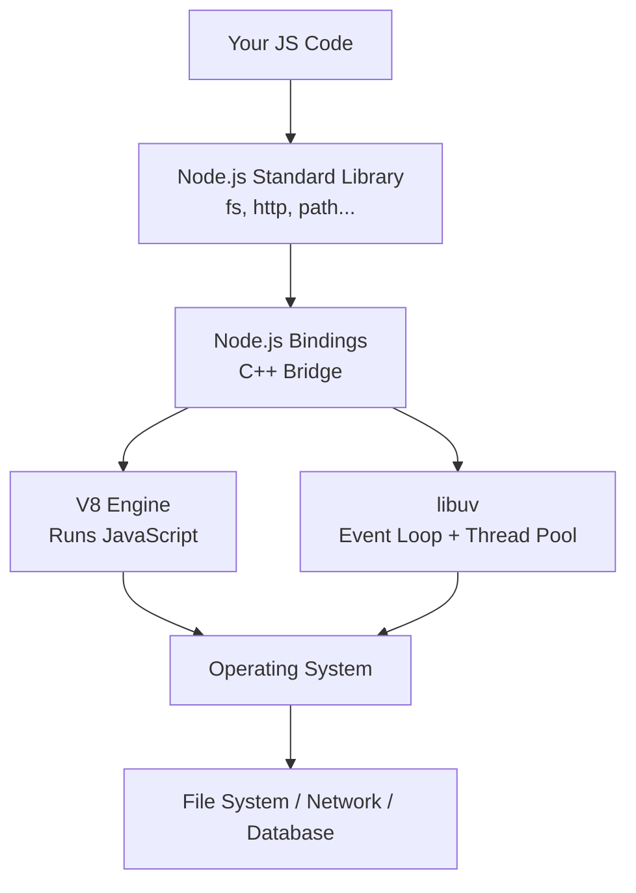

# 02 — Node.js Architecture — Notes

> **Lesson:** 02 — Node.js Architecture · **Priority:** 🔴 High
> **Previous topic:** [01 — Introduction to Node.js](../01-introduction-to-nodejs/README.md)
> **Next topic:** [03 — V8 JavaScript Engine](../03-v8-javascript-engine/README.md)
> **Lesson README:** [README.md](./README.md) · **Examples:** [examples/](./examples/) · **Exercises:** [exercises.md](./exercises.md)
>
> **One-line summary:** Node.js is single-threaded JavaScript on the outside, and a powerful C/C++ engine (V8 + libuv) on the inside. Your JavaScript runs on one thread, while slow work is handed off in the background — that is why one Node.js server can handle thousands of requests at the same time.

---

## Table of Contents

- [1. Introduction](#1-introduction)
- [2. Definition of Important Concepts](#2-definition-of-important-concepts)
- [3. Detailed Explanations](#3-detailed-explanations)
- [4. How the Technology Works Internally](#4-how-the-technology-works-internally)
- [5. Architecture or Workflow](#5-architecture-or-workflow)
- [6. Real-World Examples](#6-real-world-examples)
- [7. Code Examples Where Applicable](#7-code-examples-where-applicable)
- [8. Step-by-Step Code Explanations](#8-step-by-step-code-explanations)
- [9. Common Misconceptions](#9-common-misconceptions)
- [10. Important Technical Terminology](#10-important-technical-terminology)
- [11. Summary](#11-summary)
- [12. Interview Questions and Answers](#12-interview-questions-and-answers)
- [13. References](#13-references)

---

## 1. Introduction

**Architecture** means: *what parts is Node.js made of, and how do those parts work together?*

Node.js is not one single program. It is a **combination of several powerful tools** joined together:

| Part | Written in | Job |
|------|-----------|-----|
| **V8 Engine** | C++ | Runs your JavaScript — compiles it to fast machine code |
| **libuv** | C | Gives Node.js the Event Loop, async I/O, and the Thread Pool |
| **Node.js Bindings** | C++ | The bridge between JavaScript and C/C++ |
| **Node.js Standard Library** | JavaScript | Built-in modules you use: `fs`, `http`, `path`, `events` |
| **Other C/C++ libraries** | C/C++ | DNS (`c-ares`), HTTP parsing (`llhttp`), crypto (`OpenSSL`), compression (`zlib`) |
| **Your application** | JavaScript | The code *you* write |

**Simple way to remember it:**

> **You write JavaScript → Node.js translates it → V8 executes it → libuv handles the waiting → the Operating System does the real I/O work.**

Node.js was created because JavaScript was fast in the browser (thanks to V8), but there was no way to run it on a server. Ryan Dahl (2009) took V8 out of Chrome, added libuv for async I/O, and built Node.js around them.

This lesson explains each part, how a request flows through them, and why this design makes Node.js fast for some work and unsuitable for other work.

---

## 2. Definition of Important Concepts

| Term | Definition |
|------|-----------|
| **Node.js** | A JavaScript runtime environment that runs JavaScript outside the browser, on a server. It is not a programming language and not a framework. |
| **JavaScript** | The programming language you write. Node.js runs it; the browser also runs it, in a different environment. |
| **Runtime** | The environment that runs code: the engine that executes it, the built-in tools around it, and the operating system underneath. |
| **V8 Engine** | Google Chrome's JavaScript engine, written in C++. It parses JavaScript, compiles it to machine code with a Just-In-Time (JIT) compiler, executes it, and frees unused memory (garbage collection). |
| **libuv** | A C library that gives Node.js the Event Loop, the Thread Pool, and async I/O. It handles waiting, so your JavaScript code does not have to. |
| **Node.js Bindings** | C++ code that connects JavaScript to C/C++ code (V8, libuv, and the operating system). JavaScript cannot talk to the OS or to C libraries directly; the bindings translate between them. |
| **Node.js Standard Library** | The built-in JavaScript modules that come with Node.js — `fs`, `http`, `path`, `events`, `os`, `crypto`, `url` — available with `require()` and no `npm install`. |
| **Call Stack** | The place on the main thread where JavaScript functions run, one at a time, in order. |
| **Event Loop** | The loop, provided by libuv and running on the main thread, that keeps checking: "Is any async work finished? If yes, run its callback." |
| **Thread Pool** | A set of worker threads (4 by default) provided by libuv for work the operating system cannot do asynchronously — file I/O, crypto, compression, and DNS lookups. |
| **Callback** | A function you pass to an async operation. It runs later, when the work finishes. |
| **Callback Queue** | The queue where finished async work waits until the Event Loop picks up its callback and runs it on the main thread. |
| **Blocking (synchronous) code** | Code that makes the main thread wait until the work finishes. Nothing else can run meanwhile. |
| **Non-blocking (asynchronous) code** | Code that starts slow work in the background and lets the main thread move on. The callback runs when the work finishes. |
| **I/O-bound work** | Work that spends most of its time waiting — for a database, a network, or a file. |
| **CPU-bound work** | Work that spends most of its time calculating — big loops, encoding, heavy math. |
| **Operating System (OS)** | Linux, macOS, or Windows, at the bottom of the stack. The actual reading of a file or sending of network data always happens here. |

---

## 3. Detailed Explanations

### 3.1 Your Application (JavaScript)

This is the code you write — `server.js`, routes, controllers, database calls.

```js
const http = require('http');

http.createServer((req, res) => {
  res.end('Hello from Node.js');
}).listen(3000);
```

You never talk to V8 or libuv directly. You talk to the Standard Library, and it talks to the rest for you.

### 3.2 Node.js Standard Library (JavaScript)

Built-in modules, already included with Node.js. No `npm install` needed.

| Module | Use it for |
|--------|-----------|
| `fs` | Reading / writing files |
| `http` / `https` | Creating servers, making requests |
| `path` | Working with file paths |
| `events` | EventEmitter — events in your own code |
| `os` | CPU, memory, operating system info |
| `crypto` | Hashing, encryption |
| `url` | Parsing URLs |

Example:

```js
const fs = require('fs');     // File System module
const path = require('path');  // Path module
```

### 3.3 Node.js Bindings (C++)

JavaScript cannot directly talk to the Operating System or to C libraries. The **Bindings** are the translator in the middle.

```text
JavaScript  --(bindings)-->  C++  --(bindings)-->  V8 / libuv / OS
```

You do not write bindings in normal backend work — but you must know they exist, because they explain *how* a JS call like `fs.readFile()` ends up as real work on your hard disk.

### 3.4 V8 Engine (C++)

V8 is Google Chrome's JavaScript engine. Node.js uses the same engine, outside the browser.

What V8 does:

1. **Parses** your JavaScript code.
2. **Compiles** it to machine code (using a Just-In-Time compiler — JIT). This is why Node.js is fast.
3. **Executes** it on the Call Stack.
4. **Garbage Collection** — frees memory you no longer use.

> V8 is covered in full detail in the next topic: [03 — V8 JavaScript Engine](../03-v8-javascript-engine/README.md).
> For now, remember: **V8 = the part that runs JavaScript.**

### 3.5 libuv (C)

libuv is the part most beginners have never heard of — and the part that makes Node.js special.

What libuv provides:

| Feature | What it means |
|---------|---------------|
| **Event Loop** | The loop that keeps checking: "Is any async work finished? If yes, run its callback." |
| **Thread Pool** | 4 worker threads for work that cannot be done async by the OS (file I/O, crypto, DNS, compression). |
| **Async I/O** | Non-blocking file and network operations, using the OS where possible. |
| **Timers, signals, child processes** | `setTimeout`, `setInterval`, process signals, and more. |

> The Event Loop is covered in full detail in topic 04 — Event Loop (coming next — plain text, folder not created yet).
> For now, remember: **libuv = the part that handles waiting, so your code does not have to.**

### 3.6 Other C/C++ Libraries

Node.js also bundles small specialist libraries. You do not need to memorize them, but know they exist:

| Library | Job |
|---------|-----|
| `c-ares` | Async DNS lookups (turning `google.com` into an IP address) |
| `llhttp` | Parsing HTTP requests/responses |
| `OpenSSL` | HTTPS, TLS, crypto |
| `zlib` | Compression (gzip) |

### 3.7 Operating System

At the very bottom is the OS — Linux, macOS, or Windows. The actual reading of a file, or sending of network data, always happens here. Node.js just asks the OS to do it, and the OS notifies Node.js when it is done.

### 3.8 Single-Threaded — What It Really Means

Node.js is **single-threaded for your JavaScript code**.

```text
One Call Stack. One thing at a time. In order.
```

```js
console.log('1');
console.log('2');
console.log('3');
// Output is ALWAYS: 1, 2, 3 — never 2, 1, 3
```

**What single-threaded does NOT mean:**

| Misconception | Truth |
|---------------|-------|
| "Node.js can only do one thing at a time" | It can only *execute JavaScript* one thing at a time. I/O work happens in the background (Thread Pool / OS) at the same time. |
| "Node.js has only one thread in total" | It has one **main** thread for JS, plus a **Thread Pool** (4 threads) and OS threads behind the scenes. |
| "Node.js is slow because it is single-threaded" | For I/O-heavy work (APIs, databases, files) it is very fast, because it never wastes time waiting. |

**Analogy — a restaurant:**

- **Traditional multi-threaded server (like a restaurant with 1 waiter per table):** each waiter serves only one table. 100 tables = 100 waiters. Expensive, and waiters stand idle while food cooks.
- **Node.js (1 waiter for all tables):** one waiter takes an order, gives it to the kitchen, and immediately goes to the next table. When the kitchen rings the bell, the waiter delivers the food. One waiter, many tables, no idle waiting.

The waiter is the **Event Loop**. The kitchen is the **Thread Pool / OS**.

### 3.9 The Thread Pool

Some work cannot be done asynchronously by the OS, so libuv runs it on worker threads.

**Default size: 4 threads.**

```text
UV_THREADPOOL_SIZE = 4   (default)
```

You can change it with an environment variable (before Node.js starts):

```bash
UV_THREADPOOL_SIZE=8 node app.js
```

#### What uses the Thread Pool?

| Uses the Thread Pool ✅ | Does NOT use it ❌ |
|------------------------|-------------------|
| `fs.readFile()` — file system | Network I/O (`http`, `net`) — handled by the OS directly |
| `crypto.pbkdf2()` — password hashing | Timers (`setTimeout`) |
| `zlib` — compression | Most database drivers (they use network I/O) |
| DNS lookup (`dns.lookup()`) | |

This distinction matters: **asynchronous does not mean "Thread Pool".** Network I/O is async through the operating system, without a Thread Pool worker. File I/O, crypto, compression, and DNS lookups are async through the Thread Pool. Both are non-blocking for the main thread, but they use different mechanisms underneath.

#### Why does the size matter?

If all 4 workers are busy with heavy file/crypto work, the 5th task **waits in a queue**. That is why:

- Never do heavy CPU work (big loops, image processing, large JSON parsing) on the main thread or in the Thread Pool without thinking.
- For CPU-heavy work, use **Worker Threads**, **child processes**, or a separate service — that comes in Phase 05.

**Quick mental check:** if 4 users request a password hash at the same time and each hash takes 1 second, the 5th user waits. That is the Thread Pool limit in action. The example file `examples/architecture.js` demonstrates this.

### 3.10 Blocking vs Non-Blocking

This is the most important comparison in all of Node.js.

#### Blocking (Synchronous) — the main thread waits

```js
const fs = require('fs');

console.log('Start');
const data = fs.readFileSync('user.json', 'utf8'); // ⛔ WAITS here
console.log('File read');
console.log('End');
```

```text
Output:
Start
... (nothing else can run while the file is read) ...
File read
End
```

#### Non-Blocking (Asynchronous) — the main thread moves on

```js
const fs = require('fs');

console.log('Start');
fs.readFile('user.json', 'utf8', (err, data) => {
  console.log('File read'); // runs LATER, when the file is ready
});
console.log('End');
```

```text
Output:
Start
End          <-- runs BEFORE the file is read
File read    <-- callback runs when the work finishes
```

|  | Blocking | Non-blocking |
|--|----------|--------------|
| Main thread | Waits, does nothing | Free to handle other requests |
| Other users | Must wait | Served immediately |
| When to use | Startup config, scripts, one-time setup | **Almost always in a server** |
| Example | `readFileSync` | `readFile` (with callback / Promise) |

**Rule for backend work:** in a server, *never* block the Event Loop. A single `readFileSync` inside a request handler blocks *every* user, not just one.

### 3.11 Why Node.js Is Fast (and When It Is Not)

#### ✅ Node.js is excellent for: I/O-bound work

- REST APIs
- Real-time chat apps (Socket.io)
- Streaming (video, files)
- Microservices that call databases and other APIs
- Dashboards, admin panels, CRUD apps

Why? Because most of the time is spent **waiting** — waiting for the database, waiting for the network, waiting for a file. Node.js does not waste that waiting time.

#### ❌ Node.js is NOT the best choice for: CPU-bound work

- Video encoding / image processing
- Heavy calculations, machine learning training
- Large data compression on every request
- Complex math on the main thread

Why? Because CPU work runs on the single main thread and **blocks everything else** while it runs. There is no other JS thread to take over.

**The one-line test:**

> If the work is mostly *waiting*, use Node.js.
> If the work is mostly *calculating*, Node.js alone is the wrong tool (or use Worker Threads).

---

## 4. How the Technology Works Internally

Let's trace one real request, step by step.

**Scenario:** A user opens `http://localhost:3000/profile` and your server reads `user.json` from disk and sends it back.

```text
1. USER / BROWSER
   sends HTTP request → localhost:3000/profile
            │
            ▼
2. OPERATING SYSTEM
   receives the network data, passes it to Node.js
            │
            ▼
3. libuv — EVENT LOOP (Main Thread)
   "A new request arrived. Run the HTTP callback."
            │
            ▼
4. V8 — CALL STACK (Main Thread)
   runs your callback:  fs.readFile('user.json', ...)
   "This is slow file work — I will not wait here."
            │
            ▼
5. libuv — THREAD POOL (Worker Thread)
   a worker thread reads user.json from disk
   ... main thread is FREE meanwhile ...
   it can accept the NEXT user's request right now
            │
            ▼
6. WORK FINISHES → CALLBACK QUEUE
   "user.json is ready. Put the callback in the queue."
            │
            ▼
7. EVENT LOOP (Main Thread)
   picks up the callback from the queue
            │
            ▼
8. V8 — CALL STACK (Main Thread)
   runs your callback:  res.end(fileData)
            │
            ▼
9. OPERATING SYSTEM → USER
   response sent back to the browser
```

### The key insight

> **The main thread never waits for the file.**
> It starts the file read, moves on to the next request, and comes back only when the file is ready.
>
> That is non-blocking I/O — and that is the whole secret of Node.js.

### What happens inside, in one paragraph

V8 executes your JavaScript on the Call Stack, one function at a time. When your code starts a slow operation, the Standard Library call goes through the Bindings to libuv. libuv decides where the work goes: network I/O is handed to the operating system, which notifies Node.js when data arrives; file I/O, crypto, compression, and DNS lookups go to a Thread Pool worker. Either way, the main thread does not wait — it returns to the Event Loop and handles the next request. When the background work finishes, its callback is placed in the Callback Queue, the Event Loop picks it up, and V8 runs it on the Call Stack.

---

## 5. Architecture or Workflow

### Diagram 1: The Layers (top to bottom)

```text
┌─────────────────────────────────────────────────────────┐
│  YOUR APPLICATION (JavaScript)                          │
│  app.js, server.js, routes, controllers...              │
└──────────────────────┬──────────────────────────────────┘
                       │  require('fs'), require('http')...
┌──────────────────────▼──────────────────────────────────┐
│  NODE.JS STANDARD LIBRARY (JavaScript)                  │
│  fs  •  http  •  path  •  events  •  crypto  •  os ...  │
└──────────────────────┬──────────────────────────────────┘
                       │  Node.js Bindings (C++)
┌──────────────────────▼──────────────────────────────────┐
│  NODE.JS BINDINGS  (C++ bridge)                         │
│  Connects JavaScript code to C/C++ code                 │
└──────┬───────────────────────────────┬──────────────────┘
       │                               │
┌──────▼──────────────┐      ┌──────────▼──────────────┐
│  V8 ENGINE (C++)    │      │  libuv (C)              │
│                     │      │                         │
│  • Parses JS        │      │  • Event Loop           │
│  • Compiles JS to   │      │  • Thread Pool (4)      │
│    machine code     │      │  • Async I/O            │
│  • Garbage          │      │  • Timers, DNS,         │
│    Collection       │      │    File System          │
└──────┬──────────────┘      └──────────┬──────────────┘
       │                               │
┌──────▼───────────────────────────────▼──────────────────┐
│  OPERATING SYSTEM  (Linux / macOS / Windows)            │
│  Files, Network, Sockets — the real I/O happens here    │
└─────────────────────────────────────────────────────────┘
```

**How to read Diagram 1:** read it top to bottom. Your code is at the top and only talks to the Standard Library. The Standard Library talks, through the Bindings, to V8 (which runs JavaScript) and to libuv (which handles waiting). Everything ends at the Operating System, where real file and network work happens.

### Diagram 2: The Same Idea as a Flowchart (Mermaid — renders on GitHub)



**How to read Diagram 2:** follow the arrows. A JavaScript call flows down through the Standard Library and the Bindings, then splits: V8 runs the code, libuv handles the waiting. Both paths reach the Operating System, which does the real work on the file system, network, or database.

### Diagram 3: What Runs Where

```text
  MAIN THREAD  (only ONE thread runs your JavaScript)
  ┌──────────────────────────────────────────────────┐
  │  Call Stack  →  your functions run here,         │
  │                 one at a time, in order          │
  │                                                  │
  │  Event Loop  →  checks: is any async work done?  │
  │                 if yes, run its callback         │
  └──────────────────────────────────────────────────┘
                          │
                          │ hands slow work to →
                          ▼
  THREAD POOL  (4 worker threads by default)
  ┌──────────┐ ┌──────────┐ ┌──────────┐ ┌──────────┐
  │ Worker 1 │ │ Worker 2 │ │ Worker 3 │ │ Worker 4 │
  │ fs, crypto│ │ fs, crypto│ │ fs, crypto│ │ fs, crypto│
  └──────────┘ └──────────┘ └──────────┘ └──────────┘
                          │
                          ▼
  OPERATING SYSTEM  →  real file / network work
```

**How to read Diagram 3:** your code is always on the main thread. Slow work is *sent away* — either to the Thread Pool or to the OS — so the main thread stays free to accept the next request.

---

## 6. Real-World Examples

### A food-delivery API — 1,000 users ordering at the same time

```text
User 1 → "Order biryani"  →  DB query (waiting...)
User 2 → "Order burger"   →  DB query (waiting...)
User 3 → "Order pizza"    →  DB query (waiting...)
...
User 1000 → "Order zinger" → DB query (waiting...)

Node.js does NOT wait for User 1's database answer
before taking User 2's order.

It starts all 1,000 queries, and as each database
answer comes back, the Event Loop runs that user's
callback and sends the response.

Result: one small server handles all 1,000 users,
because the real work (database) happens outside
the main thread.
```

This is why companies like Netflix, PayPal, LinkedIn, and Uber use Node.js for their APIs — not because JavaScript is magic, but because this architecture wastes almost no time waiting.

### Other places this architecture fits

| What | Example | Why Node.js fits |
|------|---------|-----------------|
| **REST APIs** | A food-delivery API, a student-management API | Many small requests, mostly waiting for the database |
| **Real-time apps** | Chat app, live notifications, multiplayer game | Events + WebSockets, many connections at once |
| **Web servers** | Any website backend (with the `http` module, before Express) | Fast request handling |
| **Streaming apps** | Video/audio streaming, file uploads | Streams — data flows in pieces, never all at once |
| **Microservices** | Small services that talk to each other | Lightweight, fast to start |
| **Dashboards & admin panels** | CRUD apps, internal tools | Same as REST APIs |

---

## 7. Code Examples Where Applicable

### A minimal server — your code, the Standard Library, and nothing else

```js
const http = require('http');

http.createServer((req, res) => {
  res.end('Hello from Node.js');
}).listen(3000);
```

`require('http')` loads a Standard Library module. `createServer` registers a callback. That callback runs on the main thread, through V8, every time a request arrives — while slow work inside it is handed off in the background (see Section 4).

### Blocking vs non-blocking — the same file read, two ways

```js
const fs = require('fs');

// Blocking: the main thread WAITS here.
const data = fs.readFileSync('user.json', 'utf8');

// Non-blocking: the main thread moves on; the callback runs later.
fs.readFile('user.json', 'utf8', (err, data) => {
  console.log('File read');
});
```

Full detail, with outputs, is in Section 3.10. The runnable proof is in [examples/architecture.js](./examples/architecture.js) — see Section 8.

---

## 8. Step-by-Step Code Explanations

Run it:

```bash
node examples/architecture.js
```

Expected output is saved in [`examples/example.txt`](./examples/example.txt). Timings in milliseconds vary by machine — the order of events is what matters, not the exact numbers.

### What the file proves (in order)

**Part 1 — Single thread, one thing at a time:**

```js
console.log('A');
console.log('B');
console.log('C');
// Always A, B, C — the Call Stack runs in order.
```

**Part 2 — Non-blocking file read:**

```js
fs.readFile(__filename, 'utf8', () => {
  console.log('File read finished (callback)');
});
console.log('I run BEFORE the file callback');
// The main thread does not wait for the file.
```

**Part 3 — Thread Pool in action (crypto):**

```js
const start = Date.now();
for (let i = 1; i <= 5; i++) {
  crypto.pbkdf2('password', 'salt', 100000, 64, 'sha512', () => {
    console.log(`Hash ${i} done in ${Date.now() - start}ms`);
  });
}
// Hash 5 can only start when one of the first 4 workers frees up,
// so it finishes last. Exact timings vary by machine —
// the point is the ORDER, not the milliseconds.
// That is the 4-thread pool limit, visible in real time.
```

**Part 4 — Blocking code (what NOT to do):**

```js
const timerStart = Date.now();
setTimeout(() => {
  console.log(`Timer: I was scheduled for 100ms, but ran after ${Date.now() - timerStart}ms.`);
}, 100);

const blockingStart = Date.now();
while (Date.now() - blockingStart < 1000) { /* busy wait */ }
// Nothing else — no timer, no callback — can run during this 1 second.
// This is why CPU work blocks the whole server.
```

In the real run, the timer scheduled for 100 ms ran after 1000 ms, because the busy loop blocked the Event Loop. See [`examples/example.txt`](./examples/example.txt).

### Important lines explained

| Line / idea | Why it matters |
|-------------|---------------|
| `require('fs')`, `require('crypto')` | Standard Library modules — the top layer of the architecture. |
| `fs.readFile(..., callback)` | Async I/O — handed to libuv, main thread stays free. |
| `crypto.pbkdf2(...)` | Thread Pool work — uses a worker thread, not the main thread. |
| The `while` busy-wait loop | Deliberate blocking — proves that CPU work freezes the Event Loop. |
| `process.version`, `process.versions.v8` | Shows the real V8 version bundled with your Node.js. |

---

## 9. Common Misconceptions

- ❌ **"Node.js is a language."**
  ✅ Node.js is a **runtime**. JavaScript is the language.

- ❌ **"Node.js is multi-threaded."**
  ✅ Your JavaScript runs on **one main thread**. The Thread Pool is for specific background work only.

- ❌ **"Non-blocking means faster code."**
  ✅ Non-blocking means the server is **free while waiting**. The file/database itself is not faster — the server just does not sit idle.

- ❌ **"I can do heavy calculations in a route handler, it's fine."**
  ✅ A 2-second calculation blocks **every user** for 2 seconds. Move CPU work out of the request path.

- ❌ **"The Event Loop and the Thread Pool are the same thing."**
  ✅ The Event Loop **coordinates** work on the main thread. The Thread Pool **executes** certain heavy/async tasks on worker threads.

- ❌ **"V8 and Node.js are the same."**
  ✅ V8 is one part of Node.js. Node.js = V8 + libuv + bindings + standard library + more.

---

## 10. Important Technical Terminology

| Term | Meaning in one line |
|------|---------------------|
| **Architecture** | What parts a system is made of, and how they work together. |
| **Runtime** | The environment that runs code (engine + built-in tools + OS). |
| **V8** | The C++ engine that parses, compiles, and executes JavaScript. |
| **libuv** | The C library that provides the Event Loop, Thread Pool, and async I/O. |
| **Bindings** | The C++ bridge between JavaScript and C/C++ code. |
| **Standard Library** | Node.js's built-in JavaScript modules (`fs`, `http`, `path`, …). |
| **Call Stack** | Where JavaScript functions run on the main thread, one at a time. |
| **Event Loop** | The loop that checks for finished async work and runs its callback. |
| **Thread Pool** | 4 worker threads (by default) for file I/O, crypto, compression, DNS. |
| **Callback Queue** | Where finished async work waits for the Event Loop to run its callback. |
| **Blocking** | The main thread waits until the work finishes. |
| **Non-blocking** | The main thread moves on; the callback runs when the work finishes. |
| **I/O-bound** | Work that mostly waits (database, network, file). |
| **CPU-bound** | Work that mostly calculates (encoding, heavy math). |
| **JIT (Just-In-Time) compiler** | V8's compiler that turns JavaScript into machine code while the program runs. |
| **Garbage Collection** | V8 freeing memory that is no longer used. |

---

## 11. Summary

```text
┌─────────────────────────────────────────────────────┐
│  YOUR JAVASCRIPT                                    │
│  runs on ONE main thread, one thing at a time       │
├─────────────────────────────────────────────────────┤
│  V8                                                 │
│  compiles + executes your JavaScript                │
├─────────────────────────────────────────────────────┤
│  libuv                                              │
│  Event Loop coordinates, Thread Pool does the       │
│  heavy background work, OS does the real I/O        │
├─────────────────────────────────────────────────────┤
│  RESULT                                             │
│  The server never waits idle — it takes the         │
│  next request while the previous one is still       │
│  being processed in the background.                 │
└─────────────────────────────────────────────────────┘
```

**If you remember only three sentences:**

1. **V8 runs JavaScript. libuv handles waiting.**
2. **The main thread never waits — slow work goes to the Thread Pool or the OS.**
3. **Never block the Event Loop with heavy work on the main thread.**

---

## 12. Interview Questions and Answers

Practice answering these out loud, in your own words — do not memorize. **Good answer pattern:** start with the one-line definition, then the diagram in words, then a real example.

1. **What is Node.js? Is it a language, a framework, or a runtime?**
   Node.js is a runtime that runs JavaScript outside the browser, on a server. JavaScript is the language; Express.js is a framework built on Node.js.

2. **Explain the architecture of Node.js. What are V8 and libuv?**
   Node.js is the Standard Library and Bindings on top of V8 and libuv, above the OS. V8 runs JavaScript; libuv provides the Event Loop, Thread Pool, and async I/O.

3. **What is the difference between V8 and libuv?**
   V8 parses, compiles, and executes JavaScript. libuv handles waiting — it does not run JavaScript, it coordinates async work and the Thread Pool.

4. **Is Node.js single-threaded or multi-threaded? Explain both sides.**
   Your JavaScript runs on one main thread, one thing at a time. Behind it, the Thread Pool (4 workers) and OS threads do background I/O work in parallel.

5. **What is the Thread Pool? What is its default size, and what uses it?**
   libuv's 4 worker threads (changeable with `UV_THREADPOOL_SIZE`) for file I/O, crypto, compression, and DNS lookups. Network I/O and timers do not use it.

6. **What is blocking vs non-blocking code? Give a real example.**
   Blocking waits: `fs.readFileSync()` stops the main thread until the file is read. Non-blocking starts the work and moves on: `fs.readFile()` runs its callback when the file is ready.

7. **Why is Node.js good for I/O-heavy applications but not for CPU-heavy ones?**
   I/O-heavy work is mostly waiting, and Node.js never wastes waiting time. CPU-heavy work runs on the single main thread and blocks every user while it runs.

8. **What happens if you block the Event Loop?**
   No timer, callback, or request can run until the blocking code finishes — the whole server freezes for every user, as the busy-loop demo in `examples/architecture.js` shows.

9. **What are Node.js Bindings? Why are they needed?**
   Bindings are the C++ bridge between JavaScript and C/C++ (V8, libuv, the OS). They turn a JS call like `fs.readFile()` into real disk work, which JavaScript cannot do directly.

10. **Trace a request: a user asks for a file — what happens step by step inside Node.js?**
    Browser → OS → Event Loop → V8 runs the callback, which starts `fs.readFile()` → a Thread Pool worker reads the file → callback goes to the queue → Event Loop runs it → V8 sends the response → OS → browser.

---

## 13. References

- Node.js official documentation — https://nodejs.org/en/docs/ — the authoritative reference for the Standard Library, the Event Loop, and the Thread Pool.
- V8 official documentation — https://v8.dev/docs — how V8 parses, compiles, and executes JavaScript.
- libuv official documentation — https://libuv.org/ — the Event Loop, Thread Pool, and async I/O design.
- This lesson's files in this folder: [README.md](./README.md), [examples/architecture.js](./examples/architecture.js) with real output in [examples/example.txt](./examples/example.txt), and [exercises.md](./exercises.md).
- Previous topic: [01 — Introduction to Node.js](../01-introduction-to-nodejs/README.md). Next topic: [03 — V8 JavaScript Engine](../03-v8-javascript-engine/README.md).

---

[← Main README](../../README.md) · [Previous: 01 — Introduction to Node.js](../01-introduction-to-nodejs/README.md) · [Next: 03 — V8 JavaScript Engine](../03-v8-javascript-engine/README.md)
