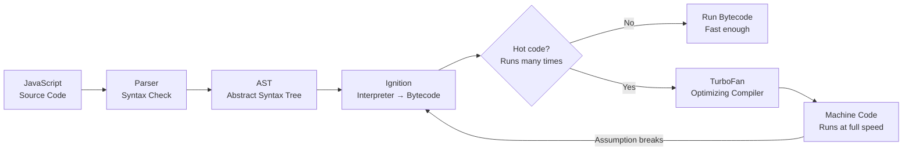

# 03 — V8 Engine: Notes

> **Priority:** 🔴 High
> **Previous topic:** [02 — Node.js Architecture](../02-nodejs-architecture/README.md)
> **Next topic:** [04 — Event Loop](../04-event-loop/README.md)
> **Main README:** [Backend Development Journey](../../README.md)
>
> **One-line summary:** V8 is the engine that runs your JavaScript — it reads your code, turns it into bytecode, then compiles the hot parts into fast machine code, and cleans up memory you no longer use. Everything else in Node.js (libuv, the standard library, the OS) exists to support what V8 does.
>
> **How to run the example:** `node --expose-gc examples/v8.js` — the `--expose-gc` flag is needed for the Garbage Collection demo in Part 4 (see [Section 8](#8-step-by-step-code-explanations)). Without it, the file still runs, but Part 4 prints a note instead of the GC step. Expected output is in [examples/example.txt](./examples/example.txt). Timings will differ on your machine — the *order* is what matters.

---

## Table of Contents

- [1. Introduction](#1-introduction)
- [2. Definition of Important Concepts](#2-definition-of-important-concepts)
- [3. Detailed Explanations](#3-detailed-explanations)
- [4. How the Technology Works Internally](#4-how-the-technology-works-internally)
- [5. Architecture or Workflow](#5-architecture-or-workflow)
- [6. Real-World Examples](#6-real-world-examples)
- [7. Code Examples Where Applicable](#7-code-examples-where-applicable)
- [8. Step-by-Step Code Explanations](#8-step-by-step-code-explanations)
- [9. Common Misconceptions](#9-common-misconceptions)
- [10. Important Technical Terminology](#10-important-technical-terminology)
- [11. Summary](#11-summary)
- [12. Interview Questions and Answers](#12-interview-questions-and-answers)
- [13. References](#13-references)

---

## 1. Introduction

**V8** is Google's open-source JavaScript and WebAssembly engine, written in C++.

- It was created in 2008 by Lars Bak's team at Google, for the Chrome browser.
- Node.js (2009) took the same engine out of Chrome and used it to run JavaScript on a server.
- Your Node.js version decides your V8 version. On this machine: **Node v24.22.1 → V8 13.6.233.17** (check yours with `process.versions.v8`).

**Simple way to remember it:**

> **V8 = the part of Node.js that understands and runs JavaScript.**
> It does not know about files, networks, or timers. It only knows JavaScript.

|  | V8 | Node.js |
|--|----|---------|
| **What it is** | A JavaScript engine | A JavaScript **runtime** built around V8 |
| **Written in** | C++ | C++ + JavaScript |
| **Runs** | JavaScript + WebAssembly | JavaScript, plus files, network, timers, modules |
| **Also used by** | Chrome, Edge, Brave, Deno | — |
| **Knows about `fs`, `http`, `setTimeout`?** | ❌ No | ✅ Yes — Node.js adds them |

**Why V8 was a breakthrough:** before V8, JavaScript engines were slow interpreters. V8 compiled JavaScript to machine code *while the program was running* — a Just-In-Time (JIT) compiler. That made JavaScript fast enough to run servers, and that is why Node.js was possible at all.

---

## 2. Definition of Important Concepts

| Concept | Definition |
|---------|-----------|
| **V8** | Google's open-source JavaScript and WebAssembly engine, written in C++. It parses, interprets, compiles, and runs JavaScript, and frees memory it no longer needs. |
| **JavaScript engine** | A program that reads JavaScript source code and executes it. V8 is one; SpiderMonkey (Firefox) and JavaScriptCore (Safari) are others. |
| **Runtime** | The environment that runs code, including the engine plus the extra abilities around it. Node.js is a runtime; V8 is the engine inside it. |
| **Parser** | The part of V8 that reads source code as text, checks its syntax, and builds an Abstract Syntax Tree (AST). |
| **AST (Abstract Syntax Tree)** | A tree structure that represents what the code *means* — its structure, not just its characters. |
| **Bytecode** | Small, simple instructions produced by the interpreter (Ignition) from the AST. Bytecode is compact, fast to produce, and portable across CPUs. |
| **Ignition** | V8's interpreter. It turns the AST into bytecode and executes it immediately, while collecting feedback about types and shapes. |
| **TurboFan** | V8's optimizing compiler. It compiles hot (frequently run) code from bytecode into optimized machine code, based on the feedback Ignition collected. |
| **JIT (Just-In-Time) compilation** | Compiling code *while the program is running*, rather than before it runs. TurboFan is V8's JIT compiler. |
| **Hot code** | Code that runs many times — a function called in a loop, or a route handler called on every request. Only hot code is worth optimizing. |
| **Hidden Class (Map)** | V8's internal description of an object's shape — which properties it has, and in which order. Objects created with the same properties in the same order share one hidden class. |
| **Inline Caching (IC)** | V8 remembering, inside the compiled code itself, where a property lives for a given hidden class — so the next read skips the lookup. |
| **Deoptimization** | V8 throwing away optimized machine code and going back to bytecode, because an assumption TurboFan made (for example, "these arguments are always numbers") turned out to be wrong. |
| **Garbage Collection (GC)** | V8 automatically freeing memory used by objects that can no longer be reached from your code. JavaScript has no `free()` — the GC does it. |
| **Young Generation (Nursery)** | Where new objects live. Most die within milliseconds, so this generation is collected often and quickly (Minor GC / Scavenge). |
| **Old Generation** | Where objects that survived several Minor GCs live. Collected rarely and more slowly (Major GC / Mark-Compact). |
| **Stack** | Fast, small, automatic memory for function calls, local variables, and primitives. Freed automatically when a function returns. |
| **Heap** | Larger memory for objects, arrays, functions, and closures. Managed by the Garbage Collector. |
| **WebAssembly** | Code compiled from other languages (C, Rust) that runs alongside JavaScript in V8 at near-native speed. |

---

## 3. Detailed Explanations

### 3.1 Parser and AST

The **Parser** reads your source code as text and checks two things:

1. **Syntax** — is the code valid JavaScript? A missing `}` stops everything here, before a single line runs.
2. **Structure** — it builds an **AST (Abstract Syntax Tree)**, a tree that represents what the code *means*, not just the characters.

```js
const total = 5 + 3;
```

```text
AST for this line:

        =
       / \
   total   +
          / \
         5   3
```

You never see the AST in normal work, but two things about it matter:

- **Parsing is lazy:** V8 does not parse a function until it is called for the first time. That is why Node.js starts fast even with a large codebase — most functions are parsed only when needed.
- **A syntax error anywhere in a file stops the whole file.** V8 parses the file before running it, so a typo on line 100 means line 1 never runs either.

### 3.2 Ignition — The Interpreter

**Ignition** is V8's interpreter. It turns the AST into **bytecode** — small, simple instructions that V8 can execute immediately.

Why bytecode, not machine code right away?

- Bytecode is **small** — it uses far less memory than machine code.
- It is **fast to produce** — no long compile step before your program starts.
- It is **portable** — the same bytecode runs on any CPU, and TurboFan can optimize it later.

You can see the bytecode yourself:

```bash
node --print-bytecode examples/v8.js
```

It prints a lot of output, but look for lines like `LdaSmi` (load a small integer) and `Add` — those are the bytecode instructions for your code.

**Key idea:** Ignition also **collects feedback** while it runs. Every time a function is called, Ignition notes: "this argument was a number", "this property was found at this position". That feedback is what TurboFan uses to optimize later.

### 3.3 TurboFan — The Optimizing Compiler (JIT)

**TurboFan** is V8's optimizing compiler. **JIT** means *Just-In-Time*: it compiles code *while the program is running*, not before.

#### How it decides what to optimize

1. A function runs a few times under Ignition. Ignition records feedback: argument types, property shapes.
2. If the function is **hot** (called many times, or a loop runs many times), V8 sends it to TurboFan.
3. TurboFan makes **assumptions** from the feedback: "a and b are always numbers", "this object always has this shape".
4. It compiles the function to optimized **machine code** — the CPU runs it directly, no interpretation.

#### Why the example gets faster

In [examples/v8.js](./examples/v8.js), the same 1,000,000-add loop runs three times:

```text
1st run (1M adds): 5.539ms   ← mostly Ignition, still learning
2nd run (1M adds): 1.496ms   ← TurboFan optimized it
3rd run (1M adds): 1.485ms   ← stays fast
```

The code did not change. V8 just learned it and compiled it. That is the JIT warm-up — real servers show the same pattern: the first requests are slower, then the hot paths get fast.

#### Deoptimization — when an assumption breaks

TurboFan's speed comes from assumptions, and assumptions can be wrong.

```js
function add(a, b) { return a + b; }

add(1, 2);       // numbers — TurboFan optimizes for numbers
add(3, 4);       // numbers — fast
add('a', 'b');   // STRINGS — assumption broken!
```

When that happens, V8 **deoptimizes**: it throws away the optimized machine code, goes back to the Ignition bytecode, and starts learning again. Deoptimization is correct — your program still works — but it costs time.

**Rule for backend work:** keep a hot function's argument types consistent. A route handler that sometimes gets a number and sometimes a string for the same value will keep deoptimizing.

### 3.4 Hidden Classes — Why Object Shape Matters

JavaScript objects are flexible — you can add a property any time. But flexibility is slow if V8 has to search for every property by name, like looking up a word in a dictionary.

V8's trick is **Hidden Classes** (also called Maps). When you create objects with the same properties in the same order, V8 gives them the **same hidden class** — and then it knows exactly where each property sits in memory, like a struct in C.

```js
// Same properties, same order → SAME hidden class ✅
const user1 = { name: 'Talha', age: 21 };
const user2 = { name: 'Moeez', age: 22 };

// Different order → DIFFERENT hidden class ❌
const user3 = { age: 21, name: 'Talha' };
```

```text
  user1:  { name, age }  →  Hidden Class A
  user2:  { name, age }  →  Hidden Class A   (same — fast!)
  user3:  { age, name }  →  Hidden Class B   (different — slow path)
```

And adding a property *after* creation changes the class too:

```js
const user = { name: 'Talha' };   // Hidden Class A
user.age = 21;                     // New hidden class: A → B
user.city = 'Karachi';             // New hidden class: B → C
```

**The proof is in the example** — reading `p.x + p.y` 2,000,000 times:

```text
Same shape (2M reads):     4.036ms   ← one hidden class
Changing shape (2M reads): 16.056ms  ← shape flips every call
```

Same values, same code — only the object shape changed, and the slow version took about 4× longer.

**Rule:** create objects with all their properties at once, in the same order, every time. Never add properties to a hot object later, and never flip the property order.

### 3.5 Inline Caching — How V8 Remembers

**Inline Caching (IC)** is how V8 uses hidden classes at runtime. The first time your code reads `p.x`, V8 looks up where `x` lives for that hidden class — and then it **remembers** that location in the code itself.

Next time the same code runs with the same hidden class, V8 skips the lookup and goes straight to the remembered location.

| State | What it means | Speed |
|-------|--------------|-------|
| **Monomorphic** | One hidden class seen so far | Fastest — one cached location |
| **Polymorphic** | A few (2–4) hidden classes seen | Slower — V8 checks each one |
| **Megamorphic** | Many hidden classes seen | Slowest — cache gives up, full lookup every time |

The "changing shape" test in the example is polymorphic: V8 sees two hidden classes alternating, so the inline cache cannot settle on one location, and every read costs more.

**Rule:** a function that touches objects should see as few shapes as possible. One shape is ideal. If a function receives ten different object shapes, it will run on the slow path no matter how simple the code is.

### 3.6 Garbage Collection — How V8 Frees Memory

JavaScript has no `free()` or `delete` for memory. **V8's Garbage Collector (GC)** frees it for you: any object that can no longer be reached from your code is collected.

#### The generational idea

Most objects die young. V8 uses that fact with two generations:

| Generation | What lives there | How it is collected |
|------------|-----------------|---------------------|
| **Young Generation** (Nursery) | New objects — most die within milliseconds | **Minor GC (Scavenge)** — fast, runs often, copies survivors to the old generation |
| **Old Generation** | Objects that survived several minor GCs | **Major GC (Mark-Compact)** — slower, runs rarely, marks live objects and compacts the rest |

#### The proof is in the example

```text
Heap before creating objects:        8 MB
Heap after creating 200,000 objects: 29 MB
Heap after dropping them + GC:       7 MB
```

The objects were dropped (`users = null`), so nothing could reach them — and GC returned the memory.

> **Note on the flag:** the GC step in [examples/v8.js](./examples/v8.js) needs `global.gc()`, which only exists when Node.js is run with `--expose-gc`. Run `node --expose-gc examples/v8.js` to see the full proof. Without the flag, the file prints a note instead of the GC step. `--expose-gc` is for testing and demos, not production.

#### What you should know (and not worry about yet)

- **You cannot force GC in normal code.** `global.gc()` only exists when you run Node.js with `--expose-gc`, and it is for testing, not production.
- **The heap has a limit** — about 2 GB by default on this machine (`heap_size_limit: 2240 MB` in the example). Raise it with `node --max-old-space-size=4096 app.js` if your app genuinely needs more memory — but first check for a leak.
- **The classic leak:** keeping a reference you forgot about — an ever-growing array, a cache with no limit, an event listener never removed. If the object is still reachable, GC *cannot* free it, no matter how long you wait.

### 3.7 Stack vs Heap

V8 stores your data in two places:

```text
┌──────────────────────────────┐
│  STACK                       │
│  • Fast, small, automatic    │
│  • Function calls, local     │
│    variables, primitives     │
│    (numbers, booleans)       │
│  • Freed automatically when  │
│    a function returns        │
└──────────────────────────────┘

┌──────────────────────────────┐
│  HEAP                        │
│  • Larger, slower, managed   │
│  • Objects, arrays,          │
│    functions, closures       │
│  • Freed by the Garbage      │
│    Collector                 │
└──────────────────────────────┘
```

```js
function greet() {
  const name = 'Talha';        // 'Talha' (string object) → HEAP
  const count = 5;             // number → STACK
  const user = { name, count } // object → HEAP, reference on STACK
  return user.name;
}
```

**Simple rule:** primitives and references live on the stack; the actual objects live on the heap. That is why the GC section talks about the heap — it is the only memory V8 has to manage.

---

## 4. How the Technology Works Internally

### The pipeline, step by step

| Step | Component | Input → Output | Speed |
|------|-----------|---------------|-------|
| 1 | **Parser** | Source code → AST | One-time cost |
| 2 | **Ignition** | AST → Bytecode | Fast to start, slower to run |
| 3 | **TurboFan** | Bytecode → Machine code | Slow to compile, fastest to run |
| — | **Maglev** *(newer V8)* | Bytecode → Mid-level machine code | A middle tier between Ignition and TurboFan |
| — | **Garbage Collector** | Dead objects → Freed memory | Runs in the background |

**The rule behind it:**

> **Start fast, optimize only what is hot.**
> A function that runs once is never compiled — it is not worth the time.
> A function that runs a million times *is* worth compiling.

### The feedback loop, in order

1. **Parse (lazily).** V8 parses a function only when it is called for the first time.
2. **Interpret.** Ignition runs the bytecode immediately and records feedback on every call: argument types, property positions, hidden classes seen.
3. **Detect hot code.** A function called many times, or a loop running many times, is marked hot.
4. **Optimize.** TurboFan compiles the hot code to machine code, making assumptions from the feedback ("a and b are always numbers").
5. **Run fast — until an assumption breaks.** A call with a different type breaks the assumption, V8 deoptimizes back to bytecode, and the learning starts again.
6. **Clean up in parallel.** While all of this runs, the Garbage Collector frees unreachable objects in the Young Generation often and in the Old Generation rarely.

### What V8 does NOT do

This is the question that separates "I know V8" from "I memorized V8":

| V8 does NOT provide | Who provides it instead |
|---------------------|------------------------|
| File system (`fs`) | Node.js standard library + libuv + OS |
| Network / HTTP (`http`) | Node.js standard library + libuv + OS |
| Timers (`setTimeout`) | libuv (Event Loop) |
| DOM, `window`, `document` | The browser (Chrome) — not Node.js at all |
| Modules (`require`) | Node.js module system |
| Event Loop | libuv — covered in [04 — Event Loop](../04-event-loop/README.md) |

That is exactly why Node.js is more than V8: V8 runs the JavaScript, and Node.js + libuv give that JavaScript something to *do* — read files, answer HTTP requests, wait on timers.

V8 also runs **WebAssembly** — code compiled from other languages (C, Rust) that runs alongside JavaScript at near-native speed. You do not need it for this journey, but know it is the same engine doing it.

---

## 5. Architecture or Workflow

### Diagram 1: Where V8 Sits in Node.js

```text
┌─────────────────────────────────────────────────────────┐
│  YOUR APPLICATION (JavaScript)                          │
│  server.js, routes, controllers...                      │
└──────────────────────┬──────────────────────────────────┘
                       │  require('fs'), require('http')...
┌──────────────────────▼──────────────────────────────────┐
│  NODE.JS STANDARD LIBRARY (JavaScript)                  │
└──────────────────────┬──────────────────────────────────┘
                       │  Node.js Bindings (C++)
┌──────────────────────▼──────────────────────────────────┐
│  V8 ENGINE (C++)  ◄── YOU ARE HERE                     │
│                                                         │
│  Parser → Ignition → TurboFan → Machine Code            │
│  + Garbage Collector                                    │
└──────┬──────────────────────────────────────────────────┘
       │  V8 asks libuv / the OS for slow work
┌──────▼──────────────────────────────────────────────────┐
│  libuv (C) — Event Loop, Thread Pool, Async I/O         │
└─────────────────────────────────────────────────────────┘
```

**Explanation:** your code sits on top. It calls the Node.js standard library, which talks through C++ bindings to V8. V8 runs the JavaScript; when the code needs slow work (a file, a network call), V8's surroundings — libuv and the OS — handle it. V8 itself never touches the file system or the network.

### Diagram 2: The V8 Pipeline (Mermaid — renders on GitHub)



**Explanation:** every function travels left to right. Cold code stays as bytecode — fast enough, and not worth compiling. Hot code goes to TurboFan and becomes machine code. The arrow back from machine code to Ignition is deoptimization: when an assumption breaks, V8 discards the optimized code and returns to bytecode.

### Diagram 3: The Same Pipeline as a Flow

```text
  const x = 5;
  function add(a, b) { return a + b; }

        │  1. PARSER
        │     reads the text, checks the syntax
        ▼
  ┌───────────┐
  │    AST    │   a tree of what the code MEANS
  └─────┬─────┘
        │  2. IGNITION (interpreter)
        │     turns the AST into BYTECODE
        ▼
  ┌───────────┐
  │ Bytecode  │   small instructions V8 can run
  │ add:      │   immediately — no waiting
  │  LdaSmi 5 │   to compile everything first
  └─────┬─────┘
        │  3. Is add() called a LOT?
        │     YES → send it to TurboFan
        ▼
  ┌───────────┐
  │ TurboFan  │   assumes: a and b are always NUMBERS
  │           │   compiles add() to optimized MACHINE CODE
  └─────┬─────┘
        │
        ▼
  CPU runs the machine code directly — very fast.
  If add() is suddenly called with STRINGS,
  TurboFan throws the optimized code away
  (DEOPTIMIZATION) and goes back to bytecode.
```

**Read this diagram like this:** V8 never compiles everything up front — that would make startup slow. It starts fast with the interpreter, watches which functions are *hot* (run many times), and only optimizes those. That trade-off is the whole design of a JIT engine.

---

## 6. Real-World Examples

### Where V8 runs in real life

- **Chrome, Edge, Brave** — every web page's JavaScript runs on V8.
- **Node.js** — the same engine, taken out of the browser to run JavaScript on a server.
- **Deno** — another server runtime built on V8.

### A real server warms up

When a Node.js API starts, the first requests are slower: Ignition is still interpreting the hot paths and collecting feedback. After a few hundred requests, TurboFan has compiled the hot route handlers, and the same requests run faster. That is the same JIT warm-up the example shows with the 1,000,000-add loop (5.5 ms first, ~1.5 ms after) — only with real requests instead of a loop.

### A route handler that keeps deoptimizing

```js
// A handler that sometimes gets a number id, sometimes a string id
app.get('/user/:id', (req, res) => {
  const id = req.params.id; // string from the URL, or a number after parsing?
  findUser(id);
});
```

If `findUser` is optimized for numbers and then receives a string, V8 deoptimizes it and re-learns. In a busy API this repeats on every mixed call. The fix is the same rule as in Section 3.3: keep the type consistent — parse the id once, in one place, before it reaches the hot function.

### Objects from a database

Rows returned from PostgreSQL are turned into JavaScript objects. If every row object is built with the same properties in the same order (`{ id, name, email }`), they share one hidden class and every property read is fast. If some rows are built as `{ name, id, email }` and others as `{ id, email, name }`, the function that reads them sees several hidden classes and runs on the slow path — even though the data is identical.

### An API that gets slower over hours

A server whose memory usage climbs until it crashes is usually not a V8 bug — it is a leak V8 cannot fix. The heap statistics in [examples/v8.js](./examples/v8.js) (`used_heap_size`, `heap_size_limit`) are the first place to look: if the used heap grows forever and never comes back down after GC, some object is still reachable — a growing array, a cache with no limit, an event listener never removed. GC frees only unreachable objects, so a forgotten reference leaks forever.

---

## 7. Code Examples Where Applicable

### 7.1 Heap statistics — asking V8 how much memory it uses

```js
const v8 = require('v8');
const heap = v8.getHeapStatistics();
console.log('Used heap size: ', Math.round(heap.used_heap_size / 1024 / 1024), 'MB');
console.log('Heap size limit:', Math.round(heap.heap_size_limit / 1024 / 1024), 'MB');
```

The `v8` module is a built-in Node.js module that exposes V8's own numbers. It is the only way to ask V8 "how much memory are you using?" from inside your program.

### 7.2 JIT warm-up — the same loop gets faster

```js
function add(a, b) { return a + b; }

function runAdd(n) {
  let sum = 0;
  for (let i = 0; i < n; i++) {
    sum += add(i, i + 1);
  }
  return sum;
}

console.time('1st run (1M adds)');
runAdd(1000000);
console.timeEnd('1st run (1M adds)');
// Run it two more times — the later runs are ~3–4× faster.
```

### 7.3 Hidden classes — same shape vs changing shape

```js
function sumPoint(p) { return p.x + p.y; }

const sameShape = { x: 1, y: 2 };
// 2,000,000 reads of sumPoint(sameShape) → ~4 ms

// Changing shape: the property order flips every call
const p = i % 2 ? { x: 1, y: 2 } : { y: 2, x: 1 };
// 2,000,000 reads with the shape flipping → ~16 ms
```

### 7.4 Deoptimization — one string breaks the assumption

```js
function add(a, b) { return a + b; }

add(1, 2);       // numbers — TurboFan optimizes for numbers
add(3, 4);       // numbers — fast
add('a', 'b');   // STRINGS — assumption broken, V8 deoptimizes
```

### 7.5 Garbage Collection — dropping a reference frees memory

```js
let users = [];
for (let i = 0; i < 200000; i++) {
  users.push({ id: i, name: 'user' + i });
}
// Heap: 8 MB → 29 MB

users = null; // the only reference is gone — objects are unreachable

global.gc(); // ⚠️ only exists with --expose-gc
// Heap: 29 MB → 7 MB
```

> **The `--expose-gc` flag:** run the demo as `node --expose-gc examples/v8.js`. Without the flag, `global.gc` does not exist and the file prints a note instead of the GC step. The flag is for testing and demos, not production — normal code never forces GC.

### 7.6 Seeing the bytecode

```bash
node --print-bytecode examples/v8.js
```

Look for lines like `LdaSmi` (load a small integer) and `Add` — those are the bytecode instructions Ignition produced for your code.

---

## 8. Step-by-Step Code Explanations

Full file: [examples/v8.js](./examples/v8.js). Expected output: [examples/example.txt](./examples/example.txt).

Run it:

```bash
node --expose-gc examples/v8.js
```

### Part 1 — Heap statistics

```js
const v8 = require('v8');
v8.getHeapStatistics();
// used_heap_size, total_heap_size, heap_size_limit
```

The `v8` module is a built-in Node.js module that exposes V8's own numbers. It is the only way to ask V8 "how much memory are you using?" from inside your program.

### Part 2 — JIT warm-up

```js
function add(a, b) { return a + b; }
function runAdd(n) { /* 1,000,000 calls to add() */ }
// 1st run ~5.5ms, 2nd and 3rd runs ~1.5ms
```

Same code, same input — the later runs are ~3–4× faster because TurboFan compiled `add()` after seeing it always receive numbers.

### Part 3 — Hidden Classes

```js
function sumPoint(p) { return p.x + p.y; }
// Same shape, 2M reads: ~4ms
// Shape flips every call, 2M reads: ~15ms
```

The only difference is property order (`{x, y}` vs `{y, x}`). One hidden class → one fast inline cache. Two alternating classes → the cache cannot settle.

### Part 4 — Garbage Collection

```js
let users = [];
// ... create 200,000 objects → heap 8 MB → 29 MB
users = null;
global.gc();   // only with --expose-gc
// heap → 7 MB
```

Dropping the reference made the objects unreachable, and GC freed them. Without `--expose-gc`, the file prints a note instead of the GC step — run it with the flag to see the full proof.

### Important lines explained

| Line / idea | Why it matters |
|-------------|---------------|
| `process.versions.v8` | The real V8 version bundled with your Node.js — `13.6.233.17-node.58` here. |
| `require('v8')` | Node.js exposes V8 internals (heap stats) through this built-in module. |
| `console.time` / `console.timeEnd` | The simplest way to measure warm-up and shape effects — no extra package needed. |
| `total` in Part 3 | The sum is printed so V8 cannot optimize the whole loop away as dead code. |
| `users = null` | The one line that makes 200,000 objects collectable — reachability, not age, decides GC. |
| `--expose-gc` | A Node.js flag, not V8 magic — it adds `global.gc()` so you can trigger GC in a demo. |

---

## 9. Common Misconceptions

- ❌ **"V8 and Node.js are the same thing."**
  ✅ V8 is one part of Node.js. Node.js = V8 + libuv + bindings + standard library.

- ❌ **"V8 compiles all my code before it runs."**
  ✅ V8 interprets first (Ignition) and compiles only hot code, while the program runs (JIT).

- ❌ **"JavaScript is slow because it is interpreted."**
  ✅ Hot JavaScript runs as optimized machine code, thanks to TurboFan. The slow part is usually waiting on I/O, not the language.

- ❌ **"Adding a property to an object is free."**
  ✅ It changes the hidden class. Done once at creation it is fine; done repeatedly on hot objects it kills the inline cache.

- ❌ **"Garbage collection means I never have to think about memory."**
  ✅ GC frees *unreachable* objects. A forgotten reference — a growing array, an unremoved listener — is still reachable, and still leaks.

- ❌ **"V8 handles files and network."**
  ✅ V8 only runs JavaScript. Files, network, and timers come from Node.js and libuv.

- ❌ **"The first benchmark run tells me the real speed."**
  ✅ The first run is warm-up. The optimized speed shows up on the 2nd or 3rd run.

---

## 10. Important Technical Terminology

| Term | Meaning |
|------|---------|
| **AST** | Abstract Syntax Tree — the tree the Parser builds from source code, representing what the code means. |
| **Bytecode** | Compact instructions produced by Ignition from the AST; fast to produce, portable, executed immediately. |
| **JIT** | Just-In-Time compilation — compiling code while the program runs, not before. TurboFan is V8's JIT compiler. |
| **Ignition** | V8's interpreter; produces bytecode and collects type/shape feedback. |
| **TurboFan** | V8's optimizing compiler; turns hot bytecode into optimized machine code using Ignition's feedback. |
| **Maglev** | A newer, mid-level V8 compiler tier between Ignition and TurboFan — faster to compile than TurboFan, less optimized. |
| **Hidden Class (Map)** | V8's internal record of an object's shape (properties and their order). Same shape = same hidden class. |
| **Inline Cache (IC)** | The remembered property location stored in the code for a given hidden class, so later reads skip the lookup. |
| **Monomorphic** | Inline-cache state: only one hidden class has been seen — fastest. |
| **Polymorphic** | Inline-cache state: a few (2–4) hidden classes have been seen — slower, V8 checks each one. |
| **Megamorphic** | Inline-cache state: many hidden classes have been seen — slowest, the cache gives up and every read does a full lookup. |
| **Deoptimization** | Discarding optimized machine code and returning to bytecode because an assumption (e.g. argument types) broke. |
| **Scavenge (Minor GC)** | Fast, frequent collection of the Young Generation; survivors are copied to the Old Generation. |
| **Mark-Compact (Major GC)** | Slower, rare collection of the Old Generation; marks live objects and compacts the rest. |
| **Young Generation (Nursery)** | Where new objects live; most die within milliseconds. |
| **Old Generation** | Where objects that survived several Minor GCs live. |
| **Heap size limit** | The maximum heap V8 will use (about 2 GB / 2240 MB by default here); raisable with `--max-old-space-size`. |
| **Stack** | Fast, automatic memory for calls, locals, and primitives; freed when a function returns. |
| **Heap** | Larger memory for objects, arrays, functions, and closures; freed by the Garbage Collector. |
| **WebAssembly** | Code from other languages (C, Rust) that runs in V8 alongside JavaScript at near-native speed. |

---

## 11. Summary

```text
┌─────────────────────────────────────────────────────┐
│  YOUR JAVASCRIPT                                    │
│  source code, plain text                            │
├─────────────────────────────────────────────────────┤
│  PARSER → AST                                       │
│  checks syntax, builds the tree                     │
├─────────────────────────────────────────────────────┤
│  IGNITION (interpreter)                             │
│  runs bytecode immediately, collects feedback       │
├─────────────────────────────────────────────────────┤
│  TURBOFAN (JIT compiler)                            │
│  compiles HOT code to machine code, based on        │
│  the feedback — fast, but assumes types stay        │
│  the same (or it deoptimizes)                       │
├─────────────────────────────────────────────────────┤
│  HIDDEN CLASSES + INLINE CACHING                    │
│  same object shape = fast property access           │
├─────────────────────────────────────────────────────┤
│  GARBAGE COLLECTOR                                  │
│  frees unreachable objects — Young (fast, often)    │
│  and Old (slow, rarely) generations                 │
└─────────────────────────────────────────────────────┘
```

**If you remember only three sentences:**

1. **V8 interprets first with Ignition, then compiles only the hot code with TurboFan.**
2. **Stable object shapes and consistent types keep your code on the fast path; changing them forces V8 to slow down or deoptimize.**
3. **V8 runs JavaScript and cleans up its memory — files, network, and timers are Node.js and libuv's job, not V8's.**

### Writing V8-friendly code — 7 rules

These are habits, not tricks. They follow directly from Sections 3 and 4:

1. **Keep object shapes stable.** Create objects with all properties at once, in the same order. Never add properties to a hot object later.
2. **Keep function types consistent.** A function that always receives numbers stays optimized. The same function receiving numbers, then strings, then `undefined` will deoptimize.
3. **Do not create objects inside hot loops** unless you need them — each one is heap work and future GC work.
4. **Initialize properties in the constructor.** In a class, assign every property in the constructor, in the same order, so every instance shares one hidden class.
5. **Avoid megamorphic code.** If one function handles ten different object shapes, split it — or accept the slow path.
6. **Do not fight the GC.** Drop references you no longer need (`array = null`, remove listeners). V8 can only free what is unreachable.
7. **Warm up before measuring.** The first run of any benchmark is Ignition, not TurboFan. Measure the 2nd or 3rd run — that is what your server actually does.

None of this matters for code that runs once. It matters for the hot path: the route handler, the loop over 10,000 rows, the function called on every request.

---

## 12. Interview Questions and Answers

Practice answering these out loud, in your own words — do not memorize. Short answers are given here as a check; say it in your own words first, then compare.

1. **What is V8? What is it written in, and who created it?**
   Google's open-source JavaScript engine, written in C++, created in 2008 by Lars Bak's team at Google for Chrome.

2. **What is the difference between V8 and Node.js?**
   V8 only runs JavaScript; Node.js is the runtime built around V8 that adds files, network, timers, and modules via libuv and the standard library.

3. **Trace the V8 pipeline: Parser → AST → Ignition → TurboFan. What does each step do?**
   The Parser checks syntax and builds the AST; Ignition turns the AST into bytecode and runs it while collecting feedback; TurboFan compiles hot code from that bytecode into optimized machine code.

4. **What is JIT compilation? Why does V8 not compile everything up front?**
   JIT compiles code while the program runs. Compiling everything up front would make startup slow, so V8 interprets first and optimizes only the hot code.

5. **What is bytecode, and why does Ignition produce it instead of machine code?**
   Bytecode is compact, portable instructions that are fast to produce, so the program can start immediately; machine code comes later, only for hot functions.

6. **What is a Hidden Class? Why does property order matter?**
   A Hidden Class is V8's internal record of an object's shape. Objects with the same properties in the same order share one class, so property reads are fast; a different order means a different class and a slower path.

7. **What is Inline Caching? What do monomorphic, polymorphic, and megamorphic mean?**
   Inline Caching is V8 remembering a property's location for a hidden class. Monomorphic means one class seen (fastest), polymorphic a few classes, megamorphic many classes (slowest, cache gives up).

8. **What is deoptimization? Give an example that causes it.**
   V8 discards optimized machine code and returns to bytecode when an assumption breaks — for example, `add()` optimized for numbers is then called with strings.

9. **How does Garbage Collection work in V8? What are the Young and Old Generations?**
   GC frees unreachable objects. New objects live in the Young Generation, collected often by fast Minor GC; survivors move to the Old Generation, collected rarely by slower Major GC.

10. **What is the difference between the Stack and the Heap?**
    The Stack holds function calls, locals, and primitives and is freed automatically on return; the Heap holds objects, arrays, and functions and is freed by the Garbage Collector.

11. **How would you check which V8 version your Node.js is running?**
    Run `process.versions.v8` in Node.js — on this machine it is `13.6.233.17-node.58` with Node v24.22.1.

12. **Your API gets slower over hours until it crashes — how would V8's heap help you find the cause?**
    Check `v8.getHeapStatistics()`: if used heap grows forever and never falls after GC, something is still reachable — a growing array, an unbounded cache, or a listener never removed — and that is the leak.

**Good answer pattern:** start with the one-line definition, then the pipeline in words, then the example ([examples/v8.js](./examples/v8.js)) as proof. Never start with a memorized paragraph.

---

## 13. References

- Node.js documentation — https://nodejs.org/en/docs/ (official Node.js docs; includes the `v8` module and CLI flags such as `--expose-gc` and `--max-old-space-size`).
- V8 documentation — https://v8.dev/docs (official V8 docs; covers the pipeline, TurboFan, and garbage collection).
- MDN Web Docs, JavaScript — https://developer.mozilla.org/en-US/docs/Web/JavaScript (JavaScript language reference used for the concepts in these notes).
- Previous topic in this module: [02 — Node.js Architecture](../02-nodejs-architecture/README.md).
- Next topic in this module: [04 — Event Loop](../04-event-loop/README.md).
- Main README for the journey: [Backend Development Journey](../../README.md).
- Example for this lesson (verified output): [examples/v8.js](./examples/v8.js) and [examples/example.txt](./examples/example.txt) — run on Node v24.22.1, V8 13.6.233.17-node.58.
- Exercises for this lesson: [exercises.md](./exercises.md).
