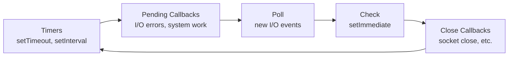

# 04 — Event Loop — Notes

> **Lesson:** [README.md](./README.md) · **Examples:** [examples/](./examples/) · **Exercises:** [exercises.md](./exercises.md) · **Main README:** [../../README.md](../../README.md)
>
> **One-line summary:** The Event Loop is the traffic controller of Node.js — it runs your JavaScript on one thread, and whenever something is slow (a file, a database, a timer), it hands that work to the background, keeps serving other requests, and runs your callback when the work finishes. That is how one thread handles thousands of users at once.

---

## Table of Contents

- [1. Introduction](#1-introduction)
- [2. Definition of important concepts](#2-definition-of-important-concepts)
- [3. Detailed explanations](#3-detailed-explanations)
- [4. How the technology works internally](#4-how-the-technology-works-internally)
- [5. Architecture or workflow](#5-architecture-or-workflow)
- [6. Real-world examples](#6-real-world-examples)
- [7. Code examples, where applicable](#7-code-examples-where-applicable)
- [8. Step-by-step code explanations](#8-step-by-step-code-explanations)
- [9. Common misconceptions](#9-common-misconceptions)
- [10. Important technical terminology](#10-important-technical-terminology)
- [11. Summary](#11-summary)
- [12. Interview questions and answers](#12-interview-questions-and-answers)
- [13. References](#13-references)

---

## 1. Introduction

The **Event Loop** is the mechanism that lets Node.js run JavaScript on **one main thread** and still handle many things at once. It is provided by **libuv**, a C library built into Node.js — not by V8.

The loop never stops while your program has work to do. Each turn around the loop it asks, in order:

> **"Is any async work finished? If yes, run its callback."**

```text
  Your code runs
       │
       ▼
  Slow work starts (file read, timer, HTTP request)
       │
       ▼
  Main thread moves on — it does NOT wait
       │
       ▼
  Slow work finishes in the background
       │
       ▼
  Event Loop runs your callback
```

**Simple way to remember it:**

> **V8 runs your JavaScript. The Event Loop decides *when* each piece of it runs.**
> V8 is the worker. The Event Loop is the schedule.

**Why it matters for backend work:** every HTTP request your server answers goes through this loop. If you block it for 300ms, *every* user waits 300ms — not just one. If you keep it free, one thread can serve thousands of users.

|  | V8 (topic 03) | Event Loop (this topic) |
|--|---------------|------------------------|
| **What it is** | The JavaScript engine | The scheduler, from libuv |
| **Written in** | C++ | C (libuv) |
| **Job** | Runs your code, fast | Decides *when* callbacks run |
| **Knows about** | JavaScript only | Timers, I/O, the Thread Pool |
| **Thread** | Main thread | Main thread (it *is* the main thread's loop) |

---

## 2. Definition of important concepts

| Concept | Definition |
|---------|-----------|
| **Event Loop** | The loop, provided by libuv, that repeatedly visits six phases and runs the callbacks whose work has finished. It is the scheduler of Node.js. |
| **libuv** | The C library built into Node.js that provides the Event Loop, the Thread Pool, and async I/O. |
| **V8** | The JavaScript engine (C++) that runs your JavaScript code. It does not provide the Event Loop. |
| **Phase** | One named step of a single turn of the Event Loop — Timers, Pending Callbacks, Idle/Prepare, Poll, Check, Close Callbacks — visited in a fixed order. |
| **Callback** | A function you pass to an async operation, to be run later when that operation finishes. |
| **Callback queue** | The queue where finished work waits for the loop to pick it up in the right phase. |
| **Microtask** | A small task that runs *between* phases, after the current operation finishes and before the loop moves on. There are two microtask queues: `process.nextTick` and Promises. |
| **`process.nextTick`** | The highest-priority microtask queue. A callback scheduled with `process.nextTick(fn)` runs before Promise microtasks, timers, and `setImmediate`. |
| **Promise microtask** | A microtask created by `Promise.resolve().then(fn)` or by `await` in an `async` function. It runs after the `nextTick` queue is empty. |
| **Timer** | A callback scheduled with `setTimeout` or `setInterval` to run no earlier than a given delay, in the Timers phase. |
| **`setImmediate`** | A callback scheduled with `setImmediate(fn)` to run in the Check phase — right after the current Poll phase finishes. |
| **Poll phase** | The phase where most I/O callbacks run: file reads, database answers, incoming HTTP requests. |
| **Thread Pool** | A small group of libuv worker threads (4 by default) that execute slow work in the background — file system, DNS, crypto, compression. |
| **Blocking** | Holding the main thread with synchronous work (a long loop, a `Sync` call, heavy CPU work) so the loop cannot run any callback. |
| **Non-blocking** | Starting slow work in the background and letting the main thread move on, so it can serve other work while waiting. |
| **I/O** | Input/output — reading a file, talking to a database, sending or receiving network data. |
| **Starvation** | A state where the loop never moves to the next phase because a higher-priority queue keeps refilling — for example, a `nextTick` callback that keeps scheduling another `nextTick` callback. |

---

## 3. Detailed explanations

### 3.1 The six phases, step by step

Each turn of the loop visits six phases, in this fixed order:

| # | Phase | What runs here |
|---|-------|---------------|
| 1 | **Timers** | Callbacks of `setTimeout` / `setInterval` whose time has come |
| 2 | **Pending Callbacks** | I/O callbacks deferred from the previous turn (mostly system errors) |
| 3 | **Idle, Prepare** | Internal libuv housekeeping — you never write code for this phase |
| 4 | **Poll** | New I/O events: file reads, network data, incoming connections |
| 5 | **Check** | Callbacks of `setImmediate` |
| 6 | **Close Callbacks** | `socket.on('close')`, and similar close events |

Then the loop starts again at Timers.

**The rule behind it:**

> **The loop never jumps the queue.**
> A timer cannot run during the Poll phase, and a `setImmediate` callback cannot run before the Poll phase finishes. Knowing the order is knowing the order your code runs in.

**When the loop stops:** when there is nothing left to do — no timers, no pending I/O, no open sockets — the process exits. That is why a plain `node script.js` that only prints something exits immediately, while a server keeps running: the server's open socket keeps the loop alive.

### 3.2 Timers phase — `setTimeout` and `setInterval`

The Timers phase runs callbacks whose scheduled time has passed.

```js
setTimeout(() => console.log('runs after ~100ms'), 100);
setInterval(() => console.log('runs every 1000ms'), 1000);
```

Three things to know:

- **The time is a *minimum*, not a promise.** `setTimeout(fn, 100)` means "run `fn` *no earlier than* 100ms from now". If the loop is busy (Section 3.9), it runs late — the example proves it: a timer set for 100ms fired after **300ms** because the main thread was blocked.
- **The minimum is about 1ms.** `setTimeout(fn, 0)` does not mean "run now" — it means "run in the Timers phase, as soon as the loop gets there".
- **Timers are checked first in each turn.** If a timer and an I/O callback are both ready, the timer runs first — because Timers is phase 1 and Poll is phase 4.

### 3.3 Poll phase — where I/O callbacks run

The Poll phase is where most of your backend callbacks run: file reads, database answers, incoming HTTP requests.

```js
const fs = require('fs');
fs.readFile('users.json', (err, data) => {
  // This callback runs in the POLL phase,
  // when the OS tells libuv the read is done.
});
```

How Poll behaves:

- If there are callbacks waiting, it runs them, then moves on.
- If there is nothing waiting, it **waits** — it blocks until either a new I/O event arrives or the nearest timer is due. That waiting is how Node.js sits idle without burning CPU.
- If a timer becomes due while Poll is waiting, Poll stops waiting and the loop goes back to the Timers phase.

**Why this phase matters most:** in a real server, almost every callback you write — `fs.readFile`, a database query, an HTTP handler — lands here. The Poll phase is where your backend actually does its work.

### 3.4 Check phase — `setImmediate`

The Check phase runs callbacks scheduled with `setImmediate`:

```js
setImmediate(() => console.log('runs in the Check phase'));
```

`setImmediate` means "run this callback right after the current Poll phase finishes" — it is the fastest way to say "run this soon, but not *right now*".

It is useful when you want to let I/O callbacks finish first:

```js
fs.readFile('data.txt', () => {
  // I/O done. Now do the follow-up work,
  // but let other I/O callbacks run first.
  setImmediate(() => processData());
});
```

**The key difference from `setTimeout(fn, 0)`:** `setTimeout` waits for the Timers phase of the *next* turn; `setImmediate` runs in the Check phase of the *current* turn. Inside an I/O callback, that makes `setImmediate` always win — Section 3.7 proves it.

### 3.5 Close callbacks and pending callbacks

Two phases you rarely write code for, but should recognise:

**Pending Callbacks** (phase 2) — I/O callbacks that were deferred from the previous turn, mostly system-level work such as TCP errors. Your application code almost never lands here directly.

**Close Callbacks** (phase 6) — callbacks for things being closed:

```js
socket.on('close', () => {
  // Runs in the Close Callbacks phase,
  // when the connection is fully closed.
});
```

If you see a callback run *after* everything else in a turn, it is probably a close callback — the last phase before the loop starts over.

### 3.6 Microtasks — `process.nextTick` vs Promises

Microtasks are **not** a phase of the Event Loop. They run *between* phases — after the current operation finishes, before the loop moves on. There are two microtask queues:

| Queue | How you add to it | Priority |
|-------|-------------------|----------|
| **`process.nextTick`** | `process.nextTick(fn)` | **Highest** — runs first |
| **Promise** | `Promise.resolve().then(fn)`, `async/await` | Runs after the `nextTick` queue is empty |

```js
setTimeout(() => console.log('timer'), 0);
setImmediate(() => console.log('immediate'));
Promise.resolve().then(() => console.log('promise'));
process.nextTick(() => console.log('nextTick'));
console.log('sync');
// Output order:
//   sync
//   nextTick
//   promise
//   timer / immediate (order varies — see Section 3.7)
```

**The proof is in the example** — Part 1 prints exactly this order:

```text
  0. synchronous code (runs first, always)
  1. process.nextTick
  2. Promise.then
  4. setTimeout(0)
  5. setImmediate
```

**Two warnings:**

- **`process.nextTick` can starve the loop.** If a `nextTick` callback schedules another `nextTick` callback, forever, the loop never moves to the next phase — timers and I/O never run. Never use `nextTick` in a loop that can keep re-scheduling itself.
- **`await` is a Promise.** An `async` function pauses at `await` and resumes as a Promise microtask — so it follows the same ordering rules as `.then()`.

### 3.7 `setTimeout(0)` vs `setImmediate` — the ordering rule

This is the classic interview question, and the answer has two parts:

**At the top level (outside any I/O callback), the order is NOT guaranteed.**

```js
setTimeout(() => console.log('timeout'), 0);
setImmediate(() => console.log('immediate'));
// Either one can print first. It depends on how long
// the process took to start up before the loop began.
```

On this machine, the example's Part 1 printed `setTimeout(0)` first — on another machine, or another run, `setImmediate` can win. Never write code that depends on this order.

**Inside an I/O callback, `setImmediate` ALWAYS wins.**

```js
fs.readFile('file.txt', () => {
  setTimeout(() => console.log('timeout'), 0);
  setImmediate(() => console.log('immediate'));
});
// Output is ALWAYS:
//   immediate
//   timeout
```

Why? The `readFile` callback runs in the **Poll** phase. The next phase after Poll is **Check** (`setImmediate`). The Timers phase only comes around again on the *next* turn of the loop. So `setImmediate` is reached first — every time, on every machine.

**The proof is in the example** — Part 2 prints:

```text
  readFile callback (poll phase)
  setImmediate - runs FIRST
  setTimeout(0) - runs second
```

**Rule:** if you need "run this right after I/O", use `setImmediate`. If you need "run this after at least N milliseconds", use `setTimeout`.

### 3.8 The Thread Pool — who does the slow work

The Event Loop itself does no slow work. The slow work goes to **libuv's Thread Pool** — a small group of worker threads (4 by default) that run in the background.

| Work | Who does it |
|------|-------------|
| File system (`fs.readFile`, `fs.writeFile`) | Thread Pool |
| DNS lookups | Thread Pool |
| `crypto` operations (`pbkdf2`, `scrypt`) | Thread Pool |
| Compression (`zlib`) | Thread Pool |
| Network I/O, timers | The OS + the Event Loop itself (no thread needed) |

```js
// This does NOT block the loop:
fs.readFile('big-file.txt', (err, data) => {
  // A Thread Pool worker read the file.
  // The main thread stayed free the whole time.
});
```

**The proof is in the example** — Part 4: a file read runs while a 50ms timer waits, and the timer still fires after **50ms, on time**. The read happened on a worker thread, so the loop was never blocked.

You can change the pool size with an environment variable before starting Node.js:

```bash
UV_THREADPOOL_SIZE=8 node app.js
```

The maximum is 1024, but bigger is not always better — more threads means more context switching. The default of 4 is right for most apps; raise it only when you can measure that file or crypto work is queuing up.

**The key distinction:** the Thread Pool *executes* slow work. The Event Loop *coordinates* it. Confusing the two is the most common wrong answer in interviews.

### 3.9 What blocks the loop (and what does not)

**Blocks the loop** — anything that runs on the main thread and takes time:

```js
// ❌ A long loop on the main thread
let x = 0;
while (Date.now() < Date.now() + 300) { x += 1; }

// ❌ Synchronous file I/O
const data = fs.readFileSync('big-file.txt');

// ❌ Heavy CPU work: big JSON.parse, big loops, crypto sync
const obj = JSON.parse(hugeString);
```

**Does NOT block the loop** — anything handed to the background:

```js
// ✅ Async file I/O (Thread Pool)
fs.readFile('big-file.txt', callback);

// ✅ Timers (the loop just waits)
setTimeout(callback, 100);

// ✅ Network requests (the OS handles them)
http.get('https://example.com', callback);
```

**The proof is in the example** — Part 3: a timer scheduled for 100ms fired after **300ms**, because a busy loop held the main thread for 300ms first. The timer was ready at 100ms, but the loop could not run it — the main thread was busy, and there is only one main thread.

**Rule for backend work:** in a server, *never* block the Event Loop. A single `readFileSync` or a 500ms loop inside a request handler blocks *every* user, not just one. Move heavy work to the Thread Pool (async APIs), a worker thread, or a separate service.

### 3.10 Writing Event-Loop-friendly code

These are habits, not tricks. They follow directly from Sections 3.6–3.9:

1. **Never use `Sync` methods in a server.** `readFileSync`, `writeFileSync`, `existsSync` — fine in a startup script, never inside a request handler.
2. **Use `setImmediate` for "run after I/O", `setTimeout` for "run after N ms".** Do not use one when you mean the other.
3. **Keep callbacks short.** A callback that loops for 200ms blocks every other user for 200ms. Split long work into chunks with `setImmediate` between them.
4. **Do not abuse `process.nextTick`.** It is for "run this before anything else, once" — not for scheduling repeated work. A `nextTick` loop that re-schedules itself starves the loop.
5. **Move heavy CPU work off the main thread.** Big `JSON.parse`, image processing, password hashing — use async APIs, worker threads, or a separate service.
6. **Remember timers are minimums.** Never write code that assumes `setTimeout(fn, 100)` fires at exactly 100ms — under load it fires late, and your code must still be correct.
7. **Let the loop exit.** A server stays alive because of its open socket, not because of a timer. A stray `setInterval` is the classic reason a script "never exits".

None of this matters for a script that runs once and exits. It matters for the hot path: the route handler, the function called on every request, the code that runs while a thousand users are connected.

---

## 4. How the technology works internally

Inside one turn, the loop works like this:

1. **Your JavaScript runs** on the main thread, line by line, on the Call Stack (V8).
2. **When you start slow work** — `fs.readFile`, a timer, an HTTP request — the call is handed to libuv. The main thread does **not** wait; it moves on to the next line, and to the next request.
3. **The slow work runs in the background** — in the Thread Pool (files, DNS, crypto) or in the OS (network). When it finishes, libuv puts its callback in the queue for the right phase.
4. **The loop visits the phases in order** — Timers, Pending Callbacks, Idle/Prepare, Poll, Check, Close Callbacks. In each phase it runs the callbacks that are ready for that phase.
5. **Between phases, microtasks drain** — after the current operation finishes, the `process.nextTick` queue runs first, then the Promise queue, before the loop moves on to the next phase.
6. **Poll waits when there is nothing to do** — if no callback is ready, Poll blocks until a new I/O event arrives or the nearest timer is due. That waiting is how Node.js sits idle without burning CPU. If a timer becomes due while Poll is waiting, Poll stops waiting and the loop goes back to Timers.
7. **The loop repeats** until there is nothing left to do — no timers, no pending I/O, no open sockets. Then the process exits. A server stays alive because its open socket keeps the loop alive.

**One request, traced through the loop:**

```text
  A user asks for /users

        │  1. YOUR CODE (main thread)
        │     route handler runs, asks the database
        ▼
  ┌───────────┐
  │  DATABASE │   the query runs in the background
  │  QUERY    │   (Thread Pool / OS) — main thread is FREE
  └─────┬─────┘
        │  2. MEANWHILE
        │     the Event Loop serves other users
        ▼
  ┌───────────┐
  │  POLL     │   the loop sees: "the query finished!"
  │  PHASE    │
  └─────┬─────┘
        │  3. YOUR CALLBACK RUNS
        │     res.json(users) — the answer goes back
        ▼
  User gets the response. The main thread never waited.
```

**Read this flow like this:** the main thread never waits for slow work. It starts the work, moves on, and the loop brings the result back as a callback. That is the whole design of Node.js — and the reason a single thread is enough.

---

## 5. Architecture or workflow

### Diagram 1: Where the Event Loop sits in Node.js

```text
┌─────────────────────────────────────────────────────────┐
│  YOUR APPLICATION (JavaScript)                          │
│  server.js, routes, controllers...                      │
└──────────────────────┬──────────────────────────────────┘
                       │  require('fs'), setTimeout()...
┌──────────────────────▼──────────────────────────────────┐
│  NODE.JS STANDARD LIBRARY (JavaScript)                  │
└──────────────────────┬──────────────────────────────────┘
                       │  Node.js Bindings (C++)
┌──────────────────────▼──────────────────────────────────┐
│  V8 ENGINE (C++)                                        │
│  Runs your JavaScript, one line at a time               │
└──────┬──────────────────────────────────────────────────┘
       │  V8 asks libuv for slow work
┌──────▼──────────────────────────────────────────────────┐
│  libuv (C) — EVENT LOOP  ◄── YOU ARE HERE               │
│                                                         │
│  Timers → Pending → Poll → Check → Close → (repeat)     │
│  + Thread Pool (4 worker threads by default)            │
│  + The Operating System (network, files)                │
└─────────────────────────────────────────────────────────┘
```

**Explanation:** your code talks to the Standard Library, which talks through the C++ bindings to V8 and libuv. V8 runs the JavaScript; libuv runs the loop. The Operating System does the real file and network work underneath both.

### Diagram 2: One turn of the loop (Mermaid — renders on GitHub)



**Explanation:** each turn visits the phases left to right, then starts again at Timers. (Idle/Prepare sits between Pending Callbacks and Poll; it is internal libuv housekeeping, so it is left out of this simplified flowchart.) Microtasks run *between* these boxes, not inside any one of them.

### Diagram 3: The six phases, in order

```text
  ┌───────────────────────────┐
  │           timers          │
  └─────────────┬─────────────┘
  ┌─────────────┴─────────────┐
  │     pending callbacks     │
  └─────────────┬─────────────┘
  ┌─────────────┴─────────────┐
  │       idle, prepare       │
  └─────────────┬─────────────┘
  ┌─────────────┴─────────────┐
  │           poll            │  ◄── most I/O callbacks run here
  └─────────────┬─────────────┘
  ┌─────────────┴─────────────┐
  │           check           │  ◄── setImmediate runs here
  └─────────────┬─────────────┘
  ┌─────────────┴─────────────┐
  │      close callbacks      │
  └─────────────┬─────────────┘
                │  back to timers
                ▼
```

**Explanation:** the loop never jumps the queue — a timer cannot run during Poll, and a `setImmediate` callback cannot run before Poll finishes. The two arrows mark the phases backend code uses most: Poll for I/O, Check for `setImmediate`.

---

## 6. Real-world examples

### Example 1 — A user asks for `/users`

A route handler runs, asks the database for the user list, and returns `res.json(users)` when the answer comes back. The database query runs in the background; the main thread never waits. While it waits, the loop serves other users. When the query finishes, the Poll phase runs the callback and the answer goes back. See Section 4 for the step-by-step trace.

### Example 2 — 10,000 connections on one thread

Ten thousand users connect at once. The server does not create ten thousand threads. It starts ten thousand small pieces of background work (network I/O handled by the OS, file and crypto work in the Thread Pool), and the loop runs each user's callback as its work finishes. Most of the time is spent *waiting* — and the loop wastes no waiting time.

### Example 3 — A slow request handler blocks everyone

A handler does a 500ms synchronous loop before answering. For those 500ms the main thread is busy, so no timer can fire, no I/O callback can run, and no other user gets an answer — even users whose data is already ready. The example proves the smaller version of this: a 300ms busy loop made a 100ms timer fire after 300ms.

### Example 4 — An API that is slow under load, but CPU usage is low

Low CPU plus slow responses is the signature of a blocked or starved loop, not a slow machine: long callbacks, `Sync` calls inside handlers, a `nextTick` loop that keeps re-scheduling itself, or Thread Pool work queuing up. The first check is the loop itself — measure how late a timer fires (Section 8, Part 3 shows how), then find the callback that is holding the main thread.

### Example 5 — Splitting a slow job so the server stays responsive

A job takes 300ms of CPU. Run it in one go and every user waits 300ms. Split it into six 50ms chunks with `setImmediate` between them, and the loop can run other callbacks — including a 10ms timer — between your chunks. The job still takes about 300ms in total, but the server stays responsive while it runs. (See [exercises.md](./exercises.md), Exercise 5.)

---

## 7. Code examples, where applicable

### 7.1 Timers

```js
setTimeout(() => console.log('runs after ~100ms'), 100);
setInterval(() => console.log('runs every 1000ms'), 1000);
```

### 7.2 Poll — an I/O callback

```js
const fs = require('fs');
fs.readFile('users.json', (err, data) => {
  // This callback runs in the POLL phase,
  // when the OS tells libuv the read is done.
});
```

### 7.3 Check — `setImmediate`

```js
setImmediate(() => console.log('runs in the Check phase'));

fs.readFile('data.txt', () => {
  // I/O done. Now do the follow-up work,
  // but let other I/O callbacks run first.
  setImmediate(() => processData());
});
```

### 7.4 Close callbacks

```js
socket.on('close', () => {
  // Runs in the Close Callbacks phase,
  // when the connection is fully closed.
});
```

### 7.5 Microtask ordering

```js
setTimeout(() => console.log('timer'), 0);
setImmediate(() => console.log('immediate'));
Promise.resolve().then(() => console.log('promise'));
process.nextTick(() => console.log('nextTick'));
console.log('sync');
// Output order:
//   sync
//   nextTick
//   promise
//   timer / immediate (order varies — see Section 3.7)
```

### 7.6 `setImmediate` always wins inside an I/O callback

```js
fs.readFile('file.txt', () => {
  setTimeout(() => console.log('timeout'), 0);
  setImmediate(() => console.log('immediate'));
});
// Output is ALWAYS:
//   immediate
//   timeout
```

### 7.7 Blocking vs non-blocking

```js
// ❌ Blocks the loop — a long loop on the main thread
let x = 0;
while (Date.now() < Date.now() + 300) { x += 1; }

// ❌ Blocks the loop — synchronous file I/O
const data = fs.readFileSync('big-file.txt');

// ✅ Does NOT block — async file I/O (Thread Pool)
fs.readFile('big-file.txt', callback);

// ✅ Does NOT block — timers (the loop just waits)
setTimeout(callback, 100);
```

All of these snippets are demonstrated, in runnable form, in [`examples/event-loop.js`](./examples/event-loop.js). Run it with:

```bash
node examples/event-loop.js
```

---

## 8. Step-by-step code explanations

Run the example:

```bash
node examples/event-loop.js
```

Expected output is saved in [`examples/example.txt`](./examples/example.txt). Timings will differ on your machine — the *order* is what matters.

> **Note on the busy-loop count:** in Part 3, `example.txt` shows `Busy loop done. (x = 3404450)`. That number is how many times the loop body ran in 300ms on the machine that recorded the output. **It varies by machine speed** — a faster machine counts higher, a slower machine counts lower. The point is the *time* (300ms), not the count. When you run the example yourself, expect a different `x` value; the timer firing after 300ms instead of 100ms is the result that must reproduce.

### Part 1 — Microtasks first

```js
setTimeout(() => console.log('  4. setTimeout(0)'), 0);
setImmediate(() => console.log('  5. setImmediate'));
Promise.resolve().then(() => console.log('  2. Promise.then'));
process.nextTick(() => console.log('  1. process.nextTick'));
console.log('  0. synchronous code (runs first, always)');
```

Synchronous code runs first, then `nextTick`, then the Promise, then the timer and the immediate — in that order on this run. The timer beat the immediate here only because this was top-level code (Section 3.7) — do not rely on it.

### Part 2 — Inside an I/O callback, `setImmediate` wins

```js
fs.readFile(__filename, () => {
  setTimeout(() => console.log('  setTimeout(0) - runs second'), 0);
  setImmediate(() => console.log('  setImmediate - runs FIRST'));
});
```

The `readFile` callback runs in the Poll phase, so the Check phase (`setImmediate`) comes before the next Timers phase. Deterministic, every time.

### Part 3 — Blocking delays a timer

```js
setTimeout(() => { /* fires after 300ms, not 100ms */ }, 100);
// ... then a busy loop that holds the main thread for ~300ms
const blockUntil = Date.now() + 300;
while (Date.now() < blockUntil) { x += 1; }
```

The timer was scheduled for 100ms but fired after 300ms — it waited for the busy loop to finish, because the loop cannot run a callback while the main thread is busy. The `x` count printed here varies by machine speed (see the note above); the 300ms delay is the result that matters.

### Part 4 — Async I/O does not block

```js
fs.readFile(__filename, 'utf8', (err, data) => { /* ... */ });
setTimeout(() => { /* fires after 50ms, on time */ }, 50);
```

The timer fired after 50ms even though the file read was still running — the read happened in the Thread Pool, not on the main thread.

### Important lines explained

| Line / idea | Why it matters |
|-------------|---------------|
| `process.nextTick(fn)` | The highest-priority microtask — runs before Promises, timers, and immediates. |
| `Promise.resolve().then(fn)` | A Promise microtask — runs after the `nextTick` queue drains. |
| `setImmediate(fn)` | Runs in the Check phase — right after Poll, before the next Timers phase. |
| `setTimeout(fn, 0)` | Runs in the Timers phase — *no earlier than* 0ms, not "immediately". |
| `fs.readFile(...)` | Async I/O: the work runs in the Thread Pool, the callback runs in the Poll phase. |
| `Date.now() + 300` busy loop | Deliberate blocking — proves that CPU work freezes the Event Loop. |
| `__filename` | The path of this file itself — so the `readFile` demo needs no extra file. |

---

## 9. Common misconceptions

- ❌ **"Node.js is multi-threaded because it handles many users at once."**
  ✅ Your JavaScript runs on **one** main thread. The *concurrency* comes from the Event Loop + Thread Pool + OS, not from many JavaScript threads.

- ❌ **"The Event Loop and the Thread Pool are the same thing."**
  ✅ The Event Loop **coordinates** work on the main thread. The Thread Pool **executes** certain heavy/async tasks on worker threads.

- ❌ **"`setTimeout(fn, 0)` runs immediately."**
  ✅ It runs in the Timers phase of a later turn — after microtasks, and after the current phase finishes. "0" means "no earlier than now", not "now".

- ❌ **"`setTimeout(0)` always runs before `setImmediate`."**
  ✅ At the top level the order is **not guaranteed**. Inside an I/O callback, `setImmediate` **always** runs first.

- ❌ **"Timers fire exactly on time."**
  ✅ Timers fire *no earlier than* their delay. A blocked loop makes them late — the example proves it (100ms timer, 300ms actual).

- ❌ **"`process.nextTick` is just a faster `setTimeout(0)`."**
  ✅ `nextTick` runs before Promises and before the loop continues — it is a microtask, not a timer. Misusing it can starve the loop entirely.

- ❌ **"Async code can never block the server."**
  ✅ Async *I/O* does not block. But the callback itself runs on the main thread — a slow callback, or a `Sync` call inside it, blocks everyone.

---

## 10. Important technical terminology

| Term | Meaning |
|------|---------|
| **Event Loop** | libuv's loop that visits six phases and runs finished work's callbacks, in order. |
| **libuv** | The C library in Node.js that provides the Event Loop, Thread Pool, and async I/O. |
| **V8** | The C++ JavaScript engine. Runs code; does not schedule it. |
| **Phase** | One named step of a loop turn: Timers, Pending Callbacks, Idle/Prepare, Poll, Check, Close Callbacks. |
| **Timers phase** | Phase 1. Runs `setTimeout` / `setInterval` callbacks whose time has come. |
| **Pending Callbacks phase** | Phase 2. I/O callbacks deferred from the previous turn, mostly system work. |
| **Idle, Prepare phase** | Phase 3. Internal libuv housekeeping; no application code runs here. |
| **Poll phase** | Phase 4. New I/O events — file reads, network data, incoming connections. |
| **Check phase** | Phase 5. Runs `setImmediate` callbacks. |
| **Close Callbacks phase** | Phase 6. Callbacks for closed handles, e.g. `socket.on('close')`. |
| **Microtask** | A task that runs between phases. Two queues: `process.nextTick` (first) and Promises (second). |
| **Macrotask / task** | A callback run inside a phase — a timer, an I/O callback, a `setImmediate` callback. Microtasks run before the next macrotask. |
| **`process.nextTick`** | The highest-priority microtask queue; drains before Promises and before the loop moves on. |
| **Callback queue** | Where a finished operation's callback waits until the loop reaches its phase. |
| **Thread Pool** | libuv's worker threads (4 by default) that execute file, DNS, crypto, and compression work. |
| **`UV_THREADPOOL_SIZE`** | Environment variable that sets the Thread Pool size before Node.js starts (default 4, maximum 1024). |
| **Blocking** | Holding the main thread with synchronous work, so no callback can run. |
| **Non-blocking** | Starting slow work in the background and letting the main thread move on. |
| **Starvation** | The loop never advancing because a higher-priority queue (e.g. `nextTick`) keeps refilling. |
| **Call Stack** | Where V8 runs your JavaScript, one function at a time, on the main thread. |

---

## 11. Summary

```text
┌─────────────────────────────────────────────────────┐
│  YOUR JAVASCRIPT (one main thread)                  │
│  runs line by line, never waits for slow work       │
├─────────────────────────────────────────────────────┤
│  EVENT LOOP (libuv) — six phases, in order:         │
│  Timers → Pending → Idle → Poll → Check → Close     │
│  then repeats, until nothing is left to do          │
├─────────────────────────────────────────────────────┤
│  MICROTASKS (between phases)                        │
│  process.nextTick first, then Promises              │
├─────────────────────────────────────────────────────┤
│  THREAD POOL (4 workers by default)                 │
│  files, DNS, crypto, compression — the slow work    │
│  that must not touch the main thread                │
├─────────────────────────────────────────────────────┤
│  THE GOLDEN RULE                                    │
│  never block the main thread — a blocked loop       │
│  delays EVERY user, not just one                    │
└─────────────────────────────────────────────────────┘
```

**If you remember only three sentences:**

1. **The Event Loop runs your callbacks in a fixed order — Timers, Poll, Check — and microtasks (`nextTick`, then Promises) run before the loop moves on.**
2. **Inside an I/O callback, `setImmediate` always beats `setTimeout(0)`; at the top level, that order is not guaranteed.**
3. **Slow work belongs in the background (Thread Pool / OS) — the main thread must stay free, or every user waits.**

---

## 12. Interview questions and answers

1. **What is the Event Loop? What is it for, and which library provides it?**
   It is the scheduler that runs finished async work's callbacks on one main thread, in six phases. It is provided by libuv, a C library in Node.js — not by V8.

2. **What is the difference between V8 and the Event Loop?**
   V8 (C++) runs your JavaScript code; the Event Loop (libuv, C) decides *when* each callback runs. V8 knows JavaScript only; the loop knows timers, I/O, and the Thread Pool.

3. **Name the six phases of the Event Loop, in order. What runs in each one?**
   Timers (`setTimeout`/`setInterval`), Pending Callbacks (deferred I/O, mostly system errors), Idle/Prepare (internal housekeeping), Poll (new I/O events), Check (`setImmediate`), Close Callbacks (`socket.on('close')` and similar).

4. **Where do `fs.readFile` callbacks run? Where do `setImmediate` callbacks run?**
   `fs.readFile` callbacks run in the Poll phase; `setImmediate` callbacks run in the Check phase, right after Poll.

5. **What is the difference between `process.nextTick` and a Promise microtask? Which runs first?**
   Both are microtasks that run between phases, but `nextTick` has the higher priority and runs first; Promise microtasks run only after the `nextTick` queue is empty.

6. **Why does `setImmediate` always beat `setTimeout(0)` inside an I/O callback — but not at the top level?**
   Inside an I/O callback (Poll phase) the next phase is Check (`setImmediate`), while Timers only comes on the next turn. At the top level the order depends on how long startup took before the loop began, so it is not guaranteed.

7. **What is the Thread Pool? Which operations use it, and how many threads does it have by default?**
   It is libuv's group of worker threads (4 by default) that execute file system, DNS, `crypto`, and `zlib` work in the background. Network I/O and timers do not use it.

8. **What happens if you block the Event Loop for 500ms in a request handler? Who is affected?**
   Every user waits 500ms, not just one — no timer can fire and no I/O callback can run while the single main thread is busy.

9. **Why does `setTimeout(fn, 100)` sometimes fire after 300ms? Is that a bug?**
   No, it is not a bug. A timer is a minimum ("no earlier than 100ms"), and a blocked loop cannot run the callback until the main thread is free — the example proves it with a 300ms busy loop.

10. **How does Node.js handle 10,000 connections on one thread?**
    It never waits: slow work runs in the background (Thread Pool / OS), the loop serves other requests meanwhile, and each connection's callback runs when its work finishes.

11. **What is `process.nextTick` starvation, and how do you avoid it?**
    Starvation is when a `nextTick` callback keeps scheduling another `nextTick` callback, so the loop never moves to the next phase and timers/I/O never run. Avoid it by never re-scheduling `nextTick` in a loop; use `setImmediate` for repeated work.

12. **Your API is slow under load, but CPU usage is low — what would you check in the Event Loop first?**
    Check for a blocked or starved loop first: long callbacks, `Sync` calls in handlers, a `nextTick` loop, or Thread Pool work queuing up — measure how late a timer fires, then find the callback holding the main thread.

---

## 13. References

- Node.js documentation — *The Node.js Event Loop, Timers, and `process.nextTick()`*: https://nodejs.org/en/learn/asynchronous-work/event-loop-timers-and-nexttick
- Node.js documentation — *Discover JavaScript Timers*: https://nodejs.org/en/learn/asynchronous-work/discover-javascript-timers
- libuv documentation — *Design overview* (Event Loop, Thread Pool, async I/O): https://docs.libuv.org/en/v1.x/design.html
- This module, topic 02 — Node.js Architecture: [../02-nodejs-architecture/README.md](../02-nodejs-architecture/README.md) — V8, libuv, and the Thread Pool in the full architecture.
- This module, topic 03 — V8 JavaScript Engine: [../03-v8-javascript-engine/README.md](../03-v8-javascript-engine/README.md) — what V8 does, and what it does not do.
- Runnable proof for this lesson: [examples/event-loop.js](./examples/event-loop.js), with real output in [examples/example.txt](./examples/example.txt) (Node.js v24.22.1).
