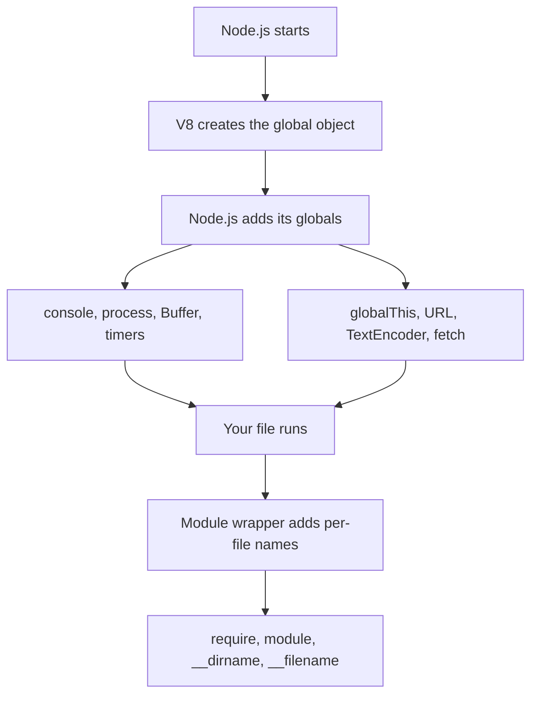

# 05 — Global Objects — Notes

> **Module:** 01 — Node.js Fundamentals
> **Topic:** 05 — Global Objects
> **Priority:** 🟢 Normal
> **Previous topic:** [04 — Event Loop](../04-event-loop/README.md)
> **Next topic:** 06 — Modules and Module Systems *(coming next — folder not created yet)*
>
> **One-line summary:** Global objects are the tools Node.js gives you for free in every file — `console`, `process`, `Buffer`, the timers, `__dirname` — no `require` needed. Know which ones exist, which ones only *look* global, and you stop re-inventing them (and stop being surprised by them).
>
> **How to use these notes:** read [README.md](./README.md) first for the short overview, then work through this file section by section. Run the examples in [`examples/global-objects.js`](./examples/global-objects.js) and compare your output with [`examples/example.txt`](./examples/example.txt). Then do the tasks in [`exercises.md`](./exercises.md).

---

## Table of Contents

- [1. Introduction](#1-introduction)
- [2. Definition of Important Concepts](#2-definition-of-important-concepts)
- [3. Detailed Explanations](#3-detailed-explanations)
- [4. How the Technology Works Internally](#4-how-the-technology-works-internally)
- [5. Architecture or Workflow](#5-architecture-or-workflow)
- [6. Real-World Examples](#6-real-world-examples)
- [7. Code Examples Where Applicable](#7-code-examples-where-applicable)
- [8. Step-by-Step Code Explanations](#8-step-by-step-code-explanations)
- [9. Common Misconceptions](#9-common-misconceptions)
- [10. Important Technical Terminology](#10-important-technical-terminology)
- [11. Summary](#11-summary)
- [12. Interview Questions and Answers](#12-interview-questions-and-answers)
- [13. References](#13-references)

---

## 1. Introduction

A **global object** is something you can use in any file without importing it first. You never write `require('console')` or `require('process')` — they are simply *there*.

```js
// No require at the top. All of this just works:
console.log('hello');
console.log(process.version);
setTimeout(() => console.log('one second later'), 1000);
const buf = Buffer.from('hello');
```

**Why they exist:** every program needs the same few tools — print something, read the environment, work with bytes, schedule work. Instead of making you import them in every file, Node.js puts them on the **global object**, the one object that is visible everywhere.

**Simple way to remember it:**

> **Globals are the furniture that comes with the house.**
> You do not bring `console` or `process` with you — Node.js already put them in every room. Your job is to know what is in the rooms, and not to rearrange the furniture.

This topic matters because globals are the first thing every Node.js program uses, and the first thing that confuses beginners who come from the browser. In a browser, the global object is `window` and it holds `document` and `alert`. In Node.js, there is no `window` and no `document` — instead the global object holds `process`, `Buffer`, and the file and network tools. If you do not know which globals exist in which environment, you will waste time on errors like `window is not defined` or `process is not defined`, and you will re-invent tools Node.js already gave you — for example, splitting a URL by hand instead of using `URL`, or counting characters when you meant bytes instead of using `Buffer`.

By the end of this topic you will be able to: name the main Node.js globals and what each one does; tell a true global apart from a name that only *looks* global (`__dirname`, `__filename`, `require`); use `process` for version, arguments, and configuration; use `Buffer` correctly for bytes versus text; and write code that works in Node.js without accidentally depending on browser globals.

---

## 2. Definition of Important Concepts

| Concept | Definition |
|---------|------------|
| **Global object** | The one object that is visible in every file of a program. In Node.js it is called `global`; the standard, portable name is `globalThis`. Properties of this object can be used without importing them. |
| **Global scope** | The outermost scope. A name that lives on the global object can be read from any file, any function, without an import. `console`, `process`, `Buffer`, and the timers live here. |
| **Module scope** | The scope of one single file in Node.js. Top-level `var`, `let`, and `const` in a file belong to the module scope, visible only in that file — they do **not** reach the global object. |
| **Function scope** | The scope inside a function. Variables declared inside a function are visible only inside that function. |
| **`global`** | Node.js's own name for the global object. It only exists in Node.js. |
| **`globalThis`** | The standard name for the global object (ES2020). It works in Node.js *and* in browsers. In Node.js, `globalThis === global` is `true`. |
| **`console`** | The global object for printing and debugging: `log`, `error`, `warn`, `table`, `time` / `timeEnd`, and more. |
| **`process`** | The global object that describes the running program: its version, platform, arguments, environment variables, and process ID. |
| **`Buffer`** | The global class for holding raw binary data (bytes). Text is characters; files, network data, images, and passwords are bytes — `Buffer` is how Node.js holds them. |
| **Timers** | The global scheduling functions `setTimeout`, `setInterval`, `setImmediate`, and their `clear*` counterparts. |
| **`__dirname`** | The folder the *current file* lives in. **Not a global** — it is given to each file separately by the module wrapper. |
| **`__filename`** | The full path of the *current file*. **Not a global** — same reason as `__dirname`. |
| **`require`, `module`, `exports`** | Names given to each CommonJS file by the module wrapper, for loading and exporting code. **Not globals.** |
| **Module wrapper** | The function Node.js wraps around every CommonJS file before running it: `(function (exports, require, module, __filename, __dirname) { /* your code */ })`. It is what creates module scope and supplies `__dirname`, `require`, and the rest. |
| **UTF-8** | The text encoding Node.js uses by default. An English letter is 1 byte in UTF-8; most other scripts use more — for example, the Urdu word `سلام` is 4 characters but 8 bytes. |
| **Microtask** | A small unit of work that runs after the current synchronous code finishes, before the next timer or I/O callback. Promises and `queueMicrotask` callbacks are microtasks. |
| **FIFO** | First In, First Out — the order the microtask queue runs in: first scheduled, first run. |
| **stderr / stdout** | The two output streams of a program. Normal output goes to stdout (`console.log`); errors and warnings go to stderr (`console.error`, `console.warn`). Production logs are often split by stream. |

### The main globals at a glance

| Global | What it is for | Needs `require`? |
|--------|---------------|------------------|
| `console` | Printing, debugging, timing | No |
| `process` | Info about your program and its environment | No |
| `Buffer` | Working with raw binary data | No |
| `setTimeout`, `setInterval`, `setImmediate` | Scheduling work (see topic 04, Event Loop) | No |
| `__dirname`, `__filename` | Where the current file lives | No — but they are **not** globals (§3.2) |
| `global`, `globalThis` | The global object itself | No |
| `URL`, `TextEncoder`, `fetch` | Modern web-platform tools | No |

---

## 3. Detailed Explanations

### 3.1 `global` and `globalThis`

The global object itself has two names:

- **`global`** — Node.js's own name for it. It only exists in Node.js.
- **`globalThis`** — the standard name (ES2020). It works in Node.js *and* in browsers, so it is the name to use in code that might run in both places.

In Node.js they are the same object:

```js
console.log(globalThis === global); // true
```

**How to check whether something is a global:** look for it on `globalThis`.

```js
console.log(typeof globalThis.setTimeout); // "function"
console.log(typeof globalThis.process);    // "object"
console.log(typeof globalThis.Buffer);     // "function"
console.log(typeof globalThis.console);    // "object"
console.log(typeof window);                // "undefined" — see §3.9
```

**Rule:** if you are writing code that must run in a browser *and* in Node.js, use `globalThis`. If the code is Node.js-only, `global` and `globalThis` both work — pick one and stay consistent.

### 3.2 `__dirname` and `__filename` — Not Globals

Two of the most-used names in Node.js files are **not** globals at all:

- **`__dirname`** — the folder the *current file* lives in.
- **`__filename`** — the full path of the *current file*.

They come from the **module wrapper**: before Node.js runs your file, it wraps your code in a function like this:

```js
(function (exports, require, module, __filename, __dirname) {
  // YOUR CODE RUNS HERE
});
```

That is why `__dirname` is different in every file — each file gets its own wrapper with its own values. And it is why they do **not** exist in ES modules (`import`/`export` files): there is no wrapper there. In an ES module you use `import.meta.url` instead.

```js
// In a CommonJS file:
console.log(__dirname);   // /home/.../05-global-objects/examples
console.log(__filename);  // /home/.../05-global-objects/examples/global-objects.js

// Proof they are not globals:
console.log(globalThis.__dirname);  // undefined
console.log(globalThis.__filename); // undefined
```

**`__dirname` is where the *file* lives. `process.cwd()` is where you *ran* `node` from.** They are equal only when you run Node.js from the file's own folder. The example proves it — Part 2 prints the real paths of the example file itself, and `process.cwd()` next to them:

```text
__dirname:      .../05-global-objects/examples
process.cwd():  .../05-global-objects
```

**The same wrapper also provides** `require`, `module`, and `exports` — none of them are globals either. That is the whole point of topic 06 (Modules): the wrapper is what makes each file its own private scope.

### 3.3 `process` — Your Program Talking About Itself

`process` is the most useful global in backend work. It tells your program about itself and its environment.

| Property / method | What it gives you | Example value (this machine) |
|---|---|---|
| `process.version` | The Node.js version | `v24.22.1` |
| `process.platform` | The operating system | `linux` (`win32` on Windows, `darwin` on macOS) |
| `process.cwd()` | The folder you ran `node` from | The `05-global-objects` folder |
| `process.argv` | Command-line arguments | `[node path, file path, ...your args]` |
| `process.env` | Environment variables | `process.env.NODE_ENV` → `undefined` unless set |
| `process.pid` | Your program's process ID | A number, different every run |
| `process.exit(code)` | Stop the program now | `0` = success, anything else = error |
| `process.stdin` / `stdout` / `stderr` | Input and output streams | Used by CLIs and servers |
| `process.memoryUsage()` | How much memory you are using | An object with `rss`, `heapUsed`, ... |
| `process.uptime()` | Seconds since the program started | A number |

**Three of these come up constantly:**

**`process.argv` — reading command-line arguments.** The first two entries are always the Node.js binary and your file. *Your* arguments start at index 2:

```js
// node app.js --port 3000
console.log(process.argv);
// ['/usr/bin/node', '/path/to/app.js', '--port', '3000']
console.log(process.argv[2]); // '--port'
```

**`process.env` — reading configuration.** This is how servers get secrets and settings without hard-coding them:

```js
const port = process.env.PORT || 3000;       // PORT=4000 node server.js
const dbUrl = process.env.DATABASE_URL;      // never hard-code a password
```

If a variable was never set, you get `undefined` — the example proves it with `process.env.NODE_ENV`. Always provide a fallback (`|| 3000`) so your program still works.

**`process.exit()` — use it rarely.** It stops the program *immediately*, even if a file write or a database query is still in flight. In a server, you almost never call it. In a small script, `process.exit(1)` is how you say "something went wrong".

### 3.4 `console` — More Than `console.log`

`console` is a global object with several methods. `log` is the one everyone knows; the others save real debugging time.

| Method | What it does |
|--------|-------------|
| `console.log(...)` | Print normal output |
| `console.error(...)` | Print to stderr (errors — shows up separately from normal output) |
| `console.warn(...)` | Print a warning (also stderr) |
| `console.info(...)` | Same as `log` in Node.js |
| `console.table(data)` | Print an array/object as a table |
| `console.time(label)` / `console.timeEnd(label)` | Measure how long something takes |
| `console.trace(...)` | Print a stack trace — *where* this line was called from |
| `console.count(label)` | Count how many times a line ran |
| `console.assert(condition, message)` | Print the message only if the condition is false |
| `console.dir(obj, { depth: null })` | Print an object with full nesting (no `[Object]` cut-off) |

The example prints a table instead of two lines of text (Part 3):

```text
┌─────────┬───────────┬───────────┐
│ (index) │ name      │ topic     │
├─────────┼───────────┼───────────┤
│ 0       │ 'Talha'   │ 'Node.js' │
│ 1       │ 'D CODES' │ 'Backend' │
└─────────┴───────────┴───────────┘
```

**Two habits that matter in backend work:**

1. **Use `console.error` for errors, `console.log` for normal output.** In production, logs are often split by stream — errors go to one place, normal output to another. If everything is `console.log`, you cannot tell them apart.
2. **Use `console.time` to measure, not guess.** "This feels slow" is a guess; `console.time('query')` / `console.timeEnd('query')` is a number.

### 3.5 `Buffer` — Raw Bytes, Not Text

JavaScript strings are text. But files, network data, images, and passwords are **bytes** — and bytes are not text. `Buffer` is Node.js's way of holding raw bytes.

```js
const buf = Buffer.from('hello', 'utf8');
console.log(buf.length);              // 5 — one byte per letter
console.log(buf.toString('hex'));     // '68656c6c6f'
console.log(buf.toString('utf8'));    // 'hello' — back to text
```

**The key lesson: characters and bytes are not the same thing.** In UTF-8, an English letter is 1 byte, but most other scripts use more:

```js
const word = 'سلام';
console.log(word.length);                    // 4 characters
console.log(Buffer.from(word).length);       // 8 bytes
```

The example proves it (Part 4):

```text
word: سلام
word.length (characters): 4
buf.length (bytes): 8
buf.toString("utf8"): سلام
Buffer.from("hello").toString("hex"): 68656c6c6f
```

**Why backend developers care:** when you read a file, receive an upload, or hash a password, you are handling bytes. If you treat bytes as text (or text as bytes), multi-byte characters break — a file gets cut in the middle of a character, or a length check counts 8 where the user typed 4. `Buffer` is the tool that keeps the two apart:

- `Buffer.from(string, 'utf8')` — text → bytes.
- `buf.toString('utf8')` — bytes → text.
- `buf.length` — how many **bytes**, not characters.
- `Buffer.alloc(10)` — 10 zero-filled bytes; `Buffer.concat([a, b])` — join two buffers.

`Buffer` is global in Node.js. In browsers it does **not** exist — browser code uses `Uint8Array` instead (§3.9).

### 3.6 Timers Are Globals Too

`setTimeout`, `setInterval`, `setImmediate`, and `clearTimeout` / `clearInterval` / `clearImmediate` are globals — you never import them. Their full behaviour (phases, ordering, blocking) is topic 04; here is the one fact that belongs to *this* topic:

```js
console.log(global.setTimeout === setTimeout);     // true
console.log(global.setImmediate === setImmediate); // true
```

They live on the global object, like `console` and `process`.

**One difference from browsers worth knowing:** in a browser, `setTimeout` returns a **number** (the timer ID). In Node.js it returns a **Timeout object** — which has extra methods, including `.unref()`:

```js
const timer = setTimeout(() => console.log('later'), 60000);
timer.unref(); // "Do not keep the program alive just for me."
// Without unref(), this timer would stop the program exiting for 60 seconds.
```

That is the classic fix for "my script never exits": a forgotten timer (or interval) is keeping the Event Loop alive. `unref()` tells the loop it may exit anyway.

### 3.7 `queueMicrotask`

`queueMicrotask(fn)` schedules `fn` as a **microtask** — it runs after the current synchronous code finishes, before the next timer or I/O callback. It is the global, standard way to say "run this soon, but after the code I am in right now".

```js
setTimeout(() => console.log('3. setTimeout(0)'), 0);
queueMicrotask(() => console.log('1. queueMicrotask'));
Promise.resolve().then(() => console.log('2. Promise.then'));
console.log('0. synchronous code (runs first, always)');
```

The example prints (Part 8):

```text
0. synchronous code (runs first, always)
1. queueMicrotask
2. Promise.then
3. setTimeout(0)
```

**Why `queueMicrotask` runs before the Promise here:** both live in the *same* microtask queue, and that queue runs in **FIFO order** — first scheduled, first run. `queueMicrotask` was scheduled first, so it runs first. (Contrast with topic 04: `process.nextTick` has its *own* higher-priority queue, so it beats Promises even when scheduled later.)

**Why Part 8 is last in the example file:** microtasks only run after **all** synchronous code finishes. If this demo sat in the middle of the file, its output would appear after the later parts — confusing to read. So the demo sits at the end, and the lesson is visible in the file layout itself: *microtasks wait for the whole synchronous run to finish.*

**When to use it:** almost never in everyday code — Promises and `async`/`await` cover the same need. It matters when you are writing a library and need "run this callback asynchronously, but as soon as possible, without creating a Promise".

### 3.8 Other Modern Globals — `URL`, `TextEncoder`, `fetch` and Friends

Node.js keeps adding web-platform globals, so the same code works in browsers and on the server. These are the ones you will actually meet:

| Global | Since | What it does |
|--------|-------|-------------|
| `URL`, `URLSearchParams` | Node 10 | Parse and build links safely |
| `TextEncoder`, `TextDecoder` | Node 11 | Convert text ↔ bytes (UTF-8) |
| `queueMicrotask` | Node 11 | Schedule a microtask (§3.7) |
| `AbortController`, `AbortSignal` | Node 15 | Cancel a `fetch` or a long operation |
| `performance`, `PerformanceObserver` | Node 16 | Measure time precisely |
| `structuredClone` | Node 17 | Deep-copy any value (objects, Dates, Maps) |
| `fetch`, `Request`, `Response`, `Headers` | Node 18 (stable 21/22) | Make HTTP requests without a library |

**`URL` — stop splitting links by hand:**

```js
const url = new URL('https://example.com/users?page=2&limit=10');
url.hostname;                  // 'example.com'
url.pathname;                  // '/users'
url.searchParams.get('page');  // '2'
```

**`TextEncoder` / `TextDecoder` — the standard text ↔ bytes pair** (the same idea as `Buffer`, but portable to browsers):

```js
const encoder = new TextEncoder();
const bytes = encoder.encode('hello');  // Uint8Array [104, 101, 108, 108, 111]
new TextDecoder().decode(bytes);        // 'hello'
```

The example prints (Part 7):

```text
url.hostname: example.com
url.pathname: /users
url.searchParams.get("page"): 2
TextEncoder "hello": 104, 101, 108, 108, 111
TextDecoder back to text: hello
```

**`fetch` — one caution:** it exists as a global in Node 18+, but it is new enough that older tutorials still teach `axios` or `node-fetch`. In a new project on Node 22/24, plain `fetch` is fine. In a project that must run on old Node, it is not — check the version first (`process.version`, §3.3).

### 3.9 Node.js Globals vs Browser Globals

The same JavaScript, two different houses. Some globals exist in both; some exist in only one:

| Global | Node.js | Browser | Notes |
|--------|---------|---------|-------|
| `console`, `setTimeout`, `setInterval` | ✅ | ✅ | Same name, small differences (§3.6) |
| `globalThis`, `URL`, `TextEncoder`, `fetch`, `queueMicrotask` | ✅ | ✅ | The portable set — prefer these |
| `process`, `Buffer`, `__dirname`, `__filename` | ✅ | ❌ | Node.js only |
| `require`, `module`, `exports` | ✅ (CommonJS) | ❌ | Module wrapper, not globals (§3.2) |
| `window`, `document`, `localStorage`, `alert` | ❌ | ✅ | Browser only — `typeof window` is `"undefined"` in Node.js |

The example proves it (Part 1): `typeof window` prints `undefined` in Node.js.

**Why this matters:** code copied from a browser tutorial will break in Node.js the moment it touches `window` or `document`, and server code copied into a browser breaks the moment it touches `process` or `Buffer`. When something is "not defined", the first question is always: *does this global exist in this environment at all?* The table above is the fastest way to answer it.

### 3.10 Module Scope vs Global Scope — The `var` Trap

Here is the mistake almost every beginner makes once:

```js
// In a browser <script> tag, this WOULD be global.
// In a Node.js file, it is NOT:
var myModuleVar = 'I live in this file only';
console.log(globalThis.myModuleVar); // undefined
```

**Why?** In a browser, a top-level `var` in a plain script becomes a property of `window`. In a Node.js file, your code runs inside the module wrapper (§3.2), so a top-level `var` — and `let` and `const` too — belongs to the **module scope**, visible only in that file. It never reaches the global object.

The example proves it (Part 6):

```text
myModuleVar: I live in this file only
globalThis.myModuleVar: undefined
globalThis.myExplicitGlobal: I live everywhere
```

The only way to make something truly global is to put it there explicitly:

```js
globalThis.myExplicitGlobal = 'I live everywhere';
// Now every file can read globalThis.myExplicitGlobal.
```

**Rule:** if two files need the same value, the answer is almost never a global. The answer is `require` — export it from one file, import it in the other. That is topic 06, and it exists precisely because globals are the wrong tool for sharing code.

### 3.11 Adding Your Own Globals — and Why You Should Not

You *can* add globals. You almost always *should not*:

```js
// ❌ Works, but do not do this in real code:
globalThis.db = connectToDatabase();
globalThis.config = { port: 3000 };
```

**Three reasons it backfires:**

1. **Name collisions.** Your `config` and a library's `config` are the same object. One overwrites the other, silently.
2. **Hidden dependencies.** A file that reads `globalThis.db` gives no sign of where `db` comes from. Nobody can tell what the file needs without reading every line — and tests cannot swap in a fake database, because the file never asks for one.
3. **Order dependence.** The global must exist *before* the file that uses it runs. Change the startup order, and the program breaks with "cannot read property of undefined".

**The one legitimate use:** test setup and tiny scripts, where you control the whole program and the convenience is worth it. Even there, prefer passing values explicitly — through function arguments, `require`, or `process.env`.

---

## 4. How the Technology Works Internally

### 4.1 How the global object is created

When Node.js starts, V8 creates the global object, and Node.js adds its own globals to it — `console`, `process`, `Buffer`, the timers, `globalThis`, `URL`, `TextEncoder`, `fetch`, and the rest. Your file runs only after that setup is done, which is why every file can use those names without importing them. There is one global object per Node.js process, shared by every file in that process.

### 4.2 How the module wrapper works

Before Node.js runs a CommonJS file, it wraps the file's code in a function:

```js
(function (exports, require, module, __filename, __dirname) {
  // YOUR CODE RUNS HERE
});
```

That wrapper is the whole mechanism behind this topic:

- It gives each file its own `__filename` and `__dirname` — that is why those values are different in every file.
- It gives each file its own `require`, `module`, and `exports` — that is why one file's `require` does not leak into another file.
- It creates module scope: a top-level `var`, `let`, or `const` inside the wrapper is a local variable of that wrapper function, not a property of the global object. That is why `globalThis.myModuleVar` is `undefined` in the example.
- It does **not** exist in ES modules. An ES module file (`import`/`export`) has no wrapper, so `__dirname`, `__filename`, and `require` do not exist there at all; `import.meta.url` is used instead of `__filename`.

### 4.3 How `process` and `process.env` work

`process` is not a plain data object that Node.js fills in once. It is a live view of the running program: `process.version` and `process.platform` describe the runtime that started the program; `process.argv` is the command line that started it (binary, then file, then your arguments from index 2); `process.env` is the environment the operating system handed to the program at startup — a change to `process.env` in your code changes it for code that reads it later, but it does not change the operating system's environment. An environment variable that was never set reads as `undefined`, which is why configuration code must always provide a fallback.

### 4.4 How `Buffer` and UTF-8 work

A JavaScript string is a sequence of characters; a `Buffer` is a sequence of bytes. Converting between them is an encoding step, and Node.js uses UTF-8 by default. In UTF-8, an English letter encodes to 1 byte, while characters from other scripts encode to 2, 3, or 4 bytes — so `سلام` (4 characters) encodes to 8 bytes, and an emoji encodes to 4 bytes. `Buffer.from(word, 'utf8')` performs that encoding and `buf.toString('utf8')` reverses it. `buf.length` counts bytes, `word.length` counts characters, and the two numbers agree only for pure ASCII text. That is why byte-length checks, file reads, and hashing must use `Buffer` (or `TextEncoder`, which produces a `Uint8Array` of the same bytes) instead of `string.length`.

### 4.5 How microtasks are ordered

`queueMicrotask` and Promise callbacks live in the same microtask queue, and that queue runs in FIFO order — first scheduled, first run. The queue is drained after the current synchronous code finishes and before the next timer or I/O callback runs. That is why, in the example, `queueMicrotask` (scheduled first) prints before `Promise.then` (scheduled second), and both print before `setTimeout(0)`. `process.nextTick` is different: it has its own higher-priority queue that is drained before the microtask queue, so it beats Promises even when scheduled later (see topic 04, Event Loop, for the full ordering).

### 4.6 How timers keep a program alive

A timer created with `setTimeout` or `setInterval` keeps the Event Loop alive until it fires or is cleared — Node.js will not exit while a timer is pending. In Node.js the timer is a Timeout object, not a number as in browsers, and that object has an `.unref()` method: calling it tells the Event Loop "do not keep the program alive just for me". A forgotten timer is the classic reason a script "never exits".

---

## 5. Architecture or Workflow

### Diagram 1: Three Scopes in a Node.js File

```text
┌─────────────────────────────────────────────────────────┐
│  GLOBAL SCOPE                                           │
│  console, process, Buffer, setTimeout, globalThis...    │
│  visible in EVERY file, no import needed                │
│                                                         │
│   ┌─────────────────────────────────────────────────┐   │
│   │  MODULE SCOPE (this file only)                  │   │
│   │  require, module, exports, __dirname,           │   │
│   │  __filename, and your top-level var/let/const   │   │
│   │                                                 │   │
│   │   ┌─────────────────────────────────────────┐   │   │
│   │   │  FUNCTION SCOPE                         │   │   │
│   │   │  variables inside your functions        │   │   │
│   └─────────────────────────────────────────┘   │   │
│   └─────────────────────────────────────────────────┘   │
└─────────────────────────────────────────────────────────┘
```

**Explanation:** the diagram shows three nested scopes. The outermost box is the global scope — the names every file shares. Inside it, each file has its own module scope, which holds the wrapper names (`require`, `__dirname`) and that file's own top-level declarations. Inside that, each function has its own function scope. A name is visible only inside its own box and the boxes nested inside it — never outside it. That nesting is why a top-level `var` never reaches the global object.

### Diagram 2: Where Globals Come From (Mermaid — renders on GitHub)



**Explanation:** Node.js starts, V8 creates the global object, and Node.js fills it with its globals. Only then does your file run. The module wrapper then adds the per-file names — `require`, `module`, `__dirname`, `__filename` — separately for each file. So there are two different kinds of "available everywhere" names: true globals, which live on the global object and are the same in every file, and module names, which are given to each file separately by the wrapper and only *look* global.

### Workflow: what happens when a program uses a global

```text
1. Node.js starts
   → V8 creates the global object
   → Node.js adds console, process, Buffer, timers, ...
2. Your file is loaded
   → the module wrapper adds require, module, __dirname, __filename
   → your code runs inside the wrapper
3. Your code reads a global, e.g. process.env.PORT
   → the name is found on the global object — no import needed
4. Your code reads __dirname
   → the name is found on the wrapper function — different in every file
5. Your code schedules work, e.g. setTimeout / queueMicrotask
   → the timer / microtask is registered with the Event Loop (topic 04)
   → it runs later, after the current synchronous code finishes
```


## 6. Real-World Examples

**Reading configuration in a server.** A real server never hard-codes its port or database address. It reads them from the environment, with a fallback for anything optional and a hard failure for anything required:

```js
const port = process.env.PORT || 3000;
const dbUrl = process.env.DATABASE_URL;
if (!dbUrl) {
  console.error('DATABASE_URL is not set');
  process.exit(1);
}
```

That is the config-loader pattern in [`exercises.md`](./exercises.md), Exercise 5.

**Handling bytes in a file upload or a password hash.** When a user uploads a file or you hash a password, you are handling bytes, not text. Checking `string.length` on a name with Urdu characters or an emoji gives the wrong size; `Buffer.byteLength` / `Buffer.from(...).length` gives the right one. Cutting a buffer in the middle of a multi-byte character corrupts the text — `Buffer` (and `TextDecoder`) are what keep the conversion safe.

**Logging that stays readable in production.** A server that prints everything with `console.log` mixes errors and normal output into one stream. Using `console.error` for errors and `console.log` for normal output keeps the two streams separate, so production logs can be split, filtered, and searched. `console.time` / `console.timeEnd` turns "this feels slow" into a measured number for a database query or an API call.

**Parsing links safely.** An API that receives a link should never split it with `split('/')` or `split('?')` by hand — query values can contain those characters. `new URL(link)` and `url.searchParams.get('page')` parse the link correctly every time.

**A timer that stops a script exiting.** A script that creates a 60-second `setTimeout` will not exit for 60 seconds, even if all its real work is done. Calling `.unref()` on the timer tells the Event Loop it may exit anyway — the fix for the classic "my script never exits" problem.

**Sharing values between files — the wrong way and the right way.** Putting a database connection on `globalThis.db` works at first, then breaks when a library uses the same name, when a test cannot swap in a fake database, or when the startup order changes. The right way is `require`: export the connection from one file and import it where it is needed (topic 06).

---

## 7. Code Examples Where Applicable

**Using globals with no import:**

```js
console.log('hello');
console.log(process.version);
setTimeout(() => console.log('one second later'), 1000);
const buf = Buffer.from('hello');
```

**Checking what is global:**

```js
console.log(globalThis === global); // true
console.log(typeof globalThis.process); // "object"
console.log(typeof window); // "undefined"
```

**`__dirname` is not a global:**

```js
console.log(__dirname); // the folder this file lives in
console.log(globalThis.__dirname); // undefined
```

**Reading command-line arguments and configuration:**

```js
// node app.js --port 3000
console.log(process.argv[2]); // '--port'
const port = process.env.PORT || 3000;
```

**`Buffer` — characters are not bytes:**

```js
const word = 'سلام';
console.log(word.length); // 4 characters
console.log(Buffer.from(word).length); // 8 bytes
console.log(Buffer.from('hello').toString('hex')); // '68656c6c6f'
```

**The module-scope trap:**

```js
var myModuleVar = 'I live in this file only';
console.log(globalThis.myModuleVar); // undefined
globalThis.myExplicitGlobal = 'I live everywhere';
```

**Parsing a link and converting text to bytes:**

```js
const url = new URL('https://example.com/users?page=2&limit=10');
url.searchParams.get('page'); // '2'
new TextEncoder().encode('hello'); // Uint8Array [104, 101, 108, 108, 111]
```

**Microtask ordering:**

```js
setTimeout(() => console.log('3. setTimeout(0)'), 0);
queueMicrotask(() => console.log('1. queueMicrotask'));
Promise.resolve().then(() => console.log('2. Promise.then'));
console.log('0. synchronous code (runs first, always)');
// Output: 0, 1, 2, 3
```

**A timer that does not keep the program alive:**

```js
const timer = setTimeout(() => console.log('later'), 60000);
timer.unref();
```

The full runnable versions of these examples are in [`examples/global-objects.js`](./examples/global-objects.js), with real output in [`examples/example.txt`](./examples/example.txt).

---

## 8. Step-by-Step Code Explanations

Run the example:

```bash
node examples/global-objects.js
```

Expected output is saved in [`examples/example.txt`](./examples/example.txt). Paths will differ on your machine — the *values* and the `true`/`false` results are what matter.

### What the file proves (in order)

**Part 1 — `globalThis`, `global`, and (no) `window`:**

```js
console.log(globalThis === global);        // true
console.log(typeof window);                // "undefined"
console.log(typeof globalThis.process);     // "object"
```

One object, two names — and no browser globals in Node.js.

**Part 2 — `__dirname`, `__filename`, and `process`:**

```js
console.log(__dirname);            // the examples/ folder
console.log(process.cwd());        // the 05-global-objects folder — different!
console.log(process.argv[0]);      // the node binary
console.log(process.env.NODE_ENV); // undefined — never set
```

Where the file lives is not where you ran Node.js from. That distinction is an interview favourite.

**Part 3 — `console` is more than `console.log`:**

```js
console.table([
  { name: 'Talha', topic: 'Node.js' },
  { name: 'D CODES', topic: 'Backend' },
]);
```

A table, printed with one call.

**Part 4 — `Buffer`: characters are not bytes:**

```js
const word = 'سلام';
Buffer.from(word, 'utf8').length; // 8 bytes for 4 characters
Buffer.from('hello').toString('hex'); // '68656c6c6f'
```

**Part 5 — Timers and `console` are globals:**

```js
global.setTimeout === setTimeout; // true — no require needed
global.Buffer === Buffer;         // true
```

**Part 6 — The module-scope trap:**

```js
var myModuleVar = 'I live in this file only';
globalThis.myModuleVar; // undefined — var stayed in the module
```

**Part 7 — `URL` and text encoding:**

```js
new URL('https://example.com/users?page=2&limit=10').searchParams.get('page'); // '2'
new TextEncoder().encode('hello'); // Uint8Array [104, 101, 108, 108, 111]
```

**Part 8 — `queueMicrotask` order (last in the file, on purpose):**

```js
setTimeout(() => console.log('  3. setTimeout(0)'), 0);
queueMicrotask(() => console.log('  1. queueMicrotask'));
Promise.resolve().then(() => console.log('  2. Promise.then'));
console.log('  0. synchronous code (runs first, always)');
```

Output: `0`, `1`, `2`, `3`. Microtasks (FIFO) run before the timer — and only after all synchronous code in the file has finished.

### Important lines explained

| Line / idea | Why it matters |
|-------------|---------------|
| `globalThis === global` | One object, two names — `globalThis` is the portable one. |
| `typeof window` → `"undefined"` | Browser globals do not exist in Node.js. |
| `__dirname` vs `process.cwd()` | File location vs run location — different things. |
| `process.argv[0]`, `[1]` | Node binary, then your file — your own args start at `[2]`. |
| `process.env.NODE_ENV` → `undefined` | Unset variables are `undefined` — always give a fallback. |
| `Buffer.from(word).length` → `8` | Bytes, not characters — the UTF-8 lesson in one number. |
| `global.setTimeout === setTimeout` | Timers live on the global object, like everything in this topic. |
| `globalThis.myModuleVar` → `undefined` | Top-level `var` is module-scoped, not global — the trap. |
| `queueMicrotask` before `Promise.then` | Same microtask queue, FIFO order — scheduled first, runs first. |
| `url.searchParams.get('page')` | Parse links with `URL`, never by splitting strings by hand. |

---

## 9. Common Misconceptions

- ❌ **"`__dirname` and `require` are globals."**
  ✅ They come from the **module wrapper** — per-file values, not globals. `globalThis.__dirname` is `undefined`. (In ES modules they do not exist at all.)

- ❌ **"A top-level `var` in a Node.js file is global, like in the browser."**
  ✅ In a Node.js file it is **module-scoped**. `globalThis.myVar` is `undefined` — the example proves it.

- ❌ **"`window` works in Node.js."**
  ✅ `typeof window` is `"undefined"`. Browser globals do not exist on the server.

- ❌ **"`string.length` tells me how big my data is."**
  ✅ It counts **characters**. `'سلام'.length` is 4, but the data is 8 bytes. Use `Buffer.byteLength` / `Buffer.from(...).length` for size.

- ❌ **"`process.env.PORT` is always set."**
  ✅ Unset variables are `undefined`. Always write `process.env.PORT || 3000`.

- ❌ **"Adding things to `global` is a fine way to share them between files."**
  ✅ It creates hidden dependencies, name collisions, and order dependence. Share with `require` instead (topic 06).

- ❌ **"`setTimeout` returns a number, like in the browser."**
  ✅ In Node.js it returns a **Timeout object** — with `.unref()`, which is how you stop a timer keeping the program alive.

- ❌ **"`queueMicrotask` always runs before a Promise."**
  ✅ They share one microtask queue, in **FIFO order**. `queueMicrotask` only wins if it was scheduled first. `process.nextTick` is the one with its own higher-priority queue (topic 04).

---

## 10. Important Technical Terminology

| Term | Meaning in one line |
|------|---------------------|
| Global object | The one object visible in every file; in Node.js it is `global`, portably `globalThis`. |
| Global scope | The outermost scope — names on the global object, usable in any file without an import. |
| Module scope | The scope of one file; its top-level `var`/`let`/`const` stay in that file. |
| Function scope | The scope inside a function; variables declared there stay there. |
| Module wrapper | The function Node.js wraps around a CommonJS file, supplying `exports`, `require`, `module`, `__filename`, `__dirname`. |
| `globalThis` | The standard (ES2020) name for the global object, working in browsers and Node.js. |
| `process` | The global describing the running program — version, platform, arguments, environment. |
| `process.env` | The environment variables handed to the program at startup; unset ones read as `undefined`. |
| `process.argv` | The command line: `[node binary, your file, ...your arguments]`. |
| `Buffer` | The global class for raw bytes; `Buffer.from(text)` encodes text to bytes. |
| UTF-8 | The default text encoding; English letters are 1 byte, other scripts use more. |
| Microtask | Work that runs after the current synchronous code, before the next timer or I/O callback. |
| FIFO | First In, First Out — the microtask queue runs in the order work was scheduled. |
| stderr / stdout | The error stream (`console.error`) and the normal output stream (`console.log`). |
| Timeout object | What `setTimeout` returns in Node.js (a number in browsers); it has `.unref()`. |
| `.unref()` | Tells the Event Loop a timer may not keep the program alive. |
| `URL` / `URLSearchParams` | Globals for parsing and building links safely. |
| `TextEncoder` / `TextDecoder` | Globals for converting text ↔ bytes (UTF-8), portable to browsers. |
| `structuredClone` | A global for deep-copying a value (objects, Dates, Maps). |
| `fetch` | The global for making HTTP requests without a library (Node 18+, stable 21/22). |

---

## 11. Summary

```text
┌─────────────────────────────────────────────────────┐
│  GLOBAL SCOPE (every file, no import)               │
│  console · process · Buffer · timers · globalThis   │
│  URL · TextEncoder · fetch · queueMicrotask         │
├─────────────────────────────────────────────────────┤
│  MODULE SCOPE (this file only)                      │
│  require · module · exports                         │
│  __dirname · __filename — NOT globals               │
│  your top-level var / let / const — NOT global      │
├─────────────────────────────────────────────────────┤
│  BROWSER ≠ NODE                                     │
│  window / document exist only in browsers           │
│  process / Buffer exist only in Node.js             │
│  globalThis / URL / fetch exist in both             │
├─────────────────────────────────────────────────────┤
│  BYTES ≠ CHARACTERS                                 │
│  'سلام' is 4 characters, 8 bytes — use Buffer       │
├─────────────────────────────────────────────────────┤
│  THE GOLDEN RULE                                    │
│  use the globals Node.js gives you —                │
│  and do not add your own                            │
└─────────────────────────────────────────────────────┘
```

**If you remember only three sentences:**

1. **`globalThis` is the global object; `console`, `process`, `Buffer`, and the timers live on it — no `require` needed.**
2. **`__dirname`, `__filename`, and `require` are not globals — they come from the module wrapper, one per file; and a top-level `var` stays in its file.**
3. **Characters are not bytes — `'سلام'` is 4 characters and 8 bytes — and config comes from `process.env`, always with a fallback.**

**Writing global-friendly code — seven habits:**

1. **Use `globalThis`, not `global`, in shared code.** It works in browsers and in Node.js; `global` works only in Node.js.
2. **Use `__dirname` for file paths, `process.cwd()` for run paths.** If your code opens a file next to itself, `__dirname` is correct. If it opens a file the *user* pointed at, `process.cwd()` is correct. Mixing them up is a classic bug that only appears on someone else's machine.
3. **Read config from `process.env`, with a fallback.** `process.env.PORT || 3000` — never hard-code a port, a password, or a database address.
4. **Use `console.error` for errors.** It keeps error output separate from normal output, which is how production logs stay readable.
5. **Use `Buffer` (or `TextEncoder`) when you mean bytes.** If you are counting length, hashing, or sending data over a network, think in bytes — `string.length` will lie to you about non-English text.
6. **Do not add your own globals.** Share values with `require`/`module.exports` (topic 06), not with `globalThis`.
7. **Check `process.version` before using a new global.** `fetch` needs Node 18+, `structuredClone` needs 17+. If your project must run on older Node, the global simply is not there.

None of this matters for a script that runs once and exits. It matters the first time code moves between files, machines, or environments — which is every real backend project.

---

## 12. Interview Questions and Answers

Practice answering these out loud, in your own words first — then check yourself against the short answers below. Never start with a memorized paragraph: start with the one-line definition, then the proof from `global-objects.js`.

1. **What is a global object in Node.js? Name five, without looking.**
   *Answer:* A name you can use in any file without importing it, because it lives on the global object — for example `console`, `process`, `Buffer`, `setTimeout`, and `globalThis`.

2. **What is the difference between `global` and `globalThis`? Which one should you use, and why?**
   *Answer:* They are the same object in Node.js (`globalThis === global` is `true`), but `global` exists only in Node.js while `globalThis` is the standard name that also works in browsers — so use `globalThis` in shared code.

3. **Is `__dirname` a global? Prove your answer, and explain where it actually comes from.**
   *Answer:* No — `globalThis.__dirname` is `undefined`. It comes from the module wrapper, which gives each CommonJS file its own `__dirname` (the folder that file lives in).

4. **What is the difference between `__dirname` and `process.cwd()`? When would they be different?**
   *Answer:* `__dirname` is where the file lives; `process.cwd()` is where you ran `node` from. They differ whenever you run a file from a different folder than the one it sits in.

5. **What is `process.argv`? Which index do *your* arguments start at, and why?**
   *Answer:* `process.argv` is the command line as an array: index 0 is the Node.js binary and index 1 is your file, so your own arguments start at index 2.

6. **How do you read configuration (like a port number) in Node.js, and what do you do when the variable is not set?**
   *Answer:* Read it from `process.env`, for example `process.env.PORT || 3000` — an unset variable is `undefined`, so always give a fallback (except for a required secret, where missing should stop the program).

7. **What is a `Buffer`? Why is `'سلام'.length` 4 but its byte length 8?**
   *Answer:* A `Buffer` holds raw bytes, not text. In UTF-8 each Urdu character takes 2 bytes, so the 4-character word `سلام` is 8 bytes — characters and bytes are not the same thing.

8. **Why is a top-level `var` in a Node.js file not global, when the same `var` in a browser script is?**
   *Answer:* A Node.js file runs inside the module wrapper, so its top-level `var` belongs to the module scope of that file; in a browser a top-level `var` in a plain script becomes a property of `window`.

9. **What does `setTimeout` return in Node.js, and how is that different from a browser? What is `.unref()` for?**
   *Answer:* In Node.js it returns a Timeout object (a number in browsers). `.unref()` tells the Event Loop not to keep the program alive just for that timer.

10. **What is `queueMicrotask`, and how does its ordering relate to Promises and `process.nextTick`?**
    *Answer:* It schedules a microtask, which runs after the current synchronous code and before the next timer. It shares one FIFO queue with Promises, so it only runs first if scheduled first; `process.nextTick` has its own higher-priority queue.

11. **Name three globals that exist in Node.js but not in browsers, and three that exist in browsers but not in Node.js.**
    *Answer:* Node.js only: `process`, `Buffer`, and `__dirname` (a module name, not a true global). Browser only: `window`, `document`, and `localStorage` (or `alert`).

12. **Why should you not put your database connection on `globalThis`? What should you do instead?**
    *Answer:* It creates name collisions, hidden dependencies, and order dependence — a file using it gives no sign of where it came from. Export it from one file and `require` it where it is needed instead.

---

## 13. References

- Node.js documentation — Globals: https://nodejs.org/docs/latest/api/globals.html
- Node.js documentation — `process`: https://nodejs.org/docs/latest/api/process.html
- Node.js documentation — `Buffer`: https://nodejs.org/docs/latest/api/buffer.html
- Node.js documentation — `console`: https://nodejs.org/docs/latest/api/console.html
- Node.js documentation — Timers: https://nodejs.org/docs/latest/api/timers.html
- Node.js documentation — `URL`: https://nodejs.org/docs/latest/api/url.html
- MDN — `globalThis`: https://developer.mozilla.org/en-US/docs/Web/JavaScript/Reference/Global_Objects/globalThis
- MDN — `TextEncoder` / `TextDecoder`: https://developer.mozilla.org/en-US/docs/Web/API/TextEncoder
- Previous topic in this module: [04 — Event Loop](../04-event-loop/README.md) — timers, microtasks, and `process.nextTick` in full.
- Next topic in this module: 06 — Modules and Module Systems *(coming next — folder not created yet)*.
- Root README of this repository: [Root README](../../README.md).

---

## Files in This Folder

```text
05-global-objects/
├── README.md                  # Short lesson overview — start here
├── notes.md                   # This file — full detailed notes
├── exercises.md               # 5 practice tasks (no solutions)
└── examples/
    ├── global-objects.js      # Runnable demo: globals, process, Buffer, scope trap
    └── example.txt            # Expected output of global-objects.js (Node v24.22.1)
```

**How to run:**

```bash
node examples/global-objects.js
```
