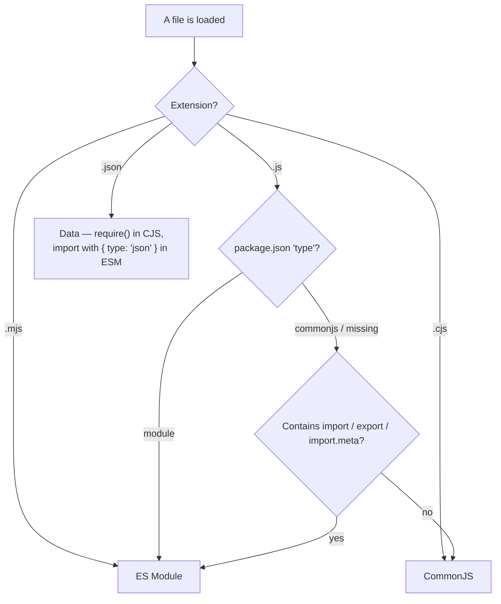

# 07 — CommonJS and ES Modules — Notes

> **Module:** 01 — Node.js Fundamentals
> **Topic:** 07 — CommonJS and ES Modules
> **Priority:** 🔴 High
> **Previous topic:** [06 — Modules and Module Systems](../06-modules/README.md)
> **Next topic:** 08 — NPM and Package Management *(coming next — folder not created yet)*
>
> **One-line summary:** Node.js has two module systems — CommonJS (`require` / `module.exports`, synchronous, the original Node.js way) and ES Modules (`import` / `export`, asynchronous, the JavaScript standard). They can live in the same project and even load each other, but only if you know which file is which — and that is decided by the file extension and `package.json`, not by the code inside.
>
> **How to use these notes:** read [README.md](./README.md) first for the short overview, then work through this file section by section. Run the examples in [`examples/demo-cjs.cjs`](./examples/demo-cjs.cjs) and [`examples/demo-esm.mjs`](./examples/demo-esm.mjs) and compare your output with [`examples/example.txt`](./examples/example.txt). Then do the tasks in [`exercises.md`](./exercises.md).

---

## Table of Contents

- [1. Introduction](#1-introduction)
- [2. Definition of Important Concepts](#2-definition-of-important-concepts)
- [3. Detailed Explanations](#3-detailed-explanations)
- [4. How the Technology Works Internally](#4-how-the-technology-works-internally)
- [5. Architecture or Workflow](#5-architecture-or-workflow)
- [6. Real-World Examples](#6-real-world-examples)
- [7. Code Examples Where Applicable](#7-code-examples-where-applicable)
- [8. Step-by-Step Code Explanations](#8-step-by-step-code-explanations)
- [9. Common Misconceptions](#9-common-misconceptions)
- [10. Important Technical Terminology](#10-important-technical-terminology)
- [11. Summary](#11-summary)
- [12. Interview Questions and Answers](#12-interview-questions-and-answers)
- [13. References](#13-references)

---

## 1. Introduction

Topic 06 taught you what a module is and how `require()` and `module.exports` share code between files. But that was only **one** of the two module systems Node.js has. The other one — ES Modules — is the system the whole JavaScript language uses, in browsers and in Node.js alike. This topic is the comparison: what each system is, how Node.js decides which one a file uses, and how they work together.

**Why are there two systems at all?** A short history makes it obvious:

- **2009 — CommonJS is born with Node.js.** JavaScript had no module system at all back then — the language simply did not have one. Node.js needed a way to split server code into files, so it invented its own: `require()` to load, `module.exports` to share. It was designed for servers: simple, synchronous, and it just worked.
- **2015 — ES Modules arrive in the language.** ECMAScript 2015 (ES6) finally added a module system to JavaScript itself: `import` and `export`. Browsers adopted it. It was designed for the whole language, not just Node.js, so it works everywhere JavaScript runs.
- **Today — Node.js supports both.** Every `.js` file in Node.js is one system or the other, and a project can mix them. That is powerful, and it is also the source of the most confusing beginner errors in Node.js: `require is not defined`, `Cannot use import statement outside a module`, `ERR_REQUIRE_ESM`. Every one of those errors means the same thing — a file is being read as the wrong system.

**Simple way to remember it:**

> **CommonJS is Node.js's own system. ES Modules is JavaScript's system. Node.js speaks both — but each file speaks only one, and the file's extension and `package.json` decide which.**

By the end of this topic you will be able to: explain both systems and why two exist; say, for any file, whether Node.js treats it as CommonJS or ES Modules, and why; convert a module from one system to the other; load a CommonJS module from ESM and an ES Module from CommonJS; explain live bindings, top-level await, and the `__dirname` replacement; and choose the right system for a new project.

---

## 2. Definition of Important Concepts

| Concept | Definition |
|---|---|
| **CommonJS (CJS)** | The module system Node.js started with (2009) and still uses by default: `require()` to load, `module.exports` to share. Synchronous — `require()` returns the value immediately. |
| **ES Modules (ESM)** | The standard JavaScript module system (ES2015): `import` to load, `export` to share. Asynchronous loading, static (known before the code runs), and the same system browsers use. |
| **`require()`** | The CommonJS loader. `require('./math.cjs')` runs that file and returns its `module.exports`. Only exists in CommonJS files. |
| **`module.exports`** | The value a CommonJS module shares. Whatever you assign to it is what `require()` returns. |
| **`import`** | The ES Modules loader. `import { add } from './math.mjs'` loads the named export `add`. Static — it must be at the top level of the file, and it is read before any code runs. |
| **`export`** | How an ES Module shares code. `export function add() {}` (named export) or `export default ...` (one default export per file). |
| **Named export** | An export with a name: `export const PI = 3.14`. Imported by that exact name: `import { PI } from './math.mjs'`. A file can have many. |
| **Default export** | The one "main thing" a module offers: `export default { ... }`. Imported under any name you like: `import maths from './math.mjs'`. A file can have only one. |
| **Live binding** | How ESM named imports work: the import is a live link to the exporting module's variable, not a copy. If the exporter changes the value, importers see the new value. |
| **Top-level await** | Using `await` at the top level of a file, with no `async` function around it. Works in ES Modules only — it is a SyntaxError in CommonJS. |
| **`"type"` field** | The field in `package.json` that decides what `.js` files mean: `"type": "commonjs"` (the default — `.js` is CommonJS) or `"type": "module"` (`.js` is ESM). |
| **`.mjs` / `.cjs`** | Explicit extensions that override `package.json`: `.mjs` is always an ES Module, `.cjs` is always CommonJS, whatever `"type"` says. Use them when a file must be one system for sure. |
| **`import.meta`** | An object available in ES Modules only, describing the current module. `import.meta.url` is the file's URL — the starting point for rebuilding `__dirname` in ESM. |
| **`createRequire`** | A helper from `node:module` that builds a `require()` function you can use inside an ES Module — for old libraries that only work with `require()`. |
| **Interop** | Short for interoperability: the rules for one system loading the other — `import` of a CommonJS module, `require()` / `import()` of an ES Module. |
| **Dual package** | A published npm package that ships both systems, so CommonJS users `require()` it and ESM users `import` it. Controlled by the `"exports"` field in its `package.json`. |
| **Syntax detection** | Since Node.js 22.7, Node.js can look at a `.js` file's syntax and guess its system: a file containing `import` / `export` / `import.meta` is treated as ESM even with no `"type": "module"`. It is a fallback, not a rule to rely on — explicit extensions and `"type"` are the reliable way. |
| **Static analysis (cjs-module-lexer)** | The trick Node.js uses to find named exports in a CommonJS file: it reads the file's text (without running it) and looks for patterns like `exports.add = ...` or `module.exports = { add, ... }`. If it cannot see the name statically, the named import fails. |

---

## 3. Detailed Explanations

### 3.1 CommonJS — the system you already know

CommonJS is topic 06 in one paragraph: every file is a module, you load with `require()`, you share with `module.exports`, and `require()` caches the result. The two properties that matter for this comparison are:

1. **It is synchronous.** `const math = require('./math.cjs')` stops and waits — the file runs, and the very next line already has the value. That is fine on a server at startup, and it is why `require()` can sit anywhere in a file, even inside an `if`.
2. **It is dynamic.** Because `require()` is an ordinary function call, you can build the path at runtime: `require('./lang/' + language + '.cjs')`. The loader only knows what you asked for when that line actually runs.

CommonJS files can use `require`, `module`, `exports`, `__filename`, and `__dirname` — all five come from the module wrapper (topic 06 §4). They cannot use `import`, `export`, or `import.meta` — those are ESM syntax and are a SyntaxError in a CommonJS file.

### 3.2 ES Modules — the standard system

ES Modules look similar at a glance, but the mechanics are different in four ways:

```js
// esm-math.mjs — named exports and one default export
export const PI = 3.14159;
export function add(a, b) { return a + b; }
export default { name: 'esm-math' };
```

```js
// demo-esm.mjs — importing them
import { add, PI } from './esm-math.mjs';   // named imports, exact names
import esmDefault from './esm-math.mjs';    // default import, any name you like
```

1. **Imports are static.** An `import` must be at the top level of the file — not inside a function or an `if`. Node.js reads all imports before running a single line of your code, so it knows the whole dependency graph up front. That is what lets tools tree-shake (drop unused exports) and what makes circular imports behave differently from CommonJS (see §3.14).
2. **Loading is asynchronous.** An ES Module can wait for its dependencies without blocking the thread, and an `import` can be deferred. You feel this most directly as top-level await (§3.8).
3. **Exports are live bindings, not copies.** See §3.6 — this is the single most surprising difference.
4. **ES Modules are always strict mode.** `"use strict"` is on whether you write it or not. That means, among other things, an undeclared variable is an error instead of silently becoming a global, and `this` at the top level is `undefined` (in CommonJS it is `module.exports`).

### 3.3 How Node.js decides which system a file is

This is the section that prevents the confusing errors. Node.js decides **before** it reads your code, using exactly three things, in this order:

| File | Nearest `package.json` `"type"` | System |
|---|---|---|
| `math.mjs` | anything | **ES Module** — `.mjs` always wins |
| `math.cjs` | anything | **CommonJS** — `.cjs` always wins |
| `math.js` | `"module"` | **ES Module** |
| `math.js` | `"commonjs"` or missing | **CommonJS** (the default) |
| `math.js` | missing, but contains `import` / `export` / `import.meta` | **ES Module** — syntax detection (Node.js 22.7+) |
| `math.json` | anything | **CommonJS-style data** — loaded with `require()`; ESM needs `import ... with { type: 'json' }` (see §3.10) |

Three practical consequences:

- **The error messages are the diagnosis.** `require is not defined` means the file is ESM and you used `require()`. `Cannot use import statement outside a module` means the file is CommonJS and you used `import`. Fix the file's system (rename it, or set `"type"`), not the line — the line is fine, the file is in the wrong system.
- **Use explicit extensions when a file must be one system.** The examples in this topic use `.cjs` and `.mjs` on purpose: they work in any project, whatever that project's `package.json` says. In a real project you would usually pick one system for the whole project (via `"type"`) and write plain `.js` files.
- **Syntax detection is a safety net, not a plan.** Node.js 22.7+ guesses ESM when a `.js` file contains ESM syntax, which is why a file with `import.meta` in it runs as ESM even without `"type": "module"`. Do not rely on it — if a teammate (or an older Node.js) reads the file without detection, it breaks. Say what you mean with the extension or `"type"`.

### 3.4 `import` vs `require` — side by side

| | CommonJS | ES Modules |
|---|---|---|
| Load | `const math = require('./math.cjs')` | `import math from './math.mjs'` / `import { add } from './math.mjs'` |
| Share | `module.exports = { add }` | `export function add() {}` / `export default ...` |
| When it loads | At the line, when it runs (synchronous) | Before any code runs (static), then evaluated |
| Where it can sit | Anywhere — top level, function, `if` | Top level only (use `import()` for anywhere else) |
| File extension | `.cjs`, or `.js` with `"type": "commonjs"` (default) | `.mjs`, or `.js` with `"type": "module"` |
| `this` at top level | `module.exports` | `undefined` |
| Strict mode | Only if you write `"use strict"` | Always on |
| Top-level await | No — SyntaxError | Yes |
| `__dirname` / `__filename` | Yes, from the wrapper | No — rebuild from `import.meta.url` (§3.9) |
| `require` / `module` / `exports` | Yes | No — use `createRequire` if you must (§3.11) |

### 3.5 Default exports vs named exports

This distinction only exists in ESM, and it causes half of all import confusion:

- **Named exports** — there can be many, and the importer must use the exact name (or rename it with `as`): `import { add as sum } from './esm-math.mjs'`. If you misspell the name, the import is `undefined` — or, with some bundlers, an error at build time.
- **Default export** — there can be only one per file, and the importer can call it anything: `import maths from './esm-math.mjs'` and `import whatever from './esm-math.mjs'` both get the same value. That freedom is also its weakness: nothing checks that you picked a sensible name, and refactoring tools cannot follow it as reliably.

**Rule of thumb:** prefer named exports for libraries and shared helpers — they are explicit, searchable, and tree-shakeable. Use a default export only when a module really has one main thing (a class, a component, a single function), the way `esm-math.mjs` exports its `{ name, description }` object as the "about this module" value.

### 3.6 Live bindings vs copies — the difference that surprises everyone

In CommonJS, `require()` returns a **value**. In ESM, `import` creates a **live link** to the exporter's variable. The demo proves it:

```js
// esm-math.mjs
export let count = 0;
export function increment() { count += 1; return count; }
```

```js
// demo-esm.mjs
import { count, increment } from './esm-math.mjs';
console.log(count);   // 0
increment();
increment();
console.log(count);   // 2 — the import followed the change
```

The importer never re-imports anything. `count` in `demo-esm.mjs` is the same variable as `count` in `esm-math.mjs` — when `increment()` changes it, every importer sees the new value. Two consequences:

1. **An imported binding is read-only from the importer's side.** `count = 5` in `demo-esm.mjs` is a SyntaxError (in strict mode, an assignment to an imported binding fails). Only the exporting module may change it.
2. **In CommonJS the same code behaves differently.** If `cjs-math.cjs` exported `count` as a plain number (`module.exports = { count: 0 }`), a `require()` would get the number `0` — a copy. Incrementing the exporter's own variable afterwards would not change the importer's copy. (If it exports an *object*, both sides share the object — that is the caching behaviour from topic 06, not a live binding. Primitives copy, objects share.)

### 3.7 Synchronous vs asynchronous loading

`require()` is synchronous: the file runs to completion before the next line executes. That is simple to reason about, and it is why startup code in CommonJS reads top-to-bottom in order.

ESM loading is asynchronous in two senses. First, the module graph is built before execution: Node.js reads every `import` in the graph, fetches the files, and only then starts running them. Second, an ES Module may pause at a top-level `await` while other work continues. In practice this means:

- A slow `import` never blocks the Event Loop the way a slow synchronous `require()` at startup can — but startup order is also less "read it top to bottom" and more "the graph decides".
- If you need to load a module conditionally or lazily in ESM, you do not use a static `import` — you use dynamic `import()` (§3.11), which returns a Promise.

### 3.8 Strict mode and top-level await

Two features that only exist (or only work) in ESM:

- **Strict mode is always on.** Assigning to an undeclared variable throws `ReferenceError` instead of creating a global; `this` at the top level is `undefined`. Most of what strict mode forbids is code you should not write anyway — treat its errors as the language catching a bug early.
- **Top-level await works.** `const data = await import('./esm-math.mjs')` at the top level of an ESM file is legal, and the module simply waits there. The same line in a CommonJS file is a SyntaxError — in CommonJS you must wrap it: `(async () => { const data = await import('./esm-math.mjs'); })()`, exactly as `demo-cjs.cjs` does in Part 3.

### 3.9 `__dirname` and `__filename` in ESM

ES Modules have no module wrapper, so there is no `__dirname` and no `__filename`. The replacement is `import.meta.url` — the file's URL — plus two helpers:

```js
import { fileURLToPath } from 'node:url';
import path from 'node:path';

const __filename = fileURLToPath(import.meta.url);
const __dirname = path.dirname(__filename);
```

`import.meta.url` is a `file://` URL, not a path, so `fileURLToPath()` converts it first. This is the single most-copied snippet in ESM migration — keep it in `demo-esm.mjs` Part 4 and reuse it whenever you move a file from CommonJS to ESM.

### 3.10 Loading JSON

- **CommonJS:** `require('./config.json')` works, and returns the parsed object. (Topic 06 used this.)
- **ES Modules:** a plain `import config from './config.json'` does **not** work by default — you must say it is JSON: `import config from './config.json' with { type: 'json' }`. The `with` clause is the import attribute; older code writes `assert` instead of `with`, which is deprecated. If JSON loading feels awkward in ESM, that is a real rough edge — many projects read JSON with `fs.readFileSync` + `JSON.parse` instead.

### 3.11 Interop — each system loading the other

Real projects mix systems for years during a migration. All four directions work on Node.js v24.22.1 (verified in the examples):

| From → To | How | What you get |
|---|---|---|
| CJS → CJS | `require('./cjs-math.cjs')` | `module.exports`, as always |
| CJS → ESM | `await import('./esm-math.mjs')` (safe everywhere) or `require('./esm-math.mjs')` (Node.js 22.12+) | The module namespace: named exports as properties, plus a `.default` property |
| ESM → ESM | `import { add } from './esm-math.mjs'` | Named and default exports |
| ESM → CJS | `import cjsMath from './cjs-math.cjs'` | `module.exports` as the **default** export |

Two traps inside that table:

1. **Named imports from CommonJS are a guess, not a guarantee.** Node.js finds them by reading the CJS file's text (cjs-module-lexer) and looking for patterns like `exports.add = ...` or `module.exports = { add, ... }`. It works for `cjs-math.cjs` — `import { add } from './cjs-math.cjs'` returns the function. But if a CJS module builds its exports dynamically (`module.exports[key] = ...` in a loop, or `module.exports = require('./other')`), the lexer cannot see the names and the named import is `undefined`. The default import always works — it is just `module.exports`. When in doubt, import the default and destructure it yourself: `import cjsMath from './cjs-math.cjs'; const { add } = cjsMath;`.
2. **`require(esm)` is new.** Before Node.js 22.12 it threw `ERR_REQUIRE_ESM`, and the only way to load ESM from CommonJS was dynamic `import()`. `import()` still works everywhere and is still the safe choice in code that must run on older Node.js versions. `require(esm)` also has a limit: it cannot load an ES Module that uses top-level await — that still needs `import()`.

And one escape hatch: `createRequire` from `node:module` builds a `require()` inside an ESM file (demo Part 5). Use it for old libraries that only work with `require()`, not as a habit — if you are writing `createRequire` everywhere, the file probably wants to be CommonJS.

### 3.12 The `"exports"` field and dual packages

When you publish a library, users in both systems must be able to load it. The `"exports"` field in `package.json` is how a package says "CommonJS users enter here, ESM users enter there":

```json
{
  "name": "my-maths",
  "exports": {
    "import": "./esm/index.mjs",
    "require": "./cjs/index.cjs"
  }
}
```

Node.js picks the entry by how it was loaded — `import` gets the ESM file, `require()` gets the CJS file. You do not need to publish a dual package for this course (topic 08 covers `package.json` in full), but you do need to recognise the pattern: if a library's `package.json` has both `"main"` (CommonJS entry) and `"module"` (ESM entry, used by bundlers, not by Node.js), Node.js itself uses `"main"` for `require()` and `"exports"` for both.

### 3.13 What `"type"` does — and does not — do

Setting `"type": "module"` in `package.json` changes only one thing: how `.js` files are read. It does not convert your code, does not install anything, and does not change `.mjs` or `.cjs` files. A project that flips `"type"` without renaming or rewriting its `require()` calls breaks immediately — every `require()` becomes `require is not defined`. Migration is a real task: rename files or rewrite the loading code, one file at a time, and keep `.cjs` files for the ones you have not converted yet. That is exactly what the extensions are for.

### 3.14 Circular dependencies — different in each system

Topic 06 showed the CommonJS rule: the cache is filled before the file runs, so the second module gets the first one's *partially finished* exports. ESM handles cycles differently: because imports are read before any code runs, both modules' bindings exist from the start — but they are **uninitialised** until the exporting module runs its code. Reading a binding too early gives a `ReferenceError` (temporal dead zone) instead of the CommonJS `undefined`. The practical advice is the same in both systems: do not write circular imports; move the shared value into a third module. Only the failure mode differs.

### 3.15 Which system should a new project use?

- **New project, no legacy code:** ES Modules. It is the JavaScript standard, it works in browsers and Node.js, and every new Node.js feature (top-level await, import attributes) is built for it.
- **Existing CommonJS project:** stay CommonJS, and convert file by file when you touch them — `.cjs` for the old files, `.mjs` or `"type": "module"` for the new ones. A mixed project is normal and supported.
- **A library for npm:** ship both (a dual package, §3.12), so nobody's project breaks because of your choice.
- **Interview answer, in one line:** "ES Modules for new code because it is the standard; CommonJS is still everywhere, so I need to read and interop with both."

---

## 4. How the Technology Works Internally

### 4.1 The CommonJS load, step by step

This is the same pipeline as topic 06 §4, repeated here because the contrast with ESM is the point:

1. **Resolve** — turn `'./cjs-math.cjs'` into a full path. (If it cannot be resolved: `Cannot find module`, nothing runs.)
2. **Cache check** — if the full path is already in `require.cache`, return its `module.exports` at once. The file does not run again.
3. **Create the Module object** — a fresh `module` with `exports = {}`, and put it in the cache *before* running the file. (That early caching is what stops circular requires from looping forever.)
4. **Wrap** — wrap the file in `function (exports, require, module, __filename, __dirname) { ... }`. That wrapper is where `require`, `__dirname`, and friends come from.
5. **Run** — execute the file, top to bottom, synchronously. Assignments to `module.exports` decide what the file shares.
6. **Return** — hand back `module.exports`. Done, immediately, on the same line.

### 4.2 The ES Module load, step by step

ESM loading has three phases, and the split between them is the whole difference:

1. **Construction (parsing)** — Node.js reads the entry file, finds every static `import`, and follows them recursively until it has the whole module graph. No code runs yet. This is also when syntax errors and missing files are found — an `import` of a file that does not exist fails before anything executes.
2. **Instantiation (linking)** — for every `export` in the graph, Node.js creates the live binding and connects each `import` to it. The bindings exist now, but their values are uninitialised — reading one before its module has run is a `ReferenceError`.
3. **Evaluation (running)** — the modules run, in dependency order (deepest first), each one exactly once. A module with top-level await pauses here; the modules that depend on it wait. Only when evaluation finishes does the entry file's code run.

Because construction happens before evaluation, an ES Module can never be "half loaded" the CommonJS way — either the whole graph linked, or nothing ran. And because the graph is known up front, Node.js (and bundlers) can tell which exports are never imported and drop them — tree-shaking — which is impossible in CommonJS, where `require()` can hide inside an `if`.

### 4.3 Why `require()` is synchronous and `import` is not

`require()` was designed in 2009 for a server that loads its modules once at startup: block, read the file, run it, continue. The cost is invisible at startup and unacceptable in the middle of handling a request — which is why you do not `require()` inside a request handler.

`import` was designed for a language that also runs in browsers, where a module may arrive over a network: loading *cannot* block, so the graph is built first and modules run when their dependencies are ready. Node.js keeps that model even though its files are local. The practical upshot: static `import` for everything you know at the top of the file, dynamic `import()` for everything you only know at runtime — the ESM equivalent of `require()` inside an `if`.

---

## 5. Architecture or Workflow

### 5.1 How Node.js decides — the decision flowchart

The full diagram lives in [`diagrams/commonjs-vs-esm.md`](../diagrams/commonjs-vs-esm.md). In short:



### 5.2 The module graph (ESM) vs the require chain (CJS)

```text
CommonJS — a chain, built as it runs:

  demo-cjs.cjs ──require──▶ cjs-math.cjs
       │
       └──require──▶ esm-math.mjs ── (namespace object)
  Each require() runs the file NOW, in order, and returns its exports.

ES Modules — a graph, built before anything runs:

  demo-esm.mjs ──import──▶ esm-math.mjs
       │                        ▲
       └──import──▶ cjs-math.cjs (as default export)
  Node.js reads ALL imports first, links the bindings,
  then runs the modules deepest-first. Nothing runs
  until the whole graph is linked.
```

**One-line summary:** CommonJS loads a chain, one link at a time, as it runs. ES Modules builds the whole graph first, then runs it. That one difference explains static imports, live bindings, top-level await, and the different circular-dependency behaviour.

---

## 6. Real-World Examples

- **An Express.js app, old style vs new style.** A typical Express tutorial from a few years ago is CommonJS: `const express = require('express')`. A new project started today is usually ESM: `import express from 'express'` with `"type": "module"` in `package.json`. Both run the same Express. When you follow an old tutorial in a new ESM project, the first error you hit is usually `require is not defined` — now you know it is a system mismatch, not a broken tutorial.
- **A library that must serve both.** A popular npm package ships two builds: `dist/index.cjs` for `require()` users and `dist/index.mjs` for `import` users, chosen by the `"exports"` field (§3.12). If it shipped only ESM, every CommonJS project using it would break; only CommonJS, and every ESM project would need `createRequire` or `import()` to use it.
- **Migrating a real codebase.** A team with 200 CommonJS files does not rewrite them in a weekend. They set `"type"` per folder (a `package.json` in a subfolder overrides the root one), convert the files they touch, keep the rest as `.cjs`, and use `import()` at the boundary. Mixed codebases are the normal state of Node.js in 2026, not a mistake.
- **Top-level await in a server file.** Starting a server that must read its config first: in ESM, `const config = await fs.readFile(...)` at the top of the file, then `app.listen(config.port)`. In CommonJS the same thing needs an `async` wrapper function. Small, but it is the reason server entry files are often the first files teams convert to ESM.

---

## 7. Code Examples Where Applicable

The examples live in [`examples/`](./examples/). Two modules (one per system) and two demos (one per system):

| File | System | What it shows |
|---|---|---|
| `cjs-math.cjs` | CommonJS | `module.exports` sharing `add`, `subtract`, `PI` |
| `esm-math.mjs` | ES Modules | Named exports, a default export, and a live `count` binding |
| `demo-cjs.cjs` | CommonJS | `require()` of CJS, `require()` of ESM, dynamic `import()` of ESM |
| `demo-esm.mjs` | ES Modules | Named + default imports, importing CJS, live bindings, `__dirname` from `import.meta.url`, `createRequire`, top-level await |

Run them from inside the topic folder:

```bash
node examples/demo-cjs.cjs
node examples/demo-esm.mjs
```

Expected output for both is in [`examples/example.txt`](./examples/example.txt) (Node.js v24.22.1). The output contains no machine-specific paths, so it should match exactly on your machine.

---

## 8. Step-by-Step Code Explanations

### 8.1 `demo-cjs.cjs` — a CommonJS file loading both systems

**Part 1 — `require()` a CommonJS module.** `const cjsMath = require('./cjs-math.cjs')` runs `cjs-math.cjs` once and returns its `module.exports` object. `cjsMath.add(5, 3)` is `8`, `cjsMath.PI` is `3.14159`. Nothing new — this is topic 06.

**Part 2 — `require()` an ES Module.** `require('./esm-math.mjs')` works on Node.js 22.12 and later (including the v24.22.1 used here). What it returns is the module **namespace object**: every named export becomes a property (`esmMath.add`, `esmMath.PI`), and the default export sits under `.default` (`esmMath.default.name` is `'esm-math'`). On Node.js older than 22.12 this line throws `ERR_REQUIRE_ESM` — the fix then is Part 3.

**Part 3 — dynamic `import()`.** `await import('./esm-math.mjs')` returns a Promise of the same namespace object, so it must be awaited — and because this file is CommonJS, top-level await is illegal, so the `await` sits inside `async function main()`. The result is the same namespace as Part 2: `esm.add(10, 4)` is `14`. The live binding is visible even through `require()`/`import()`: `esm.count` is `0`, `esm.increment()` returns `1`, and `esm.count` afterwards is `1` — the namespace object follows the exporter's current value.

### 8.2 `demo-esm.mjs` — an ES Module file loading both systems

**Part 1 — import an ES Module.** `import { add as esmAdd, subtract as esmSubtract, PI, count, increment } from './esm-math.mjs'` pulls in the named exports (renaming two with `as`, because `add` on its own would collide with the CJS one imported below). `import esmDefault from './esm-math.mjs'` pulls in the default export. `esmAdd(5, 3)` is `8`, `esmSubtract(5, 3)` is `2`, `PI` is `3.14159`, `esmDefault.name` is `'esm-math'`.

**Part 2 — import a CommonJS module.** `import cjsMath from './cjs-math.cjs'` takes the whole `module.exports` object as the **default** export — there is no other way to import a CJS module, because CJS has no named exports of its own. `cjsMath.add(5, 3)` is `8`. The line `import { add as cjsAdd } from './cjs-math.cjs'` also works here, but only because Node.js could *statically see* the names: `cjs-math.cjs` assigns an object literal to `module.exports`, and the lexer reads `{ add, subtract, PI }` out of the file's text. If the CJS file built its exports in a way the lexer cannot read, `cjsAdd` would be `undefined` — so the default import is the reliable one.

**Part 3 — live bindings.** `count` starts at `0`. Two calls to `increment()` change the exporter's variable, and the imported `count` reads `2` afterwards — no re-import, no function call to fetch it. The binding is a live link, not a snapshot.

**Part 4 — `__dirname` in ESM.** `import.meta.url` is the file's URL (`file:///.../demo-esm.mjs`). `fileURLToPath()` turns it into a path, `path.dirname()` turns that into the folder. Both `endsWith` checks print `true`. Copy these three lines whenever you convert a file that used `__dirname`.

**Part 5 — `createRequire`.** `createRequire(import.meta.url)` builds a `require()` bound to this file's location, so relative paths resolve from here. `require('./cjs-math.cjs')` then works exactly as in CommonJS. It exists for old libraries, not for everyday code.

**Part 6 — top-level await.** `const lazy = await import('./esm-math.mjs')` sits at the top level with no `async` wrapper — legal in ESM, a SyntaxError in CommonJS. `lazy.add(1, 2)` is `3`. It loads the same already-evaluated module again (modules run once), so this is a lazy load in syntax only — the module was already in the graph from Part 1.

---

## 9. Common Misconceptions

| Misconception | What is actually true |
|---|---|
| "ES Modules are just new syntax for the same thing." | The syntax is the smallest difference. Static loading, live bindings, strict mode, top-level await, and a different circular-dependency behaviour are all real semantic differences (§3.2, §3.6, §4.2). |
| "I can use `import` in any `.js` file." | Only if the file is ESM — `.mjs`, or `.js` with `"type": "module"` (or syntax detection, §3.3). In a default project, `import` in a `.js` file is `Cannot use import statement outside a module`. |
| "I can use `require()` in any `.js` file." | Only in CommonJS files. In ESM, `require` is not defined — use `import`, `import()`, or `createRequire` (§3.11). |
| "`require(esm)` has always worked." | No — it landed in Node.js 22.12. Before that, `require()` of an ES Module threw `ERR_REQUIRE_ESM`, and dynamic `import()` was the only way. Code that must run on older Node.js still uses `import()`. |
| "A named import from a CommonJS module always works." | Only when Node.js can statically see the name in the file's text. Dynamic exports (`module.exports[key] = ...`) are invisible to the lexer — the named import is then `undefined`. The default import always works (§3.11). |
| "ES Modules are faster / slower than CommonJS." | Neither, in any way that matters for learning. Loading is organised differently (graph first vs chain as it runs), but for a small project the difference is unmeasurable. Choose by standard and tooling, not speed. |
| "I have to convert my whole project at once." | No. Mixed projects are normal and supported — `.cjs` and `.mjs` exist precisely so you can convert one file at a time (§6). |
| "Top-level await works everywhere now." | Only in ES Modules. In CommonJS it is a SyntaxError — wrap it in an `async` function (§3.8). |
| "An imported value is a copy of the export." | In ESM it is a live binding (§3.6). If the exporter changes it, you see the change. (In CommonJS, a required primitive *is* a copy — that is the difference worth remembering.) |
| "`import` order does not matter because it is async." | Static imports are hoisted: they are all read before any code runs, and modules evaluate deepest-first regardless of the order you wrote them in. Do not rely on import order for side effects. |
| "Setting `"type": "module"` converts my code." | It only changes how `.js` files are *read*. Your `require()` calls still say `require()`, and they will now fail. Migration means rewriting the loading code, not flipping one field (§3.13). |

---

## 10. Important Technical Terminology

| Term | Meaning in one line |
|---|---|
| CommonJS (CJS) | Node.js's original module system: `require()` / `module.exports`, synchronous. |
| ES Modules (ESM) | The JavaScript standard module system: `import` / `export`, static and asynchronous. |
| Named export | An export with a name (`export const PI`), imported by that exact name. |
| Default export | The one main export of a module (`export default ...`), imported under any name. |
| Live binding | An ESM import that stays linked to the exporter's variable and follows its changes. |
| Module graph | The whole tree of ESM imports, built before any module runs. |
| Tree-shaking | Dropping exports nobody imports — possible in ESM (static imports), impossible in CJS. |
| `"type"` field | The `package.json` field that decides whether `.js` files are CJS or ESM. |
| `.mjs` / `.cjs` | Extensions that force ESM / CJS regardless of `"type"`. |
| `import.meta` | ESM-only object describing the current module; `import.meta.url` is the file's URL. |
| Dynamic `import()` | `import()` as a function: loads any module at runtime, returns a Promise. Works in both systems. |
| `createRequire` | Builds a `require()` function for use inside an ES Module. |
| Interop | The rules for CJS and ESM loading each other. |
| Dual package | A package shipping both systems, chosen via the `"exports"` field. |
| `ERR_REQUIRE_ESM` | The error when `require()` loads an ES Module on Node.js older than 22.12. |
| Syntax detection | Node.js 22.7+ guessing ESM from a `.js` file containing `import` / `export` / `import.meta`. |
| Strict mode | ESM is always strict: undeclared variables throw, top-level `this` is `undefined`. |
| Temporal dead zone | The period when an ESM binding exists but has no value yet — reading it throws `ReferenceError`. |

---

## 11. Summary

- Node.js has **two** module systems: **CommonJS** (`require` / `module.exports`, synchronous, Node.js's own) and **ES Modules** (`import` / `export`, static, asynchronous, the JavaScript standard).
- Which system a file uses is decided by its **extension** (`.mjs` = ESM, `.cjs` = CJS) and, for `.js` files, by the nearest `package.json` **`"type"`** field (`"module"` = ESM, missing/`"commonjs"` = CJS). Syntax detection (Node.js 22.7+) is only a fallback.
- ESM imports are **static** (top level only, read before any code runs) and **live bindings** (importers see the exporter's later changes). CJS `require()` is **synchronous** and **dynamic** (anywhere, path built at runtime), and returns a value.
- ESM is always **strict mode**, supports **top-level await**, and has no `__dirname` / `__filename` — rebuild them from `import.meta.url` with `fileURLToPath`.
- The systems **interop**: ESM imports a CJS module as its default export (named imports only when statically visible); CJS loads ESM with dynamic `import()` everywhere, or `require()` on Node.js 22.12+ (not for top-level-await modules); `createRequire` gives ESM files a `require()`.
- For a new project, choose **ES Modules**; for an existing CommonJS project, convert file by file — mixed projects are normal, and `.cjs` / `.mjs` exist to make mixing safe.

---

## 12. Interview Questions and Answers

**1. What is the difference between CommonJS and ES Modules?**

CommonJS is Node.js's original system: `require()` to load, `module.exports` to share, synchronous and dynamic — `require()` can sit anywhere and runs when that line executes. ES Modules is the JavaScript standard: `import` / `export`, static (imports are read before any code runs), asynchronous loading, always strict mode, and imports are live bindings rather than copies.

**2. How does Node.js decide whether a `.js` file is CommonJS or an ES Module?**

By the extension first — `.mjs` is always ESM, `.cjs` is always CJS — then, for `.js` files, by the nearest `package.json` `"type"` field: `"module"` means ESM, `"commonjs"` or a missing field means CJS. Since Node.js 22.7, a `.js` file containing `import` / `export` / `import.meta` is also detected as ESM, but that is a fallback, not something to rely on.

**3. What does `require is not defined` mean?**

The file is being read as an ES Module (`.mjs`, or `.js` under `"type": "module"`) and you used `require()`, which only exists in CommonJS. Fix it by using `import` / `import()`, by `createRequire` if you truly need `require()`, or by making the file CommonJS (rename to `.cjs`).

**4. What does `Cannot use import statement outside a module` mean?**

The opposite: the file is CommonJS (`.cjs`, or `.js` with no `"type": "module"`) and you used `import`. Either convert the file to ESM (rename to `.mjs` or set `"type": "module"`) or use `require()`.

**5. What is the difference between a named export and a default export?**

A named export (`export const PI = ...`) is imported by its exact name and a file can have many; a default export (`export default ...`) is the file's one main export and can be imported under any name. Prefer named exports — they are explicit and tree-shakeable.

**6. What is a live binding, and how is it different from `require()`?**

An ESM import is a live link to the exporter's variable: when the exporter changes it, every importer sees the new value (demo Part 3: `count` goes 0 → 2 without re-importing). `require()` returns a value — for a primitive, a copy frozen at require time. Also, an imported binding is read-only to the importer; only the exporter may change it.

**7. Can CommonJS load an ES Module? Can ES Modules load CommonJS?**

Yes, both ways. CJS loads ESM with dynamic `import()` (works everywhere) or `require()` on Node.js 22.12+ — except modules using top-level await, which still need `import()`. ESM loads CJS with `import cjs from './file.cjs'`, where the whole `module.exports` becomes the default export; named imports from CJS work only when Node.js can statically see the names.

**8. Why does `import { add } from './cjs-file.cjs'` sometimes give `undefined`?**

Because named imports from CommonJS are found by static text analysis (cjs-module-lexer). If the CJS file assigns an object literal to `module.exports` or writes `exports.add = ...`, the name is visible and it works. If it builds exports dynamically (a loop, a computed key, re-exporting another module), the lexer cannot see the name. The default import always works — import it and destructure.

**9. How do you get `__dirname` in an ES Module?**

You don't — ESM has no `__dirname` or `__filename`. Rebuild them: `const __filename = fileURLToPath(import.meta.url)` and `const __dirname = path.dirname(__filename)`, importing `fileURLToPath` from `node:url` and `path` from `node:path`.

**10. What is top-level await, and where does it work?**

Using `await` at the top level of a file without an `async` wrapper. It works in ES Modules only; in CommonJS it is a SyntaxError, so you wrap the code in an `async` function (as `demo-cjs.cjs` does).

**11. What is a dual package, and what is the `"exports"` field for?**

A dual package ships both systems so both kinds of users can load it. Its `package.json` `"exports"` field maps the `"import"` condition to the ESM entry file and the `"require"` condition to the CommonJS entry file, and Node.js picks by how the package was loaded.

**12. For a new project, CommonJS or ES Modules — and why?**

ES Modules for new code: it is the JavaScript standard, works in browsers and Node.js, and new Node.js features are built for it. But CommonJS is still everywhere, so you must be able to read it and interop with it — and a mixed project, converting file by file, is a normal and supported state, not a failure.

---

## 13. References

- Node.js documentation — Modules: CommonJS (including `require()` of ES Modules) — [https://nodejs.org/api/modules.html](https://nodejs.org/api/modules.html)
- Node.js documentation — Modules: ECMAScript Modules — [https://nodejs.org/api/esm.html](https://nodejs.org/api/esm.html)
- Node.js documentation — Modules: Packages (`"type"`, `"exports"`, dual packages) — [https://nodejs.org/api/packages.html](https://nodejs.org/api/packages.html)
- MDN — JavaScript Modules (import / export) — [https://developer.mozilla.org/en-US/docs/Web/JavaScript/Guide/Modules](https://developer.mozilla.org/en-US/docs/Web/JavaScript/Guide/Modules)
- MDN — `import.meta` — [https://developer.mozilla.org/en-US/docs/Web/JavaScript/Reference/Operators/import.meta](https://developer.mozilla.org/en-US/docs/Web/JavaScript/Reference/Operators/import.meta)

All examples in this topic were run and verified on Node.js v24.22.1 — see [`examples/example.txt`](./examples/example.txt) for the real output.

---

## Files in This Folder

```text
07-commonjs-es-modules/
├── README.md                  # Short lesson overview — start here
├── notes.md                   # This file — full detailed notes
├── exercises.md               # 5 practice tasks (no solutions)
└── examples/
    ├── cjs-math.cjs           # CommonJS module: module.exports with add, subtract, PI
    ├── esm-math.mjs           # ES Module: named + default exports, live count binding
    ├── demo-cjs.cjs           # Runnable demo: CJS loading CJS + ESM (require + import())
    ├── demo-esm.mjs           # Runnable demo: ESM loading ESM + CJS, __dirname, top-level await
    └── example.txt            # Expected output of both demos (Node v24.22.1)
```

**How to run:**

```bash
node examples/demo-cjs.cjs
node examples/demo-esm.mjs
```
