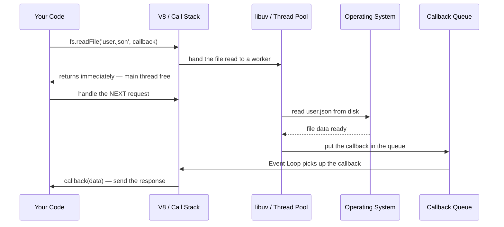

# Diagram: Asynchronous File Operation

> **Module:** [01 — Node.js Fundamentals](../README.md)
> **Explained in full:** [02 — Node.js Architecture](../02-nodejs-architecture/notes.md) and [04 — Event Loop](../04-event-loop/notes.md)

## The Diagram



```text
  Blocking version (fs.readFileSync) — the main thread WAITS:

    Start → read file (nothing else can run) → File read → End

  Non-blocking version (fs.readFile) — the main thread MOVES ON:

    Start → ask libuv to read the file → End (runs FIRST)
              ... file is read in the background ...
              → callback: File read (runs LATER, when ready)
```

## How to Read It

- **The main thread never waits for the file.** It starts the read, moves on to the next request, and comes back only when the file is ready. That is non-blocking I/O.
- **The work happens elsewhere:** a Thread Pool worker asks the OS to read the file from disk. The OS does the real reading.
- **The callback is how you get the result back:** when the work finishes, the callback goes into the Callback Queue, the Event Loop picks it up, and your code runs with the file data.
- **Blocking vs non-blocking is about waiting, not speed.** The file itself is not read faster — the server just does not sit idle while it waits.

**One-line summary:** start the slow work, do other work, get notified when it finishes — that is the whole secret of Node.js.

[← Module README](../README.md) · [02 — Node.js Architecture](../02-nodejs-architecture/notes.md)
