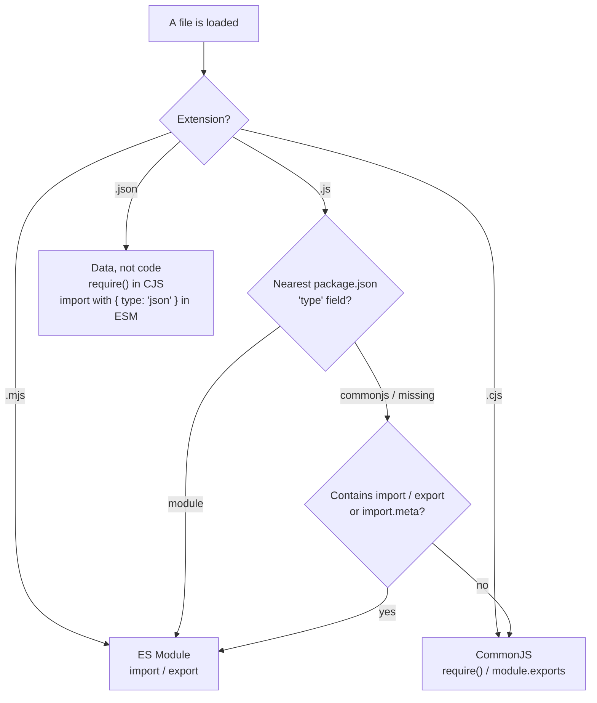

# Diagram: CommonJS vs ES Modules — How Node.js Decides

> **Module:** [01 — Node.js Fundamentals](../README.md)
> **Explained in full:** [07 — CommonJS and ES Modules](../07-commonjs-es-modules/notes.md)

## The Diagram



```text
  The same code, two readings:

  server.js  +  { "type": "commonjs" }  ──▶  CommonJS: require() works, import fails
  server.js  +  { "type": "module" }    ──▶  ES Module:  import works, require() fails
  server.mjs +  anything                 ──▶  ES Module, always
  server.cjs +  anything                 ──▶  CommonJS, always

  The file did not change. The label on the file changed.
```

## How to Read It

- **The extension decides first.** `.mjs` is always an ES Module and `.cjs` is always CommonJS, whatever `package.json` says. That is why the examples in topic 07 use `.cjs` and `.mjs` — they cannot be misread.
- **For `.js` files, `"type"` decides.** `"type": "module"` makes `.js` files ESM; `"commonjs"` — or no `"type"` at all — makes them CommonJS. Flipping `"type"` changes how files are read; it converts no code.
- **Syntax detection is the last resort.** Since Node.js 22.7, a `.js` file containing `import`, `export`, or `import.meta` is treated as ESM even without `"type": "module"`. It is a safety net for files that would otherwise be unreadable — not a rule to build on.
- **The errors are the diagnosis.** `require is not defined` means the file is ESM. `Cannot use import statement outside a module` means the file is CommonJS. Both errors say the same thing: the file is in the wrong system for the code it contains.

**One-line summary:** Node.js does not ask a file which system it is — it reads the label (extension, then `"type"`), and the code inside has to match the label.

[← Module README](../README.md) · [07 — CommonJS and ES Modules](../07-commonjs-es-modules/notes.md)
