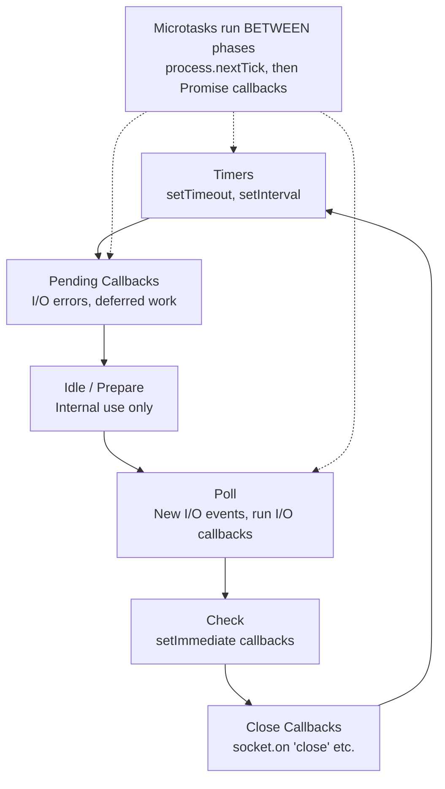

# Diagram: Event Loop Workflow — The Six Phases

> **Module:** [01 — Node.js Fundamentals](../README.md)
> **Explained in full:** [04 — Event Loop](../04-event-loop/notes.md)

## The Diagram



```text
One turn of the loop (in order):

  1. timers          — setTimeout / setInterval callbacks whose time is up
  2. pending         — I/O callbacks deferred from the last turn
     callbacks
  3. idle / prepare  — internal, Node.js housekeeping
  4. poll            — wait for new I/O; run I/O callbacks when they arrive
  5. check           — setImmediate callbacks
  6. close           — 'close' event callbacks (sockets, handles)
     callbacks
  → back to 1

Microtasks (process.nextTick, then Promise callbacks) run
BETWEEN phases — after each phase, before the next one.
process.nextTick runs before Promise microtasks.
```

## How to Read It

- **A timer is a threshold, not an appointment.** A `setTimeout(..., 100)` callback runs *after* 100 ms, once the loop gets back to the timers phase — later if the loop is busy.
- **`setTimeout(0)` vs `setImmediate`:** at the top level the order is not guaranteed. Inside an I/O callback, `setImmediate` always runs first, because the loop is in the poll phase and the check phase comes next, while timers wait for the next turn.
- **Microtasks cut in line:** after every phase, `process.nextTick` callbacks run first, then Promise callbacks, before the loop moves on. A `nextTick` callback that keeps scheduling itself can starve the loop — that is why you must never do it.
- **Blocking:** if your JavaScript runs a long loop, the Event Loop cannot move to the next phase. No timer, no I/O callback, nothing runs until your code finishes.

**One-line summary:** the loop is a circle of six phases, with microtasks running between them — and your code is the only thing that can stop it moving.

[← Module README](../README.md) · [04 — Event Loop](../04-event-loop/notes.md)
