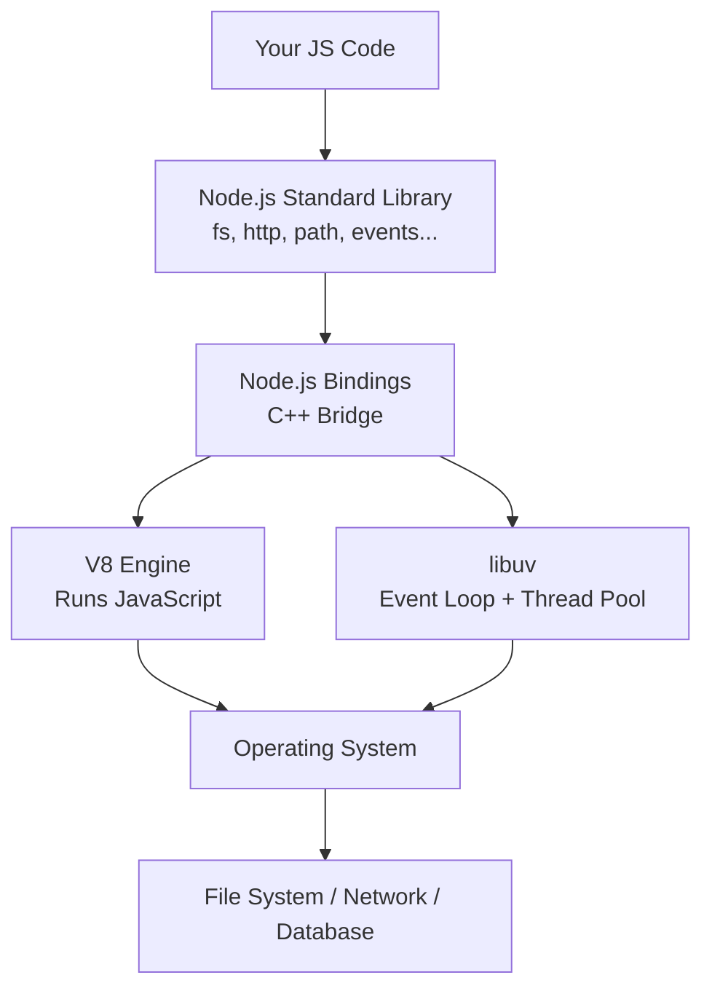

# Diagram: Node.js Runtime Architecture

> **Module:** [01 — Node.js Fundamentals](../README.md)
> **Explained in full:** [02 — Node.js Architecture](../02-nodejs-architecture/notes.md)

## The Diagram



```text
┌─────────────────────────────────────────────────────────┐
│  YOUR APPLICATION (JavaScript)                          │
└──────────────────────┬──────────────────────────────────┘
                       │  require('fs'), require('http')...
┌──────────────────────▼──────────────────────────────────┐
│  NODE.JS STANDARD LIBRARY (JavaScript)                  │
│  fs  •  http  •  path  •  events  •  crypto  •  os ...  │
└──────────────────────┬──────────────────────────────────┘
                       │  Node.js Bindings (C++)
┌──────────────────────▼──────────────────────────────────┐
│  NODE.JS BINDINGS  (C++ bridge)                         │
└──────┬───────────────────────────────┬──────────────────┘
       │                               │
┌──────▼──────────────┐      ┌──────────▼──────────────┐
│  V8 ENGINE (C++)    │      │  libuv (C)              │
│  Parses, compiles,  │      │  Event Loop, Thread     │
│  executes JS        │      │  Pool, async I/O        │
└──────┬──────────────┘      └──────────┬──────────────┘
       │                               │
┌──────▼───────────────────────────────▼──────────────────┐
│  OPERATING SYSTEM                                       │
│  Files, Network, Sockets — the real I/O happens here    │
└─────────────────────────────────────────────────────────┘
```

## How to Read It

Read it top to bottom. Your JavaScript never talks to V8 or libuv directly — it talks to the Standard Library (`fs`, `http`, `path`...), and the Bindings translate those calls into C/C++.

- **V8** is the part that runs JavaScript: it parses it, compiles it to machine code, and executes it.
- **libuv** is the part that handles waiting: the Event Loop, the Thread Pool, and async I/O.
- **The Operating System** does the real work at the bottom: reading a file, sending network data. Node.js asks the OS to do it and is notified when it is done.

**One-line summary:** you write JavaScript → Node.js translates it → V8 executes it → libuv handles the waiting → the OS does the real I/O work.

[← Module README](../README.md) · [02 — Node.js Architecture](../02-nodejs-architecture/notes.md)
