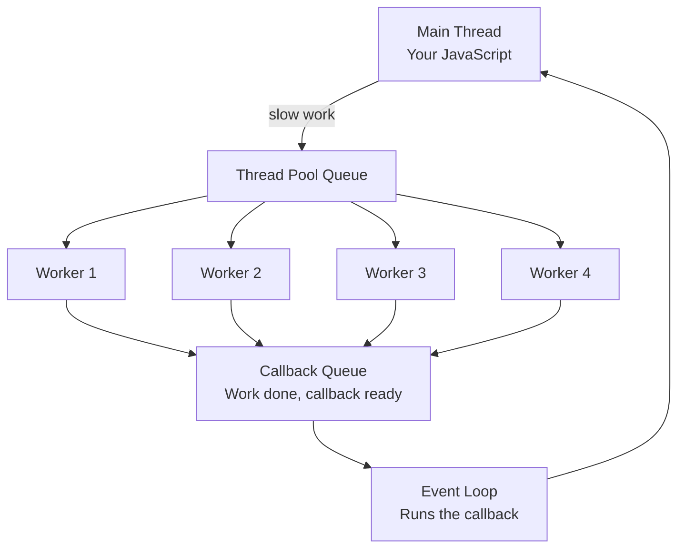

# Diagram: Thread Pool Workflow

> **Module:** [01 — Node.js Fundamentals](../README.md)
> **Explained in full:** [02 — Node.js Architecture](../02-nodejs-architecture/notes.md) and [04 — Event Loop](../04-event-loop/notes.md)

## The Diagram



```text
  MAIN THREAD (only ONE thread runs your JavaScript)
  ┌──────────────────────────────────────────────────┐
  │  Call Stack  →  your functions run here          │
  │  Event Loop  →  checks: is any async work done?  │
  └──────────────────────────────────────────────────┘
                          │ hands slow work to →
                          ▼
  THREAD POOL  (4 worker threads by default)
  ┌──────────┐ ┌──────────┐ ┌──────────┐ ┌──────────┐
  │ Worker 1 │ │ Worker 2 │ │ Worker 3 │ │ Worker 4 │
  └──────────┘ └──────────┘ └──────────┘ └──────────┘
                          │
                          ▼
  CALLBACK QUEUE → EVENT LOOP → your callback runs
```

## How to Read It

- **Default size is 4 threads.** Change it before Node.js starts with `UV_THREADPOOL_SIZE=8 node app.js` — but 4 is right for most apps.
- **What uses the Thread Pool:** file system work (`fs.readFile`), crypto (`crypto.pbkdf2` — password hashing), compression (`zlib`), and DNS lookups (`dns.lookup`).
- **What does NOT use it:** network I/O (`http`, `net`) — the OS handles that directly — and timers.
- **The queue matters:** if all 4 workers are busy, the 5th task waits in a queue. That is why 5 password hashes started at once finish with the 5th one last — it waited for a worker to free up. You can see this in `examples/architecture.js` in topic 02.
- **The Thread Pool is not the Event Loop.** The Event Loop coordinates work on the main thread; the Thread Pool executes certain heavy/async tasks on worker threads.

**One-line summary:** the main thread hands slow work to 4 workers, stays free, and runs your callback when a worker finishes.

[← Module README](../README.md) · [02 — Node.js Architecture](../02-nodejs-architecture/notes.md)
