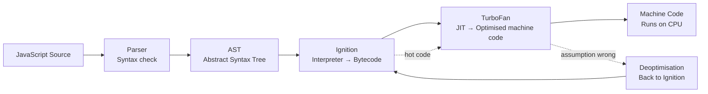

# Diagram: V8 and libuv — What Each One Does

> **Module:** [01 — Node.js Fundamentals](../README.md)
> **Explained in full:** [03 — V8 JavaScript Engine](../03-v8-javascript-engine/notes.md) and [02 — Node.js Architecture](../02-nodejs-architecture/notes.md)

## The Diagram



```text
  NODE.JS
  ┌──────────────────────────────────────────────────┐
  │  V8 — runs JavaScript                            │
  │  Parser → AST → Ignition → TurboFan → machine    │
  │  code. Plus Garbage Collection (Young / Old).    │
  ├──────────────────────────────────────────────────┤
  │  libuv — handles waiting                         │
  │  Event Loop, Thread Pool (4 workers), async I/O, │
  │  timers, DNS, file system.                       │
  └──────────────────────────────────────────────────┘
         V8 and libuv are SEPARATE libraries.
         V8 does not know about files or networks.
         libuv does not run JavaScript.
```

## How to Read It

- **V8's pipeline, left to right:** the Parser checks the syntax and builds an AST (a tree-shaped map of your code). Ignition, the interpreter, turns the AST into bytecode and runs it. If a function runs many times ("hot code"), TurboFan compiles it to fast machine code. If TurboFan's assumption about the code turns out wrong, it **deoptimises** — throws the fast code away and goes back to Ignition.
- **V8 vs libuv, the key distinction:** V8 runs JavaScript. libuv handles waiting. V8 knows nothing about files, networks, or timers; libuv knows nothing about JavaScript. Node.js joins them with Bindings.
- **What V8 does NOT do:** it does not read files, talk to a database, handle HTTP, or run the Event Loop. Those are Node.js / libuv / OS jobs.

**One-line summary:** V8 runs the code, libuv handles the waiting — confusing the two is the most common Node.js misconception.

[← Module README](../README.md) · [03 — V8 JavaScript Engine](../03-v8-javascript-engine/notes.md)
