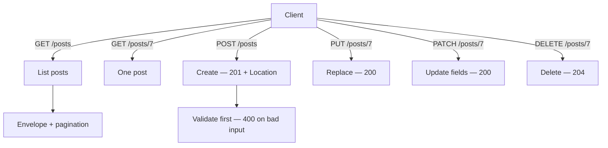

# REST API Design

> Back to the [Module 02 README](../README.md) · Related topic: [10 — REST APIs](../10-rest-apis/README.md)

How a clean REST API is shaped: resources as nouns, methods as verbs, status codes as the answer.

## Mermaid Diagram



## ASCII Version

```text
Resource: posts (noun, plural, no verbs in the URL)

  GET    /posts          → 200 + { data: [...], page, total }
  GET    /posts/7        → 200 + { data: {...} }   | 404 if missing
  POST   /posts          → 201 + Location: /posts/8 | 400 if invalid
  PUT    /posts/7        → 200 (replace whole resource)
  PATCH  /posts/7        → 200 (change some fields)
  DELETE /posts/7        → 204 (no content)

  Filtering:  /posts?author=talha&tag=node
  Sorting:    /posts?sort=-createdAt
  Pagination: /posts?page=2&limit=20

  Errors, always the same shape:
    { "error": { "code": "VALIDATION_ERROR", "message": "..." } }
```

## What to remember

- URLs name **resources** (nouns, plural). The HTTP method is the verb — never put verbs like `/getPosts` in a URL.
- Status codes carry meaning: 200 ok, 201 created, 204 deleted, 400 bad input, 401 not logged in, 403 not allowed, 404 not found, 500 server broke.
- One response shape everywhere — an envelope like `{ data, ... }` for success and `{ error }` for failure — makes the API predictable for web and mobile clients alike.
- Pagination, filtering, and sorting are query parameters, not new routes.

[← Module 02 README](../README.md)
