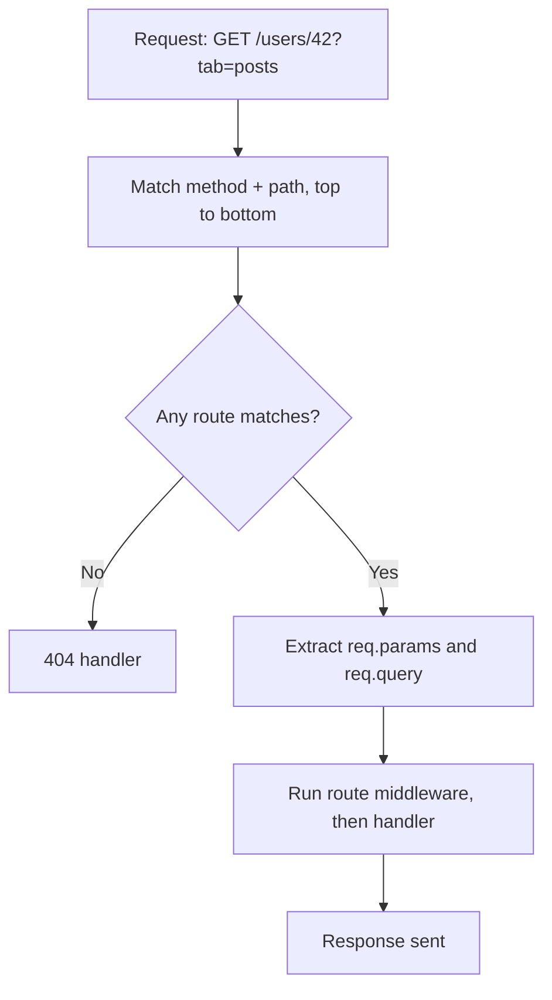

# Routing Flow

> Back to the [Module 02 README](../README.md) · Related topic: [04 — Routing](../04-routing/README.md)

How Express decides which route handles a request — first match wins, in registration order.

## Mermaid Diagram



## ASCII Version

```text
GET /users/42?tab=posts

Routes, in the order you wrote them:
  1. app.get('/users', ...)          method+path? No  → skip
  2. app.get('/users/:id', ...)      match! → req.params.id = '42'
                                        req.query.tab = 'posts'
                                     → run handler → response

If nothing matches → 404 handler (your code, not Express magic)

Rules:
  • First match wins — a broad route above a specific one shadows it.
  • :id captures one path segment. Query strings never affect matching.
  • Routers are just mini-apps: app.use('/users', usersRouter)
    strips '/users' and matches the rest inside the router.
```

## What to remember

- Routing is pattern matching on method + path, checked in the order routes were registered.
- `req.params` comes from the path (`:id`), `req.query` comes from the `?` part. They are different things.
- Put specific routes above general ones, and register the 404 handler last — after every route.
- `express.Router()` lets you split routes by resource into separate files, then mount them with `app.use('/users', usersRouter)`.

[← Module 02 README](../README.md)
