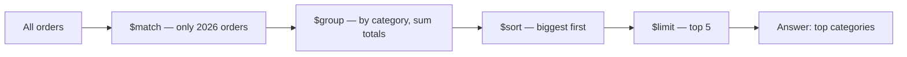

# Aggregation Pipeline

> Back to the [Module 03 README](../README.md) · Related topic: [11 — Aggregation](../11-aggregation/README.md)

Documents flow through stages, each stage transforming them, until the answer comes out the other end.

## Mermaid Diagram



## ASCII Version

```text
Input documents (orders collection)
  │
  ▼
┌──────────────┐
│ $match       │  keep only what matters: { year: 2026 }
└──────┬───────┘
       ▼
┌──────────────┐
│ $group       │  group by category, sum the totals
│              │  { _id: "$category", revenue: { $sum: "$total" } }
└──────┬───────┘
       ▼
┌──────────────┐
│ $sort        │  biggest revenue first: { revenue: -1 }
└──────┬───────┘
       ▼
┌──────────────┐
│ $limit       │  top 5 only
└──────┬───────┘
       ▼
Answer: [ { _id: "Books", revenue: 12000 }, ... ]
```

## What to remember

- A pipeline is a **chain of stages**. Each stage takes documents in and passes documents out. Order matters — filter early with `$match` so later stages do less work.
- `$group` is the stage that turns many documents into few (totals, averages, counts). `$lookup` is the join — it pulls in documents from another collection.
- If you can do it with `find()`, do it with `find()`. Reach for aggregation when the question is a **report**: totals, averages, rankings, grouped results.
- `$match` first, `$group` second, `$sort` + `$limit` last is the shape of most real pipelines.

[← Module 03 README](../README.md)
