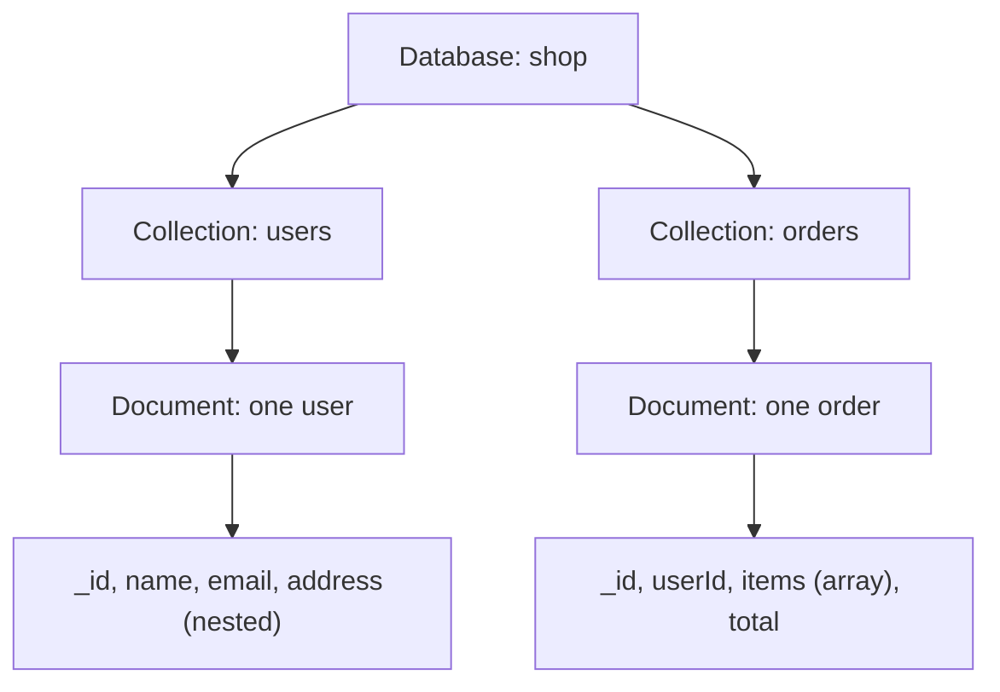

# Document Model

> Back to the [Module 03 README](../README.md) · Related topics: [01 — Introduction to MongoDB](../01-introduction/README.md), [05 — Databases, Collections and Documents](../05-databases-collections-documents/README.md)

How MongoDB organises data: database → collection → document, and what lives inside a document.

## Mermaid Diagram



## ASCII Version

```text
Database: shop
│
├── Collection: users
│   └── Document (one user):
│       {
│         _id: ObjectId("..."),
│         name: "Talha",
│         email: "talha@example.com",
│         address: { city: "Karachi", area: "Gulshan" }   ← nested object
│       }
│
└── Collection: orders
    └── Document (one order):
        {
          _id: ObjectId("..."),
          userId: ObjectId("..."),        ← reference to a user
          items: [ { name: "Book", price: 500 } ],   ← array, embedded
          total: 500
        }
```

## BSON types inside a document

| Type | Example | Notes |
|------|---------|-------|
| ObjectId | `ObjectId("...")` | Default `_id`, 12 bytes, unique |
| String | `"Talha"` | UTF-8 text |
| Int32 / Int64 / Double | `21`, `500.5` | Numbers — pick the right one |
| Boolean | `true` | |
| Date | `ISODate("2026-11-25")` | Real dates, not strings |
| Array | `[1, 2, 3]` | Ordered lists |
| Embedded document | `{ city: "Karachi" }` | Nesting — the heart of the model |
| Null | `null` | Field exists, value is nothing |

## What to remember

- A **collection** is roughly a table, a **document** is roughly a row — but a document can nest objects and arrays, so one document can hold what would be several joined rows in SQL.
- Every document has an `_id`. MongoDB creates an ObjectId for you if you don't supply one.
- Documents in one collection do **not** have to look the same — flexible schema. That freedom needs discipline (topic 08), or your data becomes a mess.

[← Module 03 README](../README.md)
