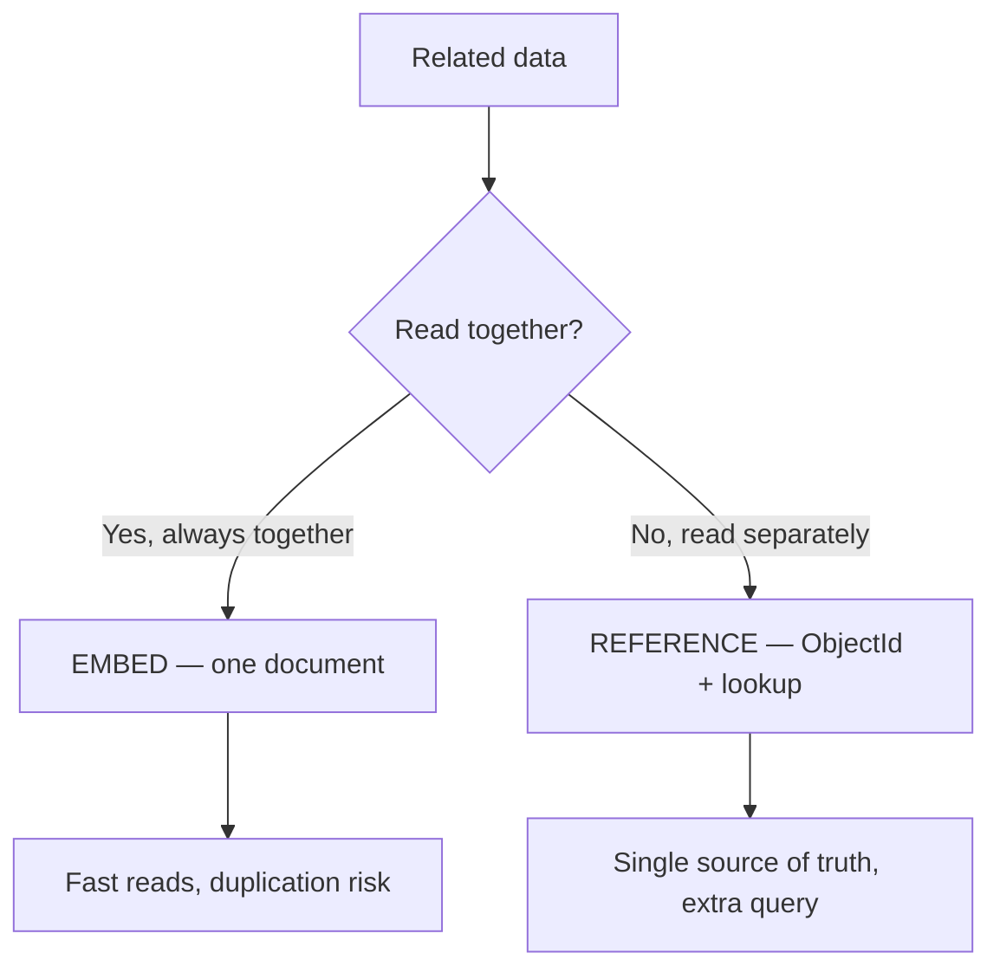

# Embed vs Reference

> Back to the [Module 03 README](../README.md) · Related topics: [08 — Schema Design](../08-schema-design/README.md), [09 — Relationships](../09-relationships/README.md)

The one decision that shapes every MongoDB schema: put the related data inside the document, or store an ObjectId and look it up?

## Mermaid Diagram



## ASCII Version

```text
EMBED — user with their addresses inside the document

  { _id, name: "Talha",
    addresses: [ { city: "Karachi" }, { city: "Lahore" } ] }

  One read gets everything. But if the address changes in
  two places, you update it in two places.

REFERENCE — order points at a user by ObjectId

  orders: { _id, userId: ObjectId("..."), total: 500 }
  users:  { _id: ObjectId("..."), name: "Talha" }

  One source of truth. But reading an order + its user
  needs a $lookup (join) or a second query.
```

## The rules of thumb

1. **Embed** when the child is always read with the parent, and only belongs to that parent (addresses, comments on a post).
2. **Reference** when the child is large, unbounded (a user's thousands of orders), or shared between parents.
3. **Embed** when the data rarely changes; **reference** when it changes often and must stay consistent everywhere.
4. Watch the **16 MB document limit** — an ever-growing embedded array will hit it one day.
5. When in doubt, start with what your most common query needs — schema follows queries, not the other way round.

[← Module 03 README](../README.md)
