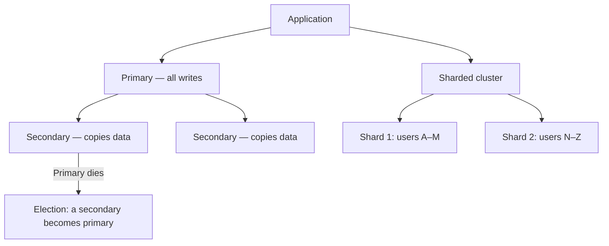

# Replica Set and Sharding

> Back to the [Module 03 README](../README.md) · Related topic: [03 — MongoDB Architecture](../03-mongodb-architecture/README.md)

How MongoDB stays available when a server dies, and how it scales beyond one machine.

## Mermaid Diagram



## ASCII Version

```text
REPLICA SET — availability (copies of the same data)

   App ── writes ──> PRIMARY ── replicates ──> SECONDARY
                        │                          │
                        └────── replicates ──> SECONDARY

   Primary dies → the secondaries elect a new primary.
   Writes pause briefly, reads continue. Minimum 3 members
   is the standard: 1 primary + 2 secondaries.

SHARDING — scaling (different data on different machines)

   App ──> mongos (router) ──> Shard 1: users A–M
                              └─> Shard 2: users N–Z

   A shard key (e.g. userId) decides which shard holds a document.
   More shards = more capacity. Sharding is for scale;
   a replica set is for availability. You usually have both:
   each shard is itself a replica set.
```

## What to remember

- **Replica set = same data, several machines.** It protects you from a server dying. Writes go to the primary only.
- **Sharding = different data, several machines.** It protects you from outgrowing one machine. The shard key decides the split — a bad shard key (e.g. a field with one value) defeats the whole point.
- A single `mongod` on your laptop is neither — it is fine for learning, never for production.

[← Module 03 README](../README.md)
