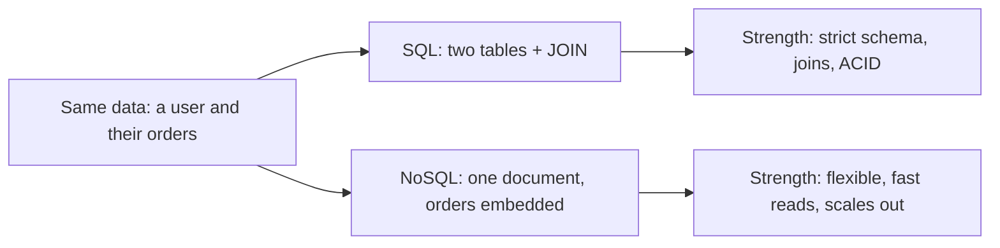

# SQL vs NoSQL

> Back to the [Module 03 README](../README.md) · Related topic: [02 — SQL vs NoSQL](../02-sql-vs-nosql/README.md)

The same data, two shapes — and how to choose honestly between them.

## Mermaid Diagram



## ASCII Version

```text
SQL (PostgreSQL)                      NoSQL (MongoDB)

users table                           users collection
┌────┬───────┬─────────┐              ┌─────────────────────────────────┐
│ id │ name  │ email   │              │ { _id, name, email,            │
├────┼───────┼─────────┤              │   orders: [                   │
│ 1  │ Talha │ t@x.com │              │     { item: "Book", price: 500 }│
└────┴───────┴─────────┘              │   ] }                           │
                                      └─────────────────────────────────┘
orders table
┌────┬─────────┬───────┐
│ id │ user_id │ price │              One read gets everything.
├────┼─────────┼───────┤              No JOIN — but the orders are
│ 1  │ 1       │ 500   │              copied if the same order belongs
└────┴─────────┴───────┘              to two places (duplication).

To read a user + orders in SQL: JOIN.
To read a user + orders in MongoDB: one find().
```

## How to choose

| Pick SQL when… | Pick MongoDB when… |
|---|---|
| The data is highly relational and joins are the norm | Reads usually need one whole object at once |
| Strict schema and strong consistency matter most | The schema changes often, or varies per record |
| Money, bookings, ledgers — correctness first | Content, catalogues, profiles, activity feeds |
| Complex reporting with aggregations across tables | You need to scale out by sharding |

## What to remember

- Neither is "better". The honest answer is always "it depends on the shape of the data and the queries".
- MongoDB trades strictness for flexibility — you gain speed of development and scaling, and you pay for it with discipline in schema design.
- Many real systems use **both** (polyglot persistence): SQL for money, MongoDB for content.

[← Module 03 README](../README.md)
